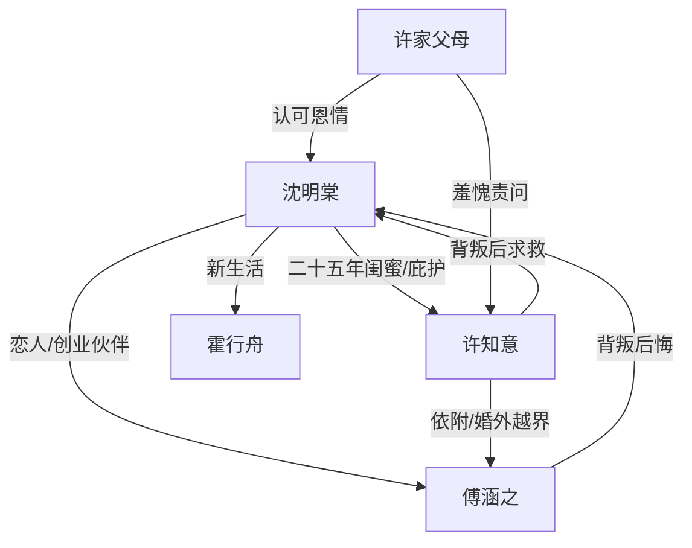

# 角色标签图谱

## 角色清单

### 沈明棠 — 清醒复仇型大女主
- 叙事功能: 第一人称承伤者、设局者、最终价值承载者。
- 核心标签: 白手起家、重情重义、边界清醒。
- 弧光: 把闺蜜和爱人视作人生支点 → 被双重背叛 → 撤回资源与爱 → 重建自我。
- 台词风格: 冷静、短句、道德判断明确。
- 关键行为: 收留许知意、质问二人、联系许家、婚礼曝光证据、拒绝复合、开启新生活。
- 读者情绪关系: 心疼、代入、爽、敬佩。

### 许知意 — 菟丝花式背叛闺蜜
- 叙事功能: 友情线施害者，制造“恩将仇报”恨点。
- 核心标签: 被娇养、依附型、自我合理化。
- 弧光: 女主少女时代英雄 → 落难被庇护 → 抢走女主男友 → 失去庇护后崩塌。
- 台词风格: 哭诉、哀求、道德绑架。
- 关键行为: 接受女主资源，和傅涵之越界，婚礼索要祝福，后期求救。
- 读者情绪关系: 前史让人痛惜，背叛让人厌恶，结局有微弱悲悯但不值得原谅。

### 傅涵之 — 自恋救世主型背叛男友
- 叙事功能: 爱情线施害者，权力压迫者，后悔回旋承载者。
- 核心标签: 冷漠强势、虚荣救世主、双标。
- 弧光: 女主创业伴侣和爱人 → 护着许知意伤害女主 → 职场威胁 → 名誉事业下滑 → 悔悟失去。
- 台词风格: 平静压迫、上位者口吻、后期低姿态忏悔。
- 关键行为: 给许知意剥蟹、赶女主出家、用项目威胁、婚礼被公开、求复合。
- 读者情绪关系: 恨、厌恶、期待他后悔。

### 霍行舟 — 稳定新关系/温柔对照组
- 叙事功能: 后半治愈对照，证明女主仍有选择爱的能力。
- 核心标签: 情绪稳定、尊重边界、温和成熟。
- 弧光: 陌生相亲对象 → 稳定陪伴者 → 新生活象征。
- 台词风格: 温和、不过界。
- 关键行为: 约会、送热汤、陪爬山、庆功宴支持女主、披大衣。
- 读者情绪关系: 安心、补偿、舒缓。

### 许阿姨/许家父母 — 道德见证者
- 叙事功能: 证明女主的恩情被社会认可，形成许知意的羞耻压力。
- 核心标签: 知恩、愧疚、传统道德。
- 弧光: 曾照顾女主 → 对女儿背叛感到羞愧。
- 台词风格: 道歉、震惊。
- 关键行为: 电话责骂许知意，婚礼现场质问。
- 读者情绪关系: 提供道德公证。

## 关系网络

## 角色功能对照表（供改编参考）

| 原角色 | 极致标签 | 叙事功能 | 读者情绪功能 | 改编时必须保留的 |
|--------|---------|---------|-------------|---------------|
| 沈明棠 | 清醒复仇大女主 | 承伤、设局、重建 | 心疼到爽 | 重情前史、冷静边界、拒绝回头 |
| 许知意 | 菟丝花背叛闺蜜 | 友情背刺 | 恨与痛惜 | 曾经救过女主，背叛才够痛 |
| 傅涵之 | 自恋救世主男友 | 爱情背刺/压迫 | 恨与等悔 | “她离不开我”的双标逻辑 |
| 霍行舟 | 稳定新关系 | 补偿与对照 | 安心 | 不能抢走女主主体性 |
| 许家父母 | 道德见证者 | 社会公证 | 佐证女主正当性 | 必须承认女主恩情 |
