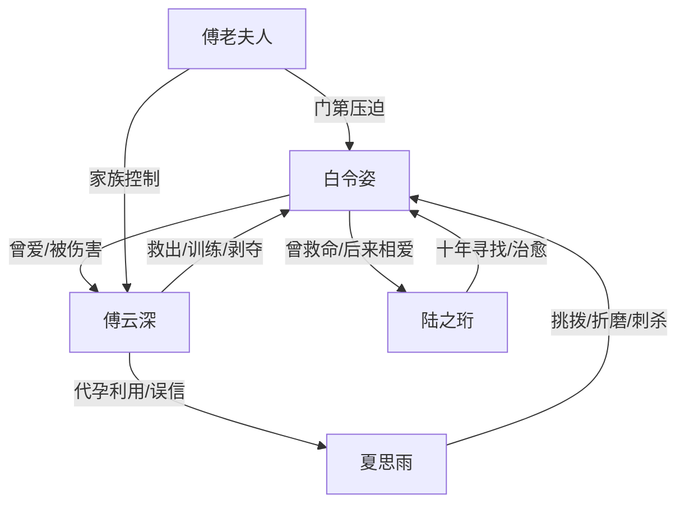

# 角色标签图谱

## 角色清单

### 白令姿 — 黑玫瑰/被工具化的大女主
- 叙事功能: 承载虐点、出走、重生和主题升华。
- 核心标签: 傅家刀、创伤孤女、救赎者
- 弧光: 被救出的孤女 → 傅氏工具 → 被剥夺的妻子 → 剑桥学生 → 女子学校创办者
- 台词风格: 前半克制少言，后半平静划界。
- 关键行为: 答应离婚、手雷自救、赴剑桥、接受陆之珩、创办学校。
- 读者情绪关系: 心疼、替她愤怒、为她重生获得补偿。

### 傅云深 — 伪保护型伤害者/追妻火葬场男主
- 叙事功能: 制造最大情绪债，并在后半承担悔恨偿还。
- 核心标签: 控制欲、懦弱、迟来深情
- 弧光: 救命恩人 → 丈夫 → 剥夺者 → 悔恨者 → 以命偿还者
- 台词风格: 前半冷静合理化，后半破碎忏悔。
- 关键行为: 设计流产摘子宫、污蔑白令姿、换人、追到剑桥、挡刀。
- 读者情绪关系: 前半恨，后半复杂悲悯，但不能盖过女主新生。

### 夏思雨 — 白莲伪高知/寄生型反派
- 叙事功能: 外部第三者与反衬工具，放大傅云深的选择错误。
- 核心标签: 伪耶鲁、代孕骗局、恶毒挑拨
- 弧光: 清白高材生假面 → 傅家新宠 → 真相败露 → 刺杀疯癫
- 台词风格: 装柔弱、暗讽、哭诉。
- 关键行为: 生下非傅家孩子、折磨白令姿、自导绑架、刺杀。
- 读者情绪关系: 厌恶，期待被揭穿和反噬。

### 陆之珩 — 治愈小狗/记恩十年的真爱
- 叙事功能: 证明白令姿值得被爱，也证明她的善良真实存在。
- 核心标签: 年下、稳定陪伴、阳光救赎
- 弧光: 被救孩子 → 追随者 → 男朋友 → 丈夫与共同建设者
- 台词风格: 轻松直白，关键时刻认真。
- 关键行为: 持续陪伴、揭开十年前救命因果、支持女子学校。
- 读者情绪关系: 安慰、补偿、甜感。

### 傅老夫人 — 豪门血统规训者
- 叙事功能: 提供家族压力与离婚通道的双重推动。
- 核心标签: 门第偏见、冷酷、控制
- 弧光: 排斥白令姿 → 帮她离婚 → 仍维护家族利益
- 台词风格: 冷淡、命令式。
- 关键行为: 羞辱白令姿、逼傅云深受家法、告知剑桥去向。
- 读者情绪关系: 厌恶但承认其工具作用。

## 关系网络

## 角色功能对照表（供改编参考）

| 原角色 | 极致标签 | 叙事功能 | 读者情绪功能 | 改编时必须保留的 |
|--------|---------|---------|-------------|---------------|
| 白令姿 | 黑玫瑰大女主 | 被剥夺后重建主体 | 心疼、爽、敬佩 | “工具→人”的弧光 |
| 傅云深 | 伪保护伤害者 | 制造虐点与悔恨火葬场 | 恨、复杂、唏嘘 | 以爱为名的剥夺 |
| 夏思雨 | 伪高知小三 | 引爆误判与清算 | 厌恶、等报应 | 假清白与真肮脏反差 |
| 陆之珩 | 治愈年下 | 情绪补偿与新生活证明 | 甜、安心 | 不是凭空爱她，必须有旧因果 |
| 傅老夫人 | 豪门规训者 | 门第压力与离婚推手 | 压迫、工具性爽点 | 血统/门第偏见 |
