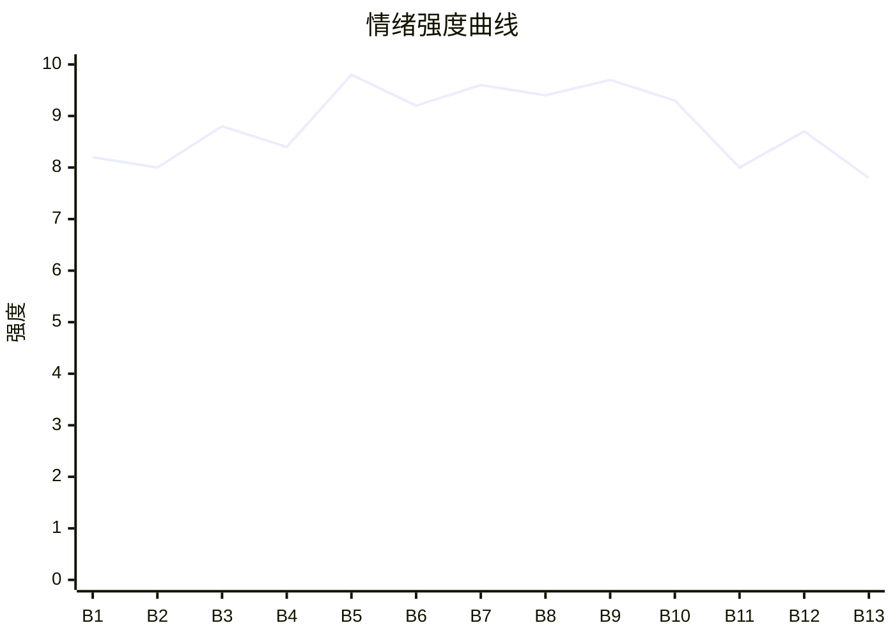

# Beat Sheet 节拍器

## 全文概况

- 总字数: 约 15000 字
- 节拍数: 13 幕
- 核心母题（Logline）: 隐身份公主为了田园爱情放弃尊荣，却被负心世子为门第与嫡子亲手伤害；她召回皇权身份公开清算，最终不复仇致死，而让旧人活在永失所爱的悔恨里。
- 情绪模式: 甜蜜错信 → 极致打压 → 失子触底 → 身份爆发 → 因果回旋 → 自我修复

## 节拍详表

### Beat 1: 有孕当日，被宣判为外室 [开篇-首次分隔符]
- **字数**: 约 520 字（占比 3.5%）
- **核心事件**: 昭宁得知有孕，却听陆北辰宣布三日后迎娶太师府嫡女，只愿给她宅院和外室待遇。
- **情绪标签**: 震惊、羞辱、心碎
- **情绪强度**: 8.2/10
- **情绪方向**: ⚡突变
- **冲突类型**: 大转折
- **悬念钩子**: “若我也可以与你门第相当呢？”暗示女主隐藏身份。
- **叙事速度**: 快
- **对话占比**: 70%
- **reversal_mechanism**: [M2, M5]
- **hook_strength**: 8.8/10（极端度 2.4/3，信息密度 2.8/3，悬念 1.8/2，节奏 1.8/2）
- **关键句**: “若我说，我也可以与你门第相当呢？”
- **原文摘录**: “我隐瞒身份和陆北辰做起了平凡夫妻。得知有孕那天，他突然开口：‘我和太师府嫡女三日后便要成婚了。’……‘所以我是一辈子见不得光的外室是吗？’……‘若我说，我也可以与你门第相当呢？’”

### Beat 2: 他用门第否定她三年夫妻 [分隔符-烧院前]
- **字数**: 约 1150 字（占比 7.7%）
- **核心事件**: 昭宁求他别娶，陆北辰以门第、负责、主母体面反复压制她，把她定位为“无名分的妻子”。
- **情绪标签**: 憋屈、哀求、失望
- **情绪强度**: 8.0/10
- **情绪方向**: ↓下降
- **冲突类型**: 微冲突累积
- **悬念钩子**: 陆北辰称要抹去他们存在的过往。
- **叙事速度**: 中
- **对话占比**: 65%
- **reversal_mechanism**: [M2, M5]
- **hook_strength**: null
- **关键句**: “你我在这山脚下做了三年夫妻，你是什么身份我最清楚不过了。”
- **原文摘录**: “可他可以隐瞒身份，他又怎知我不能。……‘我不要困在后宅当你的外室，我也不要让我和孩子一辈子见不得光。’……‘只要你不闹到主母前面去，在那里你依旧是我的妻子好吗？’”

### Beat 3: 小院被烧，田园梦被毁 [烧院-囚入别院]
- **字数**: 约 900 字（占比 6.0%）
- **核心事件**: 陆北辰命侍卫烧掉两人亲手建的小院，昭宁身份暗揭为公主，三年田园梦彻底破灭。
- **情绪标签**: 崩溃、失去、寒心
- **情绪强度**: 8.8/10
- **情绪方向**: ↓下降
- **冲突类型**: 大转折
- **悬念钩子**: “我堂堂公主，如何能做你平妻。”
- **叙事速度**: 快
- **对话占比**: 35%
- **reversal_mechanism**: [M2, M5]
- **hook_strength**: null
- **关键句**: “可陆北辰，我堂堂公主，如何能做你平妻。”
- **原文摘录**: “他大手一挥，身后的侍卫纷纷拿着火把，点燃了小院。……‘乖，等时机成熟，我让你做平妻。’……小院没了，我们就再也回不去了。”

### Beat 4: 凤冠旧诺成新人聘礼 [囚禁-生辰真相]
- **字数**: 约 1100 字（占比 7.3%）
- **核心事件**: 昭宁被囚别院，听闻陆北辰用军功换来她钟爱的公主凤冠给林楚楚；又得知生辰夜他与林楚楚苟合。
- **情绪标签**: 嫉痛、恶心、旧爱碎裂
- **情绪强度**: 8.4/10
- **情绪方向**: ↓下降
- **冲突类型**: 微冲突
- **悬念钩子**: 昭宁仍想给他最后一次机会，读者等待他的选择。
- **叙事速度**: 中
- **对话占比**: 30%
- **reversal_mechanism**: [M5]
- **hook_strength**: null
- **关键句**: “没想到如今凤冠被陆北辰用军工换给了林楚楚。”
- **原文摘录**: “她们口中的凤冠，是我在皇宫时最喜欢的……那时他说：‘我的阿宁值得世间最好的，就是公主的凤冠也配得。’……‘你生辰那日。’”

### Beat 5: 糕点下药，亲手杀子 [生辰真相-小产]
- **字数**: 约 1500 字（占比 10.0%）
- **核心事件**: 陆北辰承认林楚楚可能有孕，为保嫡长子地位，在昭宁最爱吃的糕点里下药，拒绝请太医。
- **情绪标签**: 绝望、愤怒、母性痛
- **情绪强度**: 9.8/10
- **情绪方向**: ↓触底
- **冲突类型**: 大转折
- **悬念钩子**: 昭宁说出“我是公主”，他却不信并离开。
- **叙事速度**: 快
- **对话占比**: 55%
- **reversal_mechanism**: [M2, M5]
- **hook_strength**: null
- **关键句**: “那个我曾日夜期盼的孩子，在他父亲刚知晓的第一天，就亲手杀了他。”
- **原文摘录**: “‘她的孩子必须要成为嫡长子，你才安全。’……‘太医是不可能给你这种身份的人看诊的。’……‘我是公主，昭宁公主。’……‘流产死不了人，你好自为之吧。’”

### Beat 6: 林楚楚灌红花，七彩天灯求救 [林楚楚闯入-天灯升起]
- **字数**: 约 1350 字（占比 9.0%）
- **核心事件**: 林楚楚上门羞辱，强灌红花断绝昭宁子嗣，昭宁诱她放七彩天灯，向父皇暗号求救。
- **情绪标签**: 屈辱、冷醒、期待
- **情绪强度**: 9.2/10
- **情绪方向**: ⚡突变
- **冲突类型**: 大转折
- **悬念钩子**: 七彩天灯升起，读者知道援兵将至。
- **叙事速度**: 快
- **对话占比**: 50%
- **reversal_mechanism**: [M2, M6]
- **hook_strength**: null
- **关键句**: “不论何时，只要升起彩色天灯，一定是我有了危险，届时会有人带我离开。”
- **原文摘录**: “‘药是陆北辰下的，孩子是他不要的。’……‘免的日后再有子嗣。’……‘林姑娘可曾听过昭宁公主？’……昏迷中，我恍恍惚惚看见了窗外那七色的天灯。”

### Beat 7: 小产后被逼叩九千九百九十九阶 [天灯后-暗探找到]
- **字数**: 约 1500 字（占比 10.0%）
- **核心事件**: 陆北辰知道林楚楚灌红花仍替她开脱，又逼刚小产的昭宁一步一叩求平安符。
- **情绪标签**: 极虐、麻木、断情
- **情绪强度**: 9.6/10
- **情绪方向**: ↓下降
- **冲突类型**: 大转折
- **悬念钩子**: 暗探找到昭宁，大婚清算即将开始。
- **叙事速度**: 中
- **对话占比**: 45%
- **reversal_mechanism**: [M5, M6]
- **hook_strength**: null
- **关键句**: “希望明日，你们不要后悔。”
- **原文摘录**: “‘她也是为了自保……也是人之长情。’……‘一步一叩爬完九千九百九十九阶天梯求个平安符给楚楚。’……我看向他离去的方向和这所不属于的小院，不自觉的笑了笑。”

### Beat 8: 公主驾到，身份第一层爆发 [大婚-身份坐实]
- **字数**: 约 1450 字（占比 9.7%）
- **核心事件**: 昭宁身着公主冠服现身侯府，林楚楚污蔑她假扮，青黛以冠服、东珠、御赐规格坐实身份。
- **情绪标签**: 爽感、震惊、反压制
- **情绪强度**: 9.4/10
- **情绪方向**: ↑上升
- **冲突类型**: 大转折
- **悬念钩子**: 陆北辰意识到她小产时说的都是真的。
- **叙事速度**: 快
- **对话占比**: 60%
- **reversal_mechanism**: [M2, M6]
- **hook_strength**: null
- **关键句**: “本公主来恭贺陆世子新婚。”
- **原文摘录**: “‘公主殿下驾到！’……我身着公主冠服在宫女的簇拥下进了侯府。……‘睁开你们的狗眼看看，绣着金凤纹的冠服有几个人敢穿。’”

### Beat 9: 满堂公开清算，爱之名被拆穿 [身份坐实-陆北辰跪地]
- **字数**: 约 1450 字（占比 9.7%）
- **核心事件**: 昭宁当众列举陆北辰烧院、下药、拒医、纵容红花、逼叩阶，彻底拆穿“爱你”的谎言。
- **情绪标签**: 痛快、审判、压迫释放
- **情绪强度**: 9.7/10
- **情绪方向**: ↑上升
- **冲突类型**: 大转折
- **悬念钩子**: 林楚楚突然供出胎儿不是陆北辰的。
- **叙事速度**: 快
- **对话占比**: 75%
- **reversal_mechanism**: [M2, M5, M6]
- **hook_strength**: null
- **关键句**: “你杀死我的孩子，连大夫也不肯请，只留下一句，流产死不了人，你就是这么爱我的？”
- **原文摘录**: “‘也许你就不会娶林楚楚了是吗？’……‘你亲手在我的糕点里下药？’……‘我爬了整整一夜，你可问过我一句你还好吗？’……满堂宾客倒吸一口凉气。”

### Beat 10: 林楚楚胎儿真相，侯府求饶 [林楚楚求饶-离府]
- **字数**: 约 1050 字（占比 7.0%）
- **核心事件**: 林楚楚为求命承认怀的是表哥的孩子，陆北辰发现自己牺牲一切换来的嫡子是笑话；昭宁拒绝旧情绑架。
- **情绪标签**: 反讽、快意、冷断
- **情绪强度**: 9.3/10
- **情绪方向**: ↑上升
- **冲突类型**: 大转折
- **悬念钩子**: 回宫后皇权将如何处置陆北辰。
- **叙事速度**: 快
- **对话占比**: 65%
- **reversal_mechanism**: [M3, M6]
- **hook_strength**: null
- **关键句**: “即便不是本公主，换成寻常女子，世子就可以囚禁，杀子了吗？”
- **原文摘录**: “‘要不是我怀了表哥的孩子……’……如果他从头到尾都坚信的选择我，他想要的一切，爱人，孩子，身份地位，全部都有了。……‘你烧毁小院，杀死我孩子的时候可曾见过旧情？’”

### Beat 11: 回宫，被亲情接住 [回宫-身体诊断]
- **字数**: 约 1400 字（占比 9.3%）
- **核心事件**: 昭宁回宫与父皇重逢，被亲情疗愈；太医确认小产伤了根本，孩子与身体代价不可逆。
- **情绪标签**: 心酸、补偿、余痛
- **情绪强度**: 8.0/10
- **情绪方向**: →平稳
- **冲突类型**: 微冲突
- **悬念钩子**: 昭宁选择让陆北辰活着受苦。
- **叙事速度**: 慢
- **对话占比**: 35%
- **reversal_mechanism**: [M5]
- **hook_strength**: null
- **关键句**: “许多时候，活着远比死去要痛苦的多。”
- **原文摘录**: “父皇眼眶发红：‘瘦了，怎么瘦了这么多。’……‘就让他活着吧，许多时候，活着远比死去要痛苦的多。’……太医说我小产伤了根本。”

### Beat 12: 悔恨回旋，陆北辰跪宫门 [诊断后-林楚楚求和离]
- **字数**: 约 1500 字（占比 10.0%）
- **核心事件**: 陆北辰跪宫门、递帖子、写信求见；林楚楚受同样叩阶与红花之苦，来求和离被昭宁拒绝。
- **情绪标签**: 冷爽、报应、释然
- **情绪强度**: 8.7/10
- **情绪方向**: ↑上升
- **冲突类型**: 微冲突/回旋清算
- **悬念钩子**: 陆北辰去边关，未来是否会再出现。
- **叙事速度**: 中
- **对话占比**: 45%
- **reversal_mechanism**: [M3, M5]
- **hook_strength**: null
- **关键句**: “本公主若无这个身份，现在怕是被你折磨的生不如死吧。”
- **原文摘录**: “‘就算是他跪死，我也不会见他的。’……‘他让我身怀六甲去长安寺为您祈福……喂了臣妇整整三碗红花。’……‘这姻缘是你自己选的，你就好好的过吧。’”

### Beat 13: 新小院与旧人门外 [出宫重建-结尾]
- **字数**: 约 1600 字（占比 10.7%）
- **核心事件**: 昭宁出宫重建山脚小院，陆北辰边关归来求留，被她视作陌生人；她继续浇菜养花，把日子过下去。
- **情绪标签**: 放下、淡漠、新生
- **情绪强度**: 7.8/10
- **情绪方向**: →平稳
- **冲突类型**: 终局收束
- **悬念钩子**: 无，情绪闭合。
- **叙事速度**: 慢
- **对话占比**: 40%
- **reversal_mechanism**: [M5, M3]
- **hook_strength**: null
- **关键句**: “没有了谁，太阳都会照常升起。”
- **原文摘录**: “我盖了一间小木屋，围了篱笆，院子里种满了瓜果蔬菜。……‘陆北辰，我从来不属于你。’……可我知道不管他在不在，我都要把我的菜浇完，把我的花养好，把我的日子过下去。没有了谁，太阳都会照常升起。”

## 情绪曲线可视化

## 节拍密度检测

- 平均每约 1150 字一个节拍
- 微冲突密度: 每约 800-1200 字一次
- 大转折密度: 每约 2200-2800 字一次
- 判定: 符合高频节拍器标准；前半每个虐点都带实物证据，后半每个清算点都能对应前债。

## 反转机制清单(Reversal Mechanisms)

从 prompts/patterns/reversal-mechanisms.md 的 8 大机制中命中以下机制:

| 机制 ID | 机制名 | 承载 Beat | 关键段落/金句 | 等价改编提示 |
|--------|--------|-----------|--------------|-------------|
| M2 | 身份反差爆发 | Beat 1, 3, 6, 8, 9 | “本公主来恭贺陆世子新婚。” | 身份载体可换，但前期弱身份、伏笔、揭身份短句砸脸节奏必须保留 |
| M3 | 因果回旋反讽 | Beat 10, 12, 13 | “你烧毁小院，杀死我孩子的时候可曾见过旧情？”、“这姻缘是你自己选的” | 施害者规则必须回到施害者身上；红花、叩阶、婚姻困局的镜像偿还不可删 |
| M5 | 温度反转曲线 | Beat 2-5, 9, 11-13 | “没有了谁，太阳都会照常升起。” | 温柔旧梦、转冷触发、不可逆失去、悔恨追随四段必须完整 |
| M6 | 多层递进反转 | Beat 6-10 | 天灯求救 → 公主驾到 → 当众清算 → 胎儿骗局 | 层数不能少；情节反转、身份反转、权力反转、价值反转要递进升维 |
