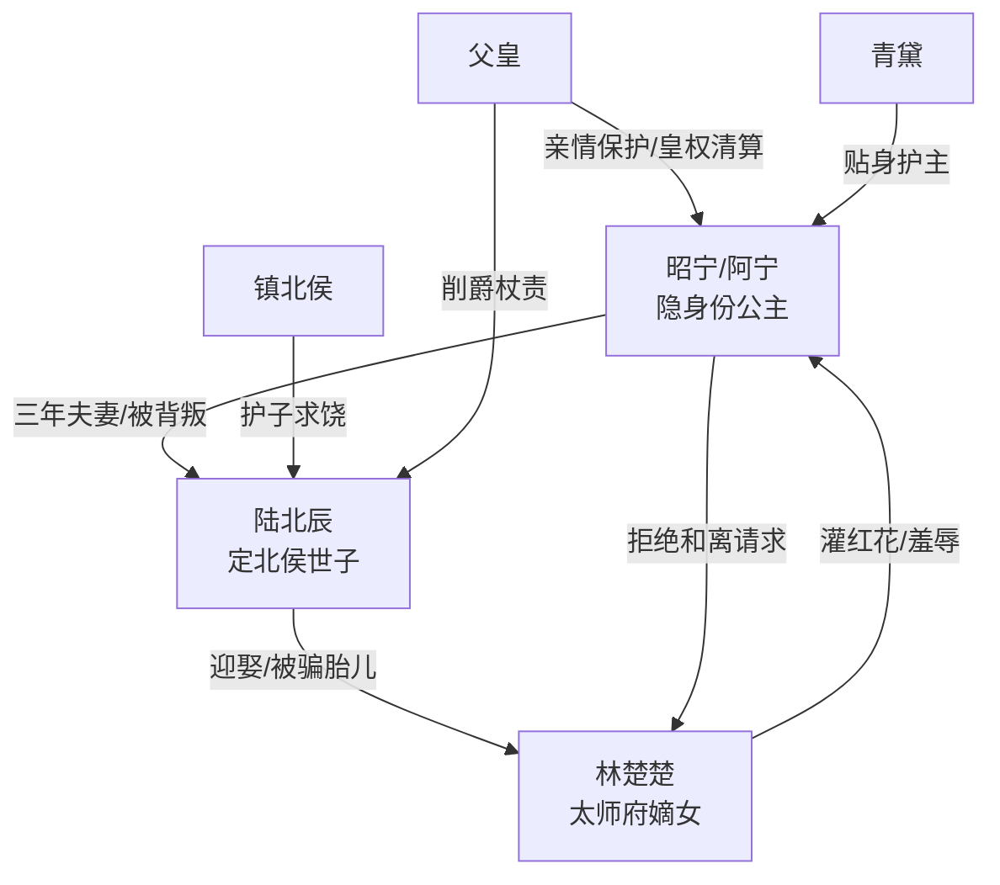

# 角色标签图谱

## 角色清单

### 昭宁/阿宁 — 隐身份公主、受伤后清醒大女主
- 叙事功能: 第一人称主角，承载虐点、身份反转和最终价值观。
- 核心标签: 隐忍、尊贵、清醒
- 弧光: 为爱放弃身份 → 被囚失子 → 召回公主身份 → 重建自我生活
- 台词风格: 前期哀求质问，后期冷静审判。
- 关键行为: 隐瞒身份做平凡夫妻；用七彩天灯求救；大婚公开清算；拒绝复合。
- 读者情绪关系: 前半心疼，后半爽，结尾获得疗愈。

### 陆北辰 — 伪深情负心世子
- 叙事功能: 核心施害者，制造门第压迫、失子债、悔恨反噬。
- 核心标签: 自私、懦弱、伪爱
- 弧光: 掌控女主命运 → 被身份反转击垮 → 失爵失爱 → 余生追悔
- 台词风格: 温柔包裹残忍，常用“为你好”“我爱你”合理化伤害。
- 关键行为: 另娶林楚楚；烧毁小院；糕点下药；拒请太医；逼叩长阶。
- 读者情绪关系: 恨、恶心、期待报应。

### 林楚楚 — 恶毒嫡女、规则共犯
- 叙事功能: 外部第三者与门第规则化身，推动小产和红花二次伤害。
- 核心标签: 嫡女、狠毒、利己
- 弧光: 借嫡女身份压人 → 公主面前求饶 → 被婚姻反噬
- 台词风格: 轻慢羞辱，暴露利益算计。
- 关键行为: 要求长子地位；灌红花；试凤冠；求和离。
- 读者情绪关系: 恨，后期报应带来冷爽。

### 父皇 — 迟到但稳定的亲情保护者
- 叙事功能: 提供权力清算与亲情补偿，证明“家一直在”。
- 核心标签: 护短、威严、心疼
- 弧光: 失女三年等待 → 接回昭宁 → 为她处罚陆家 → 支持她重建田园
- 台词风格: 表面严厉，动作里藏疼爱。
- 关键行为: 保留寝殿；削爵杖责；御花园辟地。
- 读者情绪关系: 安慰、补偿、心酸。

### 青黛 — 战斗婢女、执行型保护者
- 叙事功能: 身份坐实的证人，替女主执行边界。
- 核心标签: 忠心、能打、利落
- 弧光: 暗线保护 → 大婚护主 → 挡信挡人
- 台词风格: 直接、护短。
- 关键行为: 大婚打掉陆北辰的手；挡帖子；传话拒见。
- 读者情绪关系: 爽、可靠。

### 镇北侯 — 护短父权共犯
- 叙事功能: 展示侯府价值观，将个人伤害升维为家族失德。
- 核心标签: 护子、功利、怯权
- 弧光: 纵容儿子 → 公主质问后失声
- 台词风格: 避重就轻，求饶式官腔。
- 关键行为: 替陆北辰求情。
- 读者情绪关系: 鄙夷。

## 关系网络

## 角色功能对照表（供改编参考）

| 原角色 | 极致标签 | 叙事功能 | 读者情绪功能 | 改编时必须保留的 |
|--------|---------|---------|-------------|---------------|
| 昭宁 | 隐身份公主 | 受害者/反杀者/自我修复者 | 心疼→爽→疗愈 | 隐藏高身份、失子创伤、最终不回头 |
| 陆北辰 | 伪深情世子 | 核心施害者 | 恨与看他悔恨 | 以爱之名作恶、亲手毁掉本可拥有的一切 |
| 林楚楚 | 恶毒嫡女 | 第三者/共犯 | 恨与报应爽 | 灌红花或等价断子嗣行为、被婚姻反噬 |
| 父皇 | 护短帝王 | 补偿与权力来源 | 安全感 | 迟到但坚定的家族保护 |
| 青黛 | 护主婢女 | 执行边界 | 爽感辅助 | 大婚护主、隔绝旧人 |
| 镇北侯 | 父权共犯 | 升维批判对象 | 鄙夷 | “不识身份”求饶被反驳 |
