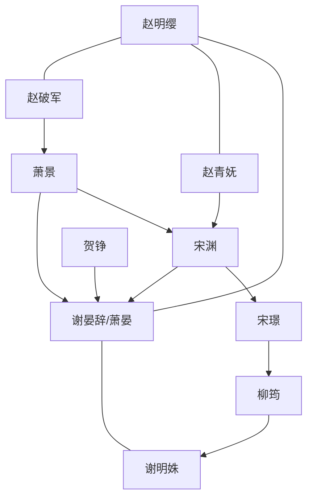

# 角色标签图谱

## 角色清单

### 赵明缨 — 护夫疯批郡主 / 收敛爪牙的大女主
- 叙事功能: 第一视角主角，承接读者愤怒并执行第一轮复仇。
- 核心标签: 魔丸血脉、护短、能打能爱
- 弧光: 温婉侯夫人 → 破戒复仇 → 与夫并肩拨乱反正 → 甜宠安胎
- 台词风格: 短句、霸气、护短，“老娘”式自称制造爽感。
- 关键行为: 折断绣花针、取九节鞭、闯国公府、护明姝、并肩战皇帝。
- 读者情绪关系: 爽、代入、期待她发疯。

### 谢晏辞 / 萧晏 — 温润假废物 / 太子遗孤
- 叙事功能: 情绪债核心受害者与后半身份反转核心。
- 核心标签: 温柔、隐忍、正统
- 弧光: 断腿病弱夫君 → 舍命护妻 → 揭露太子身份 → 拒绝皇位回归爱人
- 台词风格: 前期温柔克制，后期冷冽审判，结尾甜宠低声。
- 关键行为: 断腿挡妻、揭露萧晏身份、救明姝、斩萧景、拒绝皇位。
- 读者情绪关系: 心疼、心动、爽。

### 赵青妩 — 端王妃 / 优雅疯批母亲
- 叙事功能: 第二层身份压制，证明女主疯批有家学来源。
- 核心标签: 美艳、狠辣、护女
- 弧光: 软轿登场 → 一巴掌扇飞国公 → 火药同归 → 破皇宫火药阵
- 台词风格: 慵懒讥讽，轻声说狠话。
- 关键行为: 打飞宋渊、羞辱柳筠、黑火药同归、金叶子断引线。
- 读者情绪关系: 爽、崇拜、期待她再出手。

### 赵破军 — 端王 / 反皇权战神父亲
- 叙事功能: 第三层权力压制，把宅斗升级为皇权对抗。
- 核心标签: 战神、护短、反骨
- 弧光: 黑甲铁骑破门 → 杀太监踩圣旨 → 扶太子拨乱反正
- 台词风格: 粗粝、直接、极具压迫感。
- 关键行为: 踏平国公府大门、杀常海、屠荣国公府、太极殿护太子。
- 读者情绪关系: 极爽、解压。

### 谢明姝 — 被害小姑 / 情绪债触发器
- 叙事功能: 受害者，提供女主复仇正当性。
- 核心标签: 善良、亲近女主、无辜
- 弧光: 流产濒危 → 被挟持 → 康复并获得轻喜感结局
- 台词风格: 虚弱、为家人着想。
- 关键行为: 前期被害，后期被皇帝挟持。
- 读者情绪关系: 心疼、希望她被补偿。

### 宋璟 — 荣国公世子 / 宅斗层恶人
- 叙事功能: 第一层反派，承载宠妾灭妻、羞辱侯府。
- 核心标签: 好色、跋扈、怂
- 弧光: 叫嚣 → 惊恐 → 被废 → 死亡
- 台词风格: 下流羞辱、倚仗父权。
- 关键行为: 纵容柳筠害明姝、羞辱谢晏辞与女主。
- 读者情绪关系: 恨、期待被废。

### 柳筠 — 宠妾 / 宫中眼线
- 叙事功能: 表层宅斗恶女，实为皇帝棋子。
- 核心标签: 嫉妒、阴毒、怯懦
- 弧光: 嚣张 → 求饶 → 供出皇帝
- 台词风格: 前期娇纵，后期崩溃求命。
- 关键行为: 给明姝灌红花、供出绝子散与慢性毒。
- 读者情绪关系: 恨、厌恶。

### 宋渊 — 荣国公 / 新贵权力暴发户
- 叙事功能: 第二层反派，承载门阀暴力与皇帝爪牙。
- 核心标签: 跋扈、无知、残暴
- 弧光: 私兵围杀 → 被端王压制 → 满门抄斩
- 台词风格: 粗暴命令、权力威胁。
- 关键行为: 打杀侯府、刺伤谢晏辞、豢养私兵。
- 读者情绪关系: 恨、期待清算。

### 萧景 — 篡位皇帝 / 终极反派
- 叙事功能: 最高压迫源，承载皇权阴谋。
- 核心标签: 弑兄、忌惮、疯狂
- 弧光: 幕后操控 → 鸿门宴设杀局 → 身份崩塌 → 头颅落地
- 台词风格: 皇权威胁、疯癫不甘。
- 关键行为: 指使打压谢家、设宴围杀、启动火药阵。
- 读者情绪关系: 终极恨点，清算对象。

## 关系网络

## 角色功能对照表（供改编参考）

| 原角色 | 极致标签 | 叙事功能 | 读者情绪功能 | 改编时必须保留的 |
|--------|---------|---------|-------------|---------------|
| 赵明缨 | 护夫疯批郡主 | 第一反击手 | 爽、代入 | 温婉伪装与破戒动作 |
| 谢晏辞 | 温润假废物太子 | 情绪债+身份反转 | 心疼、心动 | 舍命护妻与太子级身份 |
| 赵青妩 | 优雅疯批母亲 | 第二层压制 | 惊艳爽 | 慵懒登场、一招碾压 |
| 赵破军 | 反骨战神父亲 | 第三层权力 | 极致解压 | 杀圣旨使者/反皇权级硬刚 |
| 谢明姝 | 无辜小姑 | 受害锚点 | 心疼 | 受害必须具体且不可轻描淡写 |
| 萧景 | 篡位皇帝 | 终极反派 | 终极恨点 | 弑兄篡位、火药绝杀、被斩首 |
