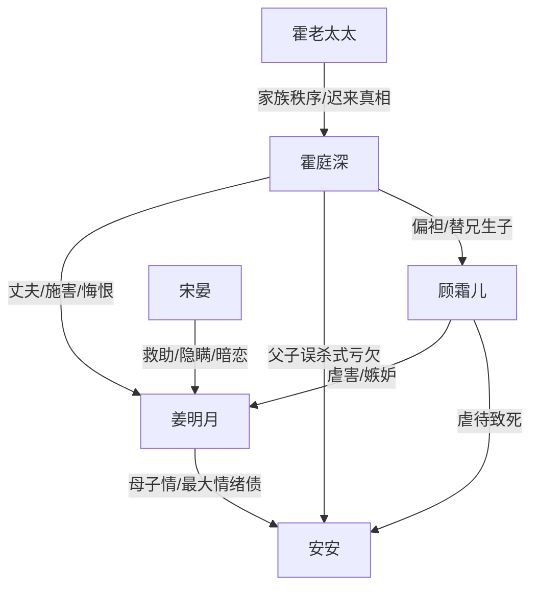

# 角色标签图谱

## 角色清单

### 姜明月 — 清醒受难型大女主
- 叙事功能: 承受最大压迫，并在终局完成自我选择。
- 核心标签: 隐忍、母性、清醒
- 弧光: 被囚受害者 → 丧子复仇者 → 失忆新生者 → 独立离开者
- 台词风格: 克制短句，关键处一刀见血
- 关键行为: 请辞、救子、公开控诉、悬崖假死、恢复记忆后拒绝两清
- 读者情绪关系: 心疼、代入、敬佩、爽

### 霍庭深 — 伪深情施害者/追妻火葬场男主
- 叙事功能: 制造核心压迫，后期承受真相反噬。
- 核心标签: 自负、迟钝、权力施害
- 弧光: 掌控者 → 误判者 → 失去者 → 悔恨者
- 台词风格: 命令式、审判式，后期破碎忏悔
- 关键行为: 囚禁姜明月、送走安安、封锁医院、开枪、公开认罪
- 读者情绪关系: 恨、怒、后期有限痛快

### 安安 — 无辜情绪核
- 叙事功能: 全文最大情绪债与道德坐标。
- 核心标签: 幼弱、懂事、被牺牲
- 弧光: 被藏起的孩子 → 濒死求救 → 死亡锚点
- 台词风格: 稚嫩、懂事、反衬残酷
- 关键行为: 呼唤妈妈、临死安慰母亲
- 读者情绪关系: 极度心疼、催化恨意

### 顾霜儿 — 恶毒寡嫂/伪弱者反派
- 叙事功能: 直接施虐者，推动家庭伦理崩坏。
- 核心标签: 嫉妒、阴毒、伪善
- 弧光: 被偏袒者 → 得意者 → 被揭穿者 → 被清算者
- 台词风格: 轻飘飘、挑衅、装弱
- 关键行为: 虐待母子、伪造命格说、隐瞒孩子血脉、纵火
- 读者情绪关系: 恨、期待报应

### 宋晏 — 守护型男二/温柔占有者
- 叙事功能: 提供新生可能，也制造“善意谎言”的二次束缚。
- 核心标签: 暗恋、守护、欺瞒
- 弧光: 救赎者 → 隐瞒者 → 被拒绝者
- 台词风格: 温柔、克制、后期慌乱
- 关键行为: 救走失忆姜明月、安排学业、隐瞒过去、说出真相
- 读者情绪关系: 心疼但不完全站队

### 霍老太太 — 家族秩序见证者
- 叙事功能: 维持旧伦理，同时后期提供部分真相。
- 核心标签: 妥协、家族、迟来的明白
- 弧光: 默许者 → 见证者 → 告知者
- 台词风格: 长辈式缓和
- 关键行为: 准许离开、告知安安骨灰、带出绑匪真相
- 读者情绪关系: 复杂、轻微责备

## 关系网络

## 角色功能对照表（供改编参考）

| 原角色 | 极致标签 | 叙事功能 | 读者情绪功能 | 改编时必须保留的 |
|--------|---------|---------|-------------|---------------|
| 姜明月 | 清醒受难型大女主 | 承债与终局选择 | 心疼、爽 | 最后不回头 |
| 霍庭深 | 伪深情施害者 | 压迫与悔恨承载 | 恨、痛快 | 亲手毁家后认罪 |
| 安安 | 无辜情绪核 | 最大情绪债 | 心疼、愤怒 | 死亡不可轻化 |
| 顾霜儿 | 伪弱恶毒反派 | 直接施虐 | 恨、期待报应 | 伪善面具与自曝 |
| 宋晏 | 守护型男二 | 新生与二次欺瞒 | 暖、复杂 | 好意也不能替女主选择 |
