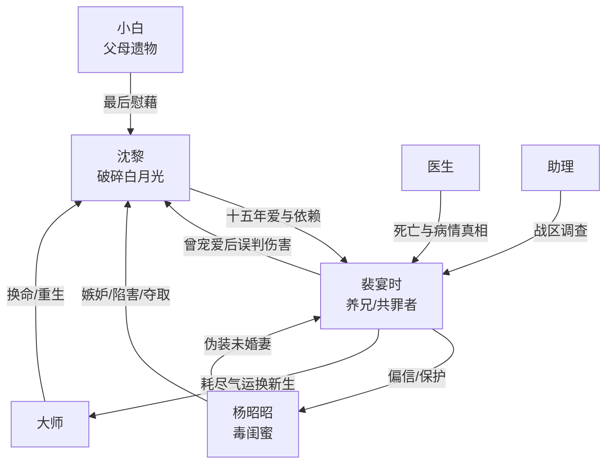

# 角色标签图谱

## 角色清单

### 沈黎 — 破碎白月光/清醒亡魂

- 叙事功能: 受害者、情绪债承载者、最终拒绝者。
- 核心标签: 被宠坏又被摧毁、骨癌晚期、死后旁观。
- 弧光: 期待被接回 → 只求体面死去 → 跳楼解脱 → 拒绝复合 → 重生回父母身边。
- 台词风格: 前期虚弱求饶，后期平静审判。
- 关键行为: 烧日记、刻灵牌、跳楼、在姻缘树下拒绝裴宴时。
- 读者情绪关系: 心疼、怜惜、替她恨、最后为她解脱而松气。

### 裴宴时 — 迟来悔悟的共罪养兄

- 叙事功能: 最大误判者、前半压迫者、后半火葬场承担者。
- 核心标签: 京圈太子爷、极致控制、迟来崩塌。
- 弧光: 宠爱养成 → 厌恶误判 → 亲手逼死 → 得知真相 → 清算杨昭昭 → 自虐赎罪 → 换女主新生后消散。
- 台词风格: 命令式、审判式，后期破碎忏悔。
- 关键行为: 抛弃沈黎、关航空箱、强喂海鲜、抽血、逼她去片场、找大师换命。
- 读者情绪关系: 前半恨，后半看他痛苦但不希望他被原谅。

### 杨昭昭 — 毒闺蜜/伪善绿茶

- 叙事功能: 外部陷害源、情绪债催化剂、反派清算对象。
- 核心标签: 孤儿嫉妒、伪柔弱、夺取者。
- 弧光: 假关心 → 私下摊牌 → 持续陷害 → 被揭穿 → 被镜像报应。
- 台词风格: 人前委屈、人后恶毒、败露后歇斯底里。
- 关键行为: 下药、夺资源、安排战区凌虐、曝光日记、片场二次设局。
- 读者情绪关系: 强烈恨点，承担最直接的报应爽点。

### 小白 — 亲情替身/最后温暖

- 叙事功能: 沈黎父母遗留的陪伴物，承载最后柔软。
- 核心标签: 小猫、父母遗物、无辜牺牲。
- 弧光: 蹭沈黎小腿 → 陪她跪夜 → 被乱棍打死 → 进入牌位系统。
- 台词风格: 无。
- 关键行为: 在花园给予沈黎唯一温暖。
- 读者情绪关系: 催泪、放大裴宴时和杨昭昭的残忍。

### 医生/助理/大师 — 真相传递者

- 叙事功能: 医生确认骨癌和尸身伤痕；助理查出战区真相；大师提供终局转生。
- 核心标签: 外部证人、信息引爆器、规则仲裁者。
- 弧光: 各自短暂出现，但负责关键证据落地。
- 台词风格: 客观、克制。
- 关键行为: 宣布死亡、解释伤痕、递交调查报告、判定沈黎不愿再见裴宴时。
- 读者情绪关系: 提供迟来公正，推动火葬场。

## 关系网络

## 角色功能对照表（供改编参考）

| 原角色 | 极致标签 | 叙事功能 | 读者情绪功能 | 改编时必须保留的 |
|--------|---------|---------|-------------|---------------|
| 沈黎 | 破碎白月光 | 承债与拒绝 | 心疼、爽在抽离 | 死亡/绝症/拒绝复合 |
| 裴宴时 | 迟来悔悟养兄 | 误判和火葬场 | 恨与看他崩塌 | 共罪属性，不能洗白 |
| 杨昭昭 | 毒闺蜜绿茶 | 陷害源 | 主要恨点 | 人前柔弱人后恶毒 |
| 小白 | 亲情替身 | 最后温暖 | 催泪放大虐感 | 必须有无辜陪伴物被毁 |
| 医生/助理/大师 | 真相传递者 | 证据与规则 | 爽点落地 | 客观证据引爆火葬场 |
