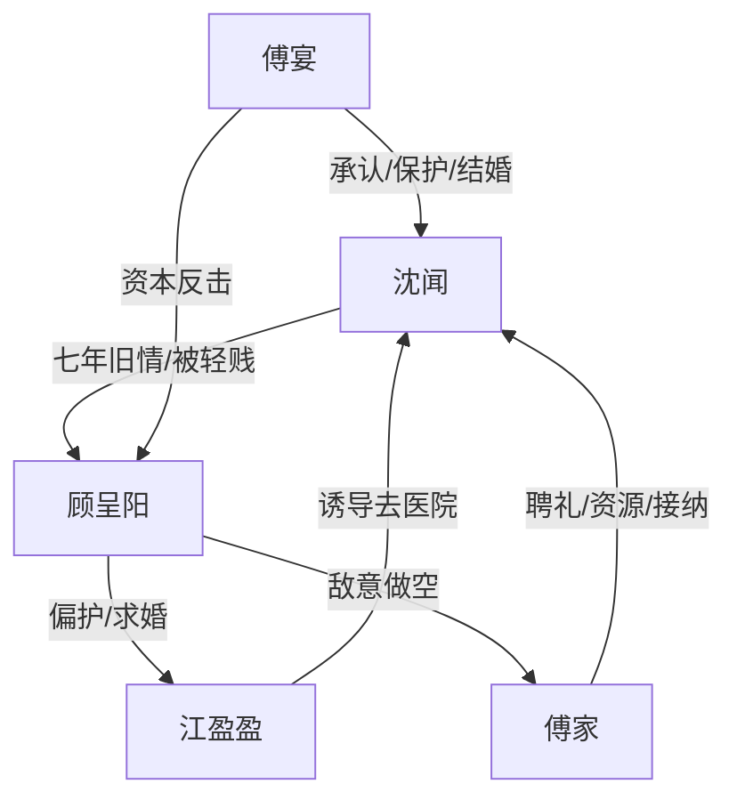

# 角色标签图谱

## 角色清单

### 沈闻 — 清醒离场型女主
- 叙事功能: 受伤者、观察者、最终被新秩序接纳者
- 核心标签: 克制、清醒、自尊
- 弧光: 被旧爱误判轻贱 → 接受新家庭承认 → 重新发光
- 台词风格: 短句、直接、少解释
- 关键行为: 掰断婚纱卡、去找傅宴、答应婚事
- 读者情绪关系: 心疼、替她憋屈，后半获得补偿爽

### 顾呈阳 — 自恋误判型旧爱
- 叙事功能: 压迫者、旧秩序代表、情绪债制造者
- 核心标签: 傲慢、自欺、轻贱
- 弧光: 以为沈闻冷战求和 → 不信傅宴会要她 → 被婚礼与破产清算
- 台词风格: 质问、否认、命令式
- 关键行为: 封锁酒店、泳池玩乐、羞辱沈闻、做空傅家
- 读者情绪关系: 恨、厌恶、期待他被打脸

### 傅宴 — 玩世表象下的护短继承者
- 叙事功能: 新秩序、补偿者、最终清算执行人
- 核心标签: 松弛、护短、资源强
- 弧光: 被视作浪荡二世祖 → 公开负责 → 资本控盘
- 台词风格: 慵懒、轻松、短句压制
- 关键行为: 带走沈闻、让傅家准备聘礼、官宣订婚、击垮顾家
- 读者情绪关系: 爽、安心、期待他护妻

### 江盈盈 — 绿茶牵引型第三者
- 叙事功能: 引线人物，把沈闻带回顾呈阳和傅宴的冲突场
- 核心标签: 柔弱、依附、假询问
- 弧光: 被顾护着 → 拉沈闻去医院 → 见证旧秩序失效
- 台词风格: “姐姐”式软压迫
- 关键行为: 机场接人、诱导去医院、寻找顾呈阳
- 读者情绪关系: 烦、警惕，但仇恨低于顾呈阳

### 傅家众人 — 郑重承认型豪门家庭
- 叙事功能: 具体化“接纳”和“补偿”
- 核心标签: 体面、效率、护短
- 弧光: 闻讯准备 → 全员接纳 → 婚礼护盘
- 台词风格: 实务型，聘单、月子单、不动产
- 关键行为: 准备红纸聘书、安排月子资源、婚礼应对股市战
- 读者情绪关系: 安心、补偿爽

## 关系网络

## 角色功能对照表（供改编参考）

| 原角色 | 极致标签 | 叙事功能 | 读者情绪功能 | 改编时必须保留的 |
|--------|---------|---------|-------------|---------------|
| 沈闻 | 清醒离场型女主 | 受伤与重生主体 | 心疼、代入、补偿 | 克制、不哭闹、不反复解释 |
| 顾呈阳 | 自恋误判型旧爱 | 情绪债来源 | 恨、等打脸 | 持续误判女主价值 |
| 傅宴 | 护短继承者 | 新秩序与清算者 | 爽、安心 | 松弛表象+强资源 |
| 江盈盈 | 绿茶牵引者 | 推动碰面 | 烦、拱火 | “姐姐”式软压迫 |
| 傅家 | 郑重接纳豪门 | 补偿具象化 | 安全感 | 资源清单必须具体 |
