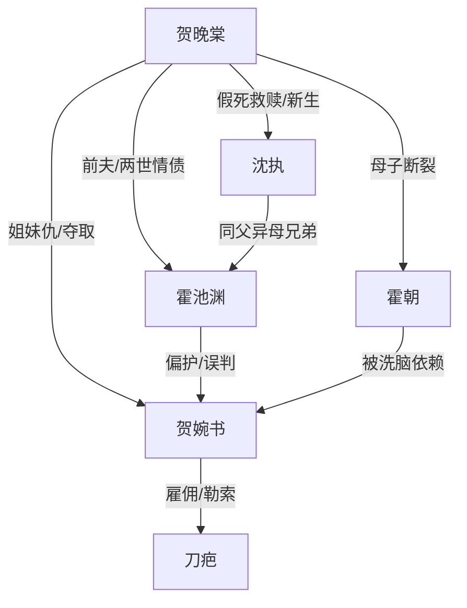

# 角色标签图谱

## 角色清单

### 贺晚棠 — 清醒重生弃爱女主
- 叙事功能: 承载两世情绪债，通过不争、不闹、假死完成价值反转。
- 核心标签: 重生、克制、抽身
- 弧光: 歇斯底里守爱 → 清醒假死 → 自由助人 → 拒绝回头
- 台词风格: 短、平、冷，如“我不会回去了。”
- 关键行为: 接纳贺婉书入住、预约假死、跳海脱身、拒绝霍池渊复合。
- 读者情绪关系: 心疼、替她憋屈、最终为她松一口气。

### 霍池渊 — 迟来悔悟霸总
- 叙事功能: 前半制造错位伤害，后半承担火葬场和清算执行。
- 核心标签: 自以为保护、迟悟、赎罪
- 弧光: 偏心合理化 → 失去后崩塌 → 查真相清算 → 求而不得
- 台词风格: 前期解释多，后期低声悔罪。
- 关键行为: 三次救贺婉书、交换贺晚棠、跳海救人、揭穿贺婉书、挡枪。
- 读者情绪关系: 前期恨，后期看他痛但不希望复合。

### 贺婉书 — 白莲毒妹/夺取型反派
- 叙事功能: 制造误会、操控舆论和孩子，承担最终清算对象。
- 核心标签: 柔弱伪装、嫉妒、恶毒
- 弧光: 装可怜受害者 → 暗中夺取一切 → 真相败露 → 被流放清算
- 台词风格: “姐姐”“不要为难”式柔弱控诉，破防后尖锐疯狂。
- 关键行为: 苦肉计、生日宴自导自演、绑架局、持枪追杀。
- 读者情绪关系: 强恨点，负责让报应成立。

### 霍朝 — 被操控的儿子/亲情债载体
- 叙事功能: 将爱情背叛升级为家庭背叛。
- 核心标签: 天真残忍、被洗脑、迟来想母亲
- 弧光: 偏爱小姨骂母亲 → 分离焦虑 → 想妈妈回来
- 台词风格: 儿童化、直接伤人。
- 关键行为: 推母亲入泳池、骂坏妈妈、同意交换、后期崩溃想母亲。
- 读者情绪关系: 又气又心酸，强化“女主没有家”的痛感。

### 沈执 — 克制救赎型新男主
- 叙事功能: 提供新生出口和价值系统，反衬霍池渊的迟到。
- 核心标签: 温和、尊重、同伤共救
- 弧光: 假死机构负责人 → 保护者 → 身世揭露 → 与女主共同前行
- 台词风格: 克制、留空间、不逼迫。
- 关键行为: 完成假死、邀请女主加入机构、挡刀、尊重她的选择。
- 读者情绪关系: 安全感、补偿感。

### 刀疤 — 外部暴力工具人
- 叙事功能: 把贺婉书的阴谋具象化，触发跳海和真相暴露。
- 核心标签: 亡命徒、勒索、证人
- 弧光: 绑架执行者 → 反咬贺婉书 → 清算证据
- 台词风格: 粗粝、威胁、贪婪。
- 关键行为: 绑架、逼交换、电话勒索、拍卖会指证。
- 读者情绪关系: 厌恶，但主要恨点仍回到贺婉书和霍池渊。

## 关系网络

## 角色功能对照表（供改编参考）

| 原角色 | 极致标签 | 叙事功能 | 读者情绪功能 | 改编时必须保留的 |
|--------|---------|---------|-------------|---------------|
| 贺晚棠 | 清醒弃爱女主 | 主线承压与抽身 | 心疼、爽 | 不争不闹、假死离开、拒绝回头 |
| 霍池渊 | 迟悟霸总 | 伤害与悔悟 | 恨、虐爽 | 自以为保护但总选错 |
| 贺婉书 | 白莲毒妹 | 误会制造与终局反派 | 恨点 | 柔弱伪装+主动谋害 |
| 霍朝 | 被洗脑儿子 | 亲情刀 | 心痛 | 说出不要妈妈/后期后悔 |
| 沈执 | 救赎新男主 | 新生系统 | 补偿 | 尊重、不逼、共同救人 |
