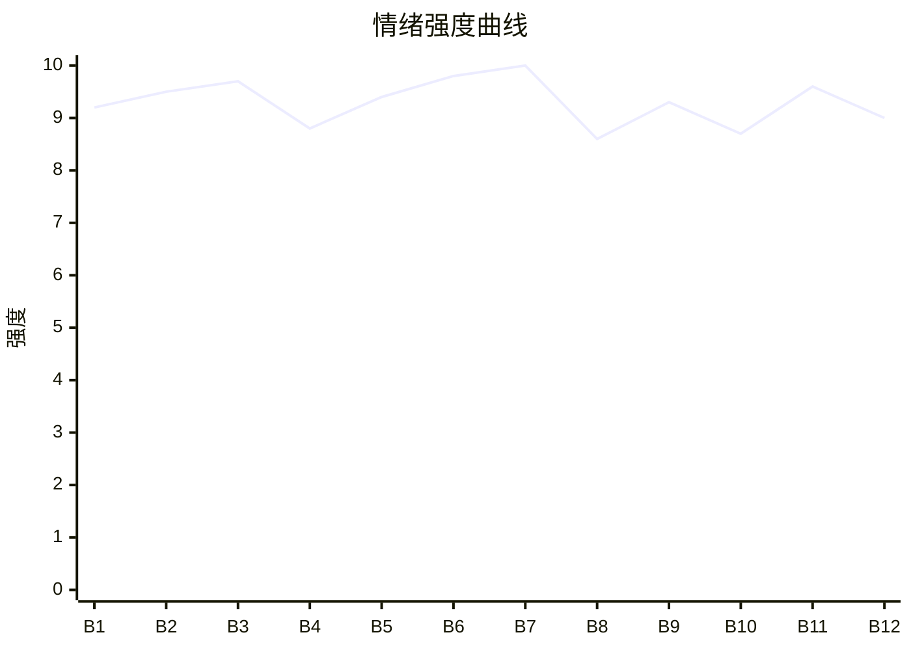

# Beat Sheet 节拍器

## 全文概况

- 总字数: 约 14500 字
- 节拍数: 12 幕
- 核心母题（Logline）: 萧时川为了救“患癌姐姐”背尸六年，却发现亲人和妻子合谋折磨他；在系统倒计时中选择死亡离开，死后旁观所有亏欠者被真相反噬、疯癫或毁灭。
- 情绪模式: 极致打压 → 倒计时解脱 → 死亡断债 → 真相反噬 → 追悔清算

## 节拍详表

### Beat 1: 六年背尸的骗局开闸 [开篇-“否则，我们就断绝关系！”]

- **字数**: 约 1150 字（占比 8%）
- **核心事件**: 男主攒够救姐姐的钱，却被姐姐、妻子、父母当场揭开六年骗局。
- **情绪标签**: 震惊、荒谬、崩溃
- **情绪强度**: 9.2/10
- **情绪方向**: ⚡突变
- **冲突类型**: 大转折
- **悬念钩子**: 他们为什么能如此残忍地合谋骗他六年？
- **叙事速度**: 快
- **对话占比**: 55%
- **reversal_mechanism**: [M6]
- **hook_strength**: 9.0/10（极端度 3/3，信息密度 3/3，悬念尖锐度 1.8/2，节奏利落度 1.2/2）
- **关键句**: “我其实没病，爸妈也没死。那场车祸是我策划的，重伤残疾的只有你。”
- **原文摘录**: 当背尸人的第六年，我终于攒够钱给姐姐治血癌。可姐姐却漫不经心地拒绝了手术。“我其实没病，爸妈也没死。那场车祸是我策划的，重伤残疾的只有你。”妻子坦白没有破产，只是不想跟他挤地下室。姐姐抽走银行卡扔进垃圾桶，说背尸钱都给了乞丐。父母出现，要求他向萧言安认错，否则断绝关系。

### Beat 2: 系统倒计时与孩子真相 [“离开！”-“孩子跟着他长大最合适了”]

- **字数**: 约 1200 字（占比 8%）
- **核心事件**: 男主选择放弃攻略脱离世界，又得知儿子没死，而是被妻子抱给萧言安。
- **情绪标签**: 绝望、恶心、二次崩塌
- **情绪强度**: 9.5/10
- **情绪方向**: ↑上升
- **冲突类型**: 大转折
- **悬念钩子**: 倒计时二十四小时内，他会如何离开？
- **叙事速度**: 快
- **对话占比**: 45%
- **reversal_mechanism**: [M6, M5]
- **hook_strength**: null
- **关键句**: “儿子根本没死，他一出生被我抱给言安，你以后别再冤枉他了。”
- **原文摘录**: 心死绝望之际，系统问是否放弃攻略任务。男主回答“离开”，倒计时二十四小时。妻子擦他的泪，指责他争宠。他怒吼刹车线是萧言安剪的，儿子死在他手里。妻子轻飘飘说儿子没死，是她抱给萧言安的，因为孩子跟着萧言安长大最合适。

### Beat 3: 人贩子旧伤与木箱惩罚 [“为什么不干脆骗我到死？”-“求求你别再把我关起来”]

- **字数**: 约 1550 字（占比 10.7%）
- **核心事件**: 亲人要求男主继续给萧言安生女儿；男主揭旧伤却被认定撒谎，姐姐把他塞进木箱触发幽闭恐惧。
- **情绪标签**: 愤怒、恐惧、窒息
- **情绪强度**: 9.7/10
- **情绪方向**: ↑上升
- **冲突类型**: 微冲突升级为大转折
- **悬念钩子**: 姐姐安排过多少“磨炼”？
- **叙事速度**: 中快
- **对话占比**: 48%
- **reversal_mechanism**: [M5]
- **hook_strength**: null
- **关键句**: “姐姐按着我的头，硬生生把我塞进了一个木箱。”
- **原文摘录**: 妻子和姐姐说萧言安想要女儿，只能由男主来。男主撩起袖子露出人贩子虐待留下的疤，质问到底谁可怜。姐姐和父母认定他撒谎，指责他心眼多。姐姐把他塞进木箱，触发他曾被和尸体钉在棺材三天三夜的创伤。他断甲抠木缝，爬出来求姐姐不要再关他。

### Beat 4: 六年羞辱来自姐姐安排 [“那些……都是你安排的？”-“好，我去。”]

- **字数**: 约 1100 字（占比 7.6%）
- **核心事件**: 男主得知背尸六年的客户羞辱都是姐姐安排；倒计时十二小时，他压下恨意答应参加晚宴。
- **情绪标签**: 麻木、恨、忍耐
- **情绪强度**: 8.8/10
- **情绪方向**: ↓短暂收束
- **冲突类型**: 微冲突
- **悬念钩子**: 他去晚宴到底要做什么？
- **叙事速度**: 中
- **对话占比**: 40%
- **reversal_mechanism**: [M6]
- **hook_strength**: null
- **关键句**: “我垂眼，把眼底翻涌的恨意一点点压下去。再抬头时，脸上已经没了刚才的崩溃：‘好，我去。’”
- **原文摘录**: 姐姐说每个背尸客户都经她挑选，只是磨炼男主性子。男主回想被逼钻裤裆、喝酒、挨酒瓶的侮辱。姐姐还要求他出席慈善晚宴，为萧言安洗清人贩子儿子的身份。倒计时十二小时出现，男主表面顺从。

### Beat 5: 慈善晚宴反击失败 [“我为什么要跟一个虐待我的人贩子的儿子和解？”-“你才是那个小三啊”]

- **字数**: 约 1350 字（占比 9.3%）
- **核心事件**: 男主撕毁澄清稿公开指控萧言安，却被萧言安用结婚证反杀，成了“小三”和精神病。
- **情绪标签**: 爽点初起、反噬、窒息
- **情绪强度**: 9.4/10
- **情绪方向**: ⚡突变
- **冲突类型**: 大转折
- **悬念钩子**: 男主的亲生孩子会认他吗？
- **叙事速度**: 快
- **对话占比**: 60%
- **reversal_mechanism**: [M6]
- **hook_strength**: null
- **关键句**: “明明我是薇芸的合法丈夫，你才是那个小三啊。”
- **原文摘录**: 晚宴上记者追问真假少爷是否和解。母亲塞稿命令男主念。男主撕碎稿子，当众质问萧言安抢妻抢子。萧言安红着眼拿出结婚证，显示他才是季薇芸合法丈夫。姐姐顺势说男主有妄想症，围观者立刻嫌恶。

### Beat 6: 孩子认贼与偷拍视频 [小男孩冲出-“倒计时：5小时”]

- **字数**: 约 1450 字（占比 10%）
- **核心事件**: 男主亲生儿子撞倒他并护萧言安；姐姐用被折辱视频威胁他，真相被再次否认。
- **情绪标签**: 心碎、羞辱、绝望
- **情绪强度**: 9.8/10
- **情绪方向**: ↑上升
- **冲突类型**: 大转折
- **悬念钩子**: 五小时后他会怎样解脱？
- **叙事速度**: 快
- **对话占比**: 46%
- **reversal_mechanism**: [M5, M6]
- **hook_strength**: null
- **关键句**: “你知不知道，我真的被那群畜生欺负了！”
- **原文摘录**: 孩子冲出来骂他欺负爸爸。男主一眼认出这是自己的孩子，想抱却被姐姐拽开。姐姐播放三年前巷子里被折辱的视频，威胁他澄清。男主尖叫真被欺负了，姐姐却说那些只是演员，指责他装可怜。倒计时剩五小时。

### Beat 7: 群殴、叉伤与跳楼脱离 [“你这个破坏别人家庭的臭小三！”-“我松开手，往后坠落”]

- **字数**: 约 1900 字（占比 13.1%）
- **核心事件**: 男主被宴会众人群殴致残，回家又被萧言安挑衅、孩子刺伤，最终在倒计时结束时跳楼脱离。
- **情绪标签**: 极痛、麻木、解脱
- **情绪强度**: 10/10
- **情绪方向**: ⚡突变
- **冲突类型**: 大转折/死亡卡点
- **悬念钩子**: 他真的死后，众人会不会悔？
- **叙事速度**: 快
- **对话占比**: 42%
- **reversal_mechanism**: [M4, M5]
- **hook_strength**: null
- **关键句**: “那就把我的命一起赔给他吧。”
- **原文摘录**: 众人因“小三”身份围殴男主，妻子和姐姐选择先护萧言安。他被打到下体破碎。回家后萧言安贴耳挑衅，说玩腻了他的儿子，还要女儿。孩子用叉子扎进他小腹，并说如果他是爸爸宁可去死。姐姐威胁他录澄清视频。男主发送视频后爬上十六楼窗台，系统提示时间到。他说若六年人生和孩子都不够抵罪，就把命赔给萧言安，然后松手坠落。

### Beat 8: 灵魂旁观与二次误判 [跳楼后-“大少爷摔死在楼下了！”]

- **字数**: 约 1450 字（占比 10%）
- **核心事件**: 男主灵魂出体，众人仍被萧言安和孩子的话术架住，没有第一时间查看尸体，继续录视频污蔑他。
- **情绪标签**: 空、冷、讽刺
- **情绪强度**: 8.6/10
- **情绪方向**: →平稳冷却
- **冲突类型**: 大转折后冷处理
- **悬念钩子**: 死讯正式抵达后会怎样崩塌？
- **叙事速度**: 中
- **对话占比**: 45%
- **reversal_mechanism**: [M4, M5]
- **hook_strength**: null
- **关键句**: “我只是静静地看着她们，甚至有点期待等她们真的知道我死了，会是什么表情。”
- **原文摘录**: 男主意识飘到姐姐身边。萧言安和孩子撒谎说楼下有充气装置，不会摔死人。母亲和妻子不安想去看，却被萧言安委屈话术和孩子质问架住。姐姐决定“给他一个教训”。众人替男主录澄清视频，萧言安暗喜。管家冲进来，说大少爷摔死在楼下。

### Beat 9: 死亡确认与迟来互撕 [“时川！”-“两个人被强行分开带走”]

- **字数**: 约 1550 字（占比 10.7%）
- **核心事件**: 众人看见尸体后崩溃，姐姐承认死亡，妻子不肯接受，妻子和姐姐互相指责并被带走。
- **情绪标签**: 迟来悔恨、痛快、荒凉
- **情绪强度**: 9.3/10
- **情绪方向**: ↑上升
- **冲突类型**: 大转折
- **悬念钩子**: 真相调查会揭出哪些更深的罪？
- **叙事速度**: 中快
- **对话占比**: 50%
- **reversal_mechanism**: [M4, M5]
- **hook_strength**: null
- **关键句**: “这六年来第一次，他们全都围绕着我，而不是萧言安。但是这个关心，来得太迟了。”
- **原文摘录**: 姐姐和妻子冲下楼，看见男主尸体。姐姐抱他叫他起来，妻子喊打 120。父母赶来，第一次开始责怪姐姐偏心。姐姐低声说时川已经死了。医生确认死亡时间至少几个小时。妻子崩溃骂姐姐害死时川，姐姐也失控，两人互殴后被报警带走。

### Beat 10: 姐姐回忆与“为你好”逻辑崩塌 [拘留室-“去查”]

- **字数**: 约 1250 字（占比 8.6%）
- **核心事件**: 姐姐回忆从厌恶男主到心疼男主，再被萧言安骗，以“改造”为名策划六年折磨。
- **情绪标签**: 追悔、荒谬、因果显影
- **情绪强度**: 8.7/10
- **情绪方向**: →平稳蓄力
- **冲突类型**: 信息补全
- **悬念钩子**: 查出来的真相会如何反噬萧言安？
- **叙事速度**: 慢
- **对话占比**: 15%
- **reversal_mechanism**: [M5, M3]
- **hook_strength**: null
- **关键句**: “她只是，偏心了一点，只是多护了萧言安一点。为什么我会选择那样的方式去死？”
- **原文摘录**: 姐姐在拘留室回忆男主刚回家时胆小、小心翼翼，会因她一句关心高兴一整天。她曾心疼他，却因萧言安带证人陷害而愤怒。她想把“有问题”的弟弟改成好弟弟、好儿子、好丈夫、好父亲，于是策划车祸和六年磨炼。如今她开始让助理查这些年男主遭遇。

### Beat 11: 真相视频与萧言安清算 [回家-“所有时川承受过的痛苦，我要你千倍万倍地来还”]

- **字数**: 约 1650 字（占比 11.4%）
- **核心事件**: 妻子查到萧言安指使凌辱男主，姐姐与妻子联手撕破萧言安伪装，萧言安被拖走清算。
- **情绪标签**: 爽、怒、报应
- **情绪强度**: 9.6/10
- **情绪方向**: ↑上升
- **冲突类型**: 大转折/清算
- **悬念钩子**: 孩子、父母、妻子、姐姐各自如何还债？
- **叙事速度**: 快
- **对话占比**: 52%
- **reversal_mechanism**: [M3, M5]
- **hook_strength**: null
- **关键句**: “你伤害了他的父亲，所有时川承受过的痛苦，我要你千倍万倍地来还。”
- **原文摘录**: 妻子播放视频，施暴者承认六年来每次姐姐让他们吓唬男主，萧言安都会让他们尽情凌辱。宴会群殴也是萧言安安排。萧言安端吃食进来继续装可怜，却被妻子掐住脖子。姐姐不再救他，冷声说怕自己直接掐断他的脖子。视频播放后，萧言安脸色消失，想用孩子威胁，姐姐决定让他千倍万倍偿还。

### Beat 12: 全员余生偿债与疯癫结尾 [孩子被送走-结尾]

- **字数**: 约 1400 字（占比 9.6%）
- **核心事件**: 孩子被断绝关系送孤儿院，父母出家赎罪，萧言安被实验折磨致死，妻子跳楼，姐姐疯癫。
- **情绪标签**: 清算、空寂、余味
- **情绪强度**: 9.0/10
- **情绪方向**: ↓收束
- **冲突类型**: 结局清算
- **悬念钩子**: 无，闭环完成
- **叙事速度**: 快
- **对话占比**: 30%
- **reversal_mechanism**: [M3, M5]
- **hook_strength**: null
- **关键句**: “从此，港城再也没有那个天之骄女的萧总。只剩下一个人人避之不及的疯子。”
- **原文摘录**: 父母崩溃认错，孩子得知真相后求姑姑和妈妈，却被季薇芸断绝关系，被姐姐逐出萧家，送去偏远孤儿院。父母剃头做苦行僧。萧言安被姐姐送去实验室当小白鼠，疼死后姐姐只说便宜他了。季薇芸长期酗酒，最终抱着男主照片从婚房窗边跳下。姐姐精神失常，记忆停在关系最好的时候，日日问路人见没见她弟弟。

## 情绪曲线可视化

## 节拍密度检测

- 平均每 1200 字一个节拍
- 微冲突密度: 每 700-900 字一次
- 大转折密度: 每 1500-2200 字一次
- 判定: 符合高频节拍器标准

## 反转机制清单(Reversal Mechanisms)

| 机制 ID | 机制名 | 承载 Beat | 关键段落/金句 | 等价改编提示 |
|--------|--------|-----------|--------------|-------------|
| M4 | 灵魂线视角 | Beat 7-12 | “下一秒，我的意识一轻。整个人已经飘到了姐姐身边。” | 死亡必须前置到中段关键卡点后，后续以贴近施害者的灵魂旁观推进真相反噬。 |
| M5 | 温度反转曲线 | Beat 2-12 | “这六年来第一次，他们全都围绕着我，而不是萧言安。但是这个关心，来得太迟了。” | 必须有“曾经在意/后来归零/死后悔疯”的完整温度曲线，追悔必须具体到动作。 |
| M6 | 多层递进反转 | Beat 1,2,5,6,11 | 假病假死、儿子未死、合法丈夫是萧言安、偷拍视频为真、萧言安幕后加害 | 反转层数不能少，且每层量级递增：骗局 → 亲子 → 婚姻 → 性侵真相 → 全员清算。 |
| M3 | 因果回旋反讽 | Beat 10-12 | “所有时川承受过的痛苦，我要你千倍万倍地来还。” | 施害者以“磨炼/为你好”加害，结尾必须让同一套痛苦规则反向套回真正施害者身上。 |
