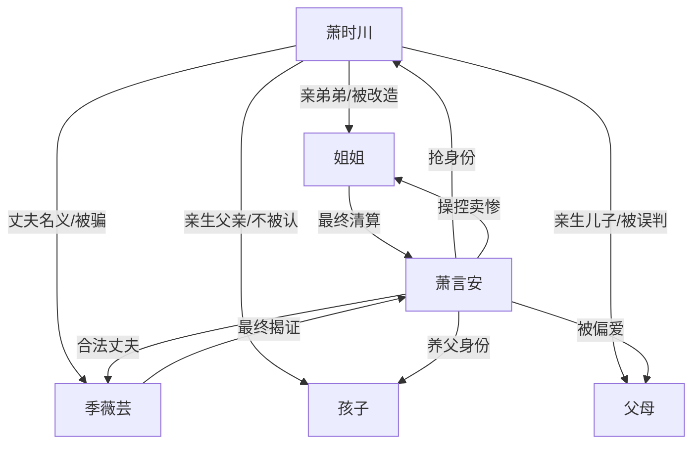

# 角色标签图谱

## 角色清单

### 萧时川 — 极致受害者/死亡退场型男主

- 叙事功能: 承载全部情绪债，用死亡触发后半清算。
- 核心标签: 背尸六年、被全家背叛、系统攻略者
- 弧光: 苦撑赎罪 → 真相崩塌 → 选择离开 → 灵魂旁观
- 台词风格: 前半质问、后半沉默；关键处短句决绝。
- 关键行为: 选择脱离世界、撕稿反击、跳楼断债。
- 读者情绪关系: 心疼、憋屈、期待他被补偿和被证明。

### 萧言安 — 绿茶养子/全局施害源

- 叙事功能: 制造误判、转移爱与资源、承接最终清算。
- 核心标签: 装弱、抢身份、幕后施暴
- 弧光: 被偏爱的假受害者 → 真相败露 → 被拖走偿债 → 惨死
- 台词风格: 委屈、反问、把自己放在弱者位。
- 关键行为: 拿结婚证反杀、指使凌辱、用孩子威胁。
- 读者情绪关系: 极恨，要求高强度报应。

### 姐姐 — 偏执改造者/迟来追悔者

- 叙事功能: 最大压迫执行者，也是后半清算执行者。
- 核心标签: 偏心、控制、悔疯
- 弧光: 策划骗局 → 折磨弟弟 → 确认死亡 → 追查真相 → 疯癫
- 台词风格: 命令式、审判式，后半变成低哑崩溃。
- 关键行为: 策划车祸、安排客户羞辱、塞木箱、清算萧言安。
- 读者情绪关系: 前半恨，后半看她痛苦但不原谅。

### 季薇芸 — 冷血妻子/迟来殉情者

- 叙事功能: 亲密关系背叛的核心，制造婚姻和孩子双重痛点。
- 核心标签: 骗婚、背叛、酗酒自毁
- 弧光: 坦白骗局 → 护萧言安 → 见尸崩溃 → 查真相 → 跳楼
- 台词风格: 理所当然式温柔残忍。
- 关键行为: 抱走孩子、与萧言安领证、放任群殴、查出施暴真相。
- 读者情绪关系: 恨与痛混合，要求她承受失去。

### 父母 — 盲信偏心的伦理压迫者

- 叙事功能: 放大家庭背叛，提供“全家不要他”的绝望。
- 核心标签: 偏心、愚蠢、迟来赎罪
- 弧光: 要断绝关系 → 指责撒谎 → 见尸崩溃 → 出家苦修
- 台词风格: 家长权威式压迫。
- 关键行为: 逼他认错、砸伤额头、不信真相、后期忏悔。
- 读者情绪关系: 憋屈、恨其眼盲。

### 孩子 — 认贼作父的刺痛点

- 叙事功能: 亲子线终极打击，也是男主自杀动因之一。
- 核心标签: 被养歪、认贼作父、被剥夺身份
- 弧光: 护萧言安 → 撞倒/刺伤亲父 → 得知真相 → 被送孤儿院
- 台词风格: 模仿大人价值观，天真残忍。
- 关键行为: 骂男主小三、叉伤男主、跳楼后撒谎、后期求原谅。
- 读者情绪关系: 心寒大于怜悯。

## 关系网络

## 角色功能对照表（供改编参考）

| 原角色 | 极致标签 | 叙事功能 | 读者情绪功能 | 改编时必须保留的 |
|--------|---------|---------|-------------|---------------|
| 萧时川 | 死亡退场型受害者 | 承债与断债 | 心疼、求偿还 | 六年牺牲、无人相信、主动离开 |
| 萧言安 | 绿茶施害源 | 制造误判 | 极恨 | 装弱话术、抢身份、幕后加害 |
| 姐姐 | 偏执改造者 | 最大执行者 | 恨后看追悔 | “为你好/磨炼”逻辑 |
| 季薇芸 | 冷血妻子 | 婚姻背叛 | 心痛与愤怒 | 骗婚、抱走孩子、迟来崩溃 |
| 父母 | 盲信父母 | 家庭抛弃 | 憋屈 | 断亲威胁与迟来赎罪 |
| 孩子 | 认贼作父 | 终极心碎 | 心寒 | 伤害亲父、后悔无门 |
