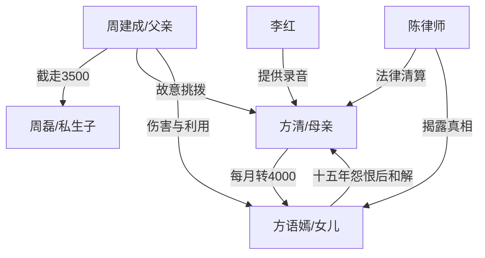

# 角色标签图谱

## 角色清单

### 方清 — 愧疚追责型母亲

- 叙事功能: 第一人称叙述者，负责发现真相、推进清算、完成亲情补偿。
- 核心标签: 母亲、失职、决绝追责
- 弧光: 自以为供养到位 → 发现女儿受苦 → 法律清算 → 十五年愧疚 → 临终和解
- 台词风格: 质问短句、愧疚解释、临终温柔
- 关键行为: 查银行流水、离婚起诉、找律师、让女儿听录音
- 读者情绪关系: 前半心疼她被蒙骗，后半也认可女儿对她失职的怨。

### 方语嫣 — 被饿三年的冷心女儿

- 叙事功能: 情绪债承载者，所有清算的道德中心。
- 核心标签: 被亏欠、克制、迟来崩溃
- 弧光: 误以为母亲抠门 → 独自受苦 → 十五年疏离 → 知道真相 → 陪母亲走完最后一程
- 台词风格: 冷淡、短促、后期崩溃哭诉
- 关键行为: 展示 500 元到账记录、拒绝母亲的钱、病房冷刺、看守所断父女关系
- 读者情绪关系: 强心疼，后期悔恨也让读者共情。

### 周建成 — 报复型恶父

- 叙事功能: 施害者、伦理反派、母女隔阂制造者。
- 核心标签: 私生子、侵占、恶意设局
- 弧光: 否认 → 承认私生子 → 轻视女儿痛苦 → 暴露报复动机 → 入狱悔恨
- 台词风格: 推诿、吼叫、冷血合理化
- 关键行为: 每月转走 3500 元、养私生子、故意挑拨母女、最后认罪
- 读者情绪关系: 纯恨点，必须被惩罚。

### 陈律师 — 证据推进器

- 叙事功能: 法律清算与真相验证工具人。
- 核心标签: 专业、冷静、助攻
- 弧光: 离婚律师 → 怀疑深层动机 → 安排对质 →传递认罪书
- 台词风格: 稳、理性、给方案
- 关键行为: 指导收集证据、谈判赔偿、安排对质、告知周建成被抓
- 读者情绪关系: 安全感和秩序感。

### 李红 — 迟来的证人

- 叙事功能: 第二层真相引爆者。
- 核心标签: 前女友、受害者、证据持有人
- 弧光: 被周建成欺骗 → 沉默多年 → 因恨提供录音
- 台词风格: 低声、犹豫、带恨
- 关键行为: 电话告知“为了报复你”，提供录音
- 读者情绪关系: 复杂但可接受，功能是助攻反派崩塌。

## 关系网络

## 角色功能对照表（供改编参考）

| 原角色 | 极致标签 | 叙事功能 | 读者情绪功能 | 改编时必须保留的 |
|--------|---------|---------|-------------|---------------|
| 方清 | 愧疚追责型母亲 | 第一人称追查与补偿 | 心疼、愧疚、认同 | 她无恶意但有失职 |
| 方语嫣 | 被亏欠女儿 | 情绪债载体 | 心疼、怜惜、后期悔痛 | 长期误恨与迟来和解 |
| 周建成 | 报复型恶父 | 施害与设局 | 恨、恶心、期待报应 | 故意伤害孩子以报复伴侣 |
| 陈律师 | 法律秩序工具 | 证据推进 | 安全感 | 证据链和对质安排 |
| 李红 | 证人型受害者 | 动机揭露 | 真相推进 | 录音/证据提供者 |
