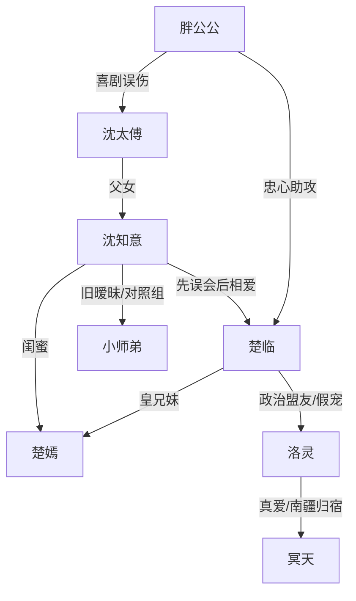

# 角色标签图谱

## 角色清单

### 沈知意 — 沙雕武力皇后 / 清醒甜宠女主
- 叙事功能: 第一视角、误会制造者、甜宠推进者、后段道德审判者。
- 核心标签: 医武双修、嘴硬心软、行动派
- 弧光: 怕皇帝只想逃 → 误以为治恋爱脑 → 动心圆房 → 因欺骗离宫 → 主动回宫守护家人
- 台词风格: 直白、吐槽、怼人快，常用反问和短句。
- 关键行为: 抱皇帝、怼洛灵、吻楚临、封狗洞、离宫、挺孕肚回宫。
- 读者情绪关系: 让读者爽、笑、心疼，并代入“被偏爱但也要被尊重”的需求。

### 楚临 — 绿茶恋爱脑皇帝 / 暗恋多年男主
- 叙事功能: 男主、误会核心、甜宠对象、信任危机制造者。
- 核心标签: 帝王、装弱、暗恋成疾
- 弧光: 表面宠洛灵 → 实则借局接近女主 → 失控软禁 → 学会放手 → 妻女奴
- 台词风格: 前期暧昧诱哄，中段撒娇示弱，后段诚恳悔痛。
- 关键行为: 立后、正宫洞房、陪钻狗洞、喝黄连茶、软禁女主、放女主离宫。
- 读者情绪关系: 先让人疑惑和心疼，后让人生气，再通过暗恋证据和放手行为回血。

### 洛灵 — 洒脱前朝公主 / 喜剧搅局者
- 叙事功能: 假情敌、政治计划关键人、终局反转执行者。
- 核心标签: 嚣张、自由、反套路
- 弧光: 被误认为祸国妖妃 → 当众偷情挑衅 → 揭开盟友计划 → 假谋反骗女主回宫 → 带叛军退场
- 台词风格: 粗粝、直球、强势，带“老娘”式江湖感。
- 关键行为: 与冥天苟合、羞辱楚临、揭露计划、假造反、解散叛军。
- 读者情绪关系: 前期让读者恨和烦，后期转为好笑与佩服。

### 冥天 — 南疆少主 / 情敌工具人
- 叙事功能: 洛灵真爱、香灵殿冲突放大器、南疆退场通道。
- 核心标签: 美艳、挑衅、护妻
- 弧光: 奸夫登场 → 南疆少主身份揭开 → 孩子父亲 → 带洛灵归南疆
- 台词风格: 挑衅、轻蔑、护短。
- 关键行为: 当众亲洛灵、挑衅楚临、保护洛灵和孩子。
- 读者情绪关系: 前期惹火，后期作为洛灵官配降低道德负担。

### 胖公公 — 忠仆助攻 / 身体喜剧机关
- 叙事功能: 推人入局、传话助攻、揭露旧事。
- 核心标签: 忠心、滑稽、误伤
- 弧光: 送皇帝进洞房 → 求女主安慰楚临 → 拂尘误伤太傅 → 揭开立后安排
- 台词风格: 圆滑、喜感、护主。
- 关键行为: 关门、求劝、递黄连、拂尘捅太傅。
- 读者情绪关系: 提供稳定笑点。

### 楚嫣 — 闺蜜公主 / 暗恋证据保管人
- 叙事功能: 女主过去生活入口，楚临暗恋证据的递送者。
- 核心标签: 闺蜜、助攻、信息桥
- 弧光: 背景叛徒 → 回山助攻 → 隐瞒宫变 → 引发女主回宫
- 台词风格: 直接、熟人式打趣。
- 关键行为: 暴露野猪往事、带来多年信件、阻止女主回宫。
- 读者情绪关系: 让楚临暗恋线可信。

### 小师弟 — 旧心动对象 / 情感对照组
- 叙事功能: 测试女主是否真正移情楚临，触发楚临疯批段。
- 核心标签: 纯情、迟钝、被辜负
- 弧光: 女主念念不忘 → 半年后迟来回应 → 被怀孕事实击碎 → 离开
- 台词风格: 纯情、委屈、直接。
- 关键行为: 夜闯皇宫、拿信表白、要带女主走。
- 读者情绪关系: 轻微心疼，但主要用于证明女主已爱楚临。

## 关系网络

## 角色功能对照表（供改编参考）

| 原角色 | 极致标签 | 叙事功能 | 读者情绪功能 | 改编时必须保留的 |
|--------|---------|---------|-------------|---------------|
| 沈知意 | 沙雕武力皇后 | 第一视角与行动核心 | 爽、笑、心疼 | 她必须能打、能怼、能主动离开 |
| 楚临 | 绿茶暗恋皇帝 | 甜宠对象与信任危机源 | 心疼、生气、回甜 | 暗恋多年证据和放手行为 |
| 洛灵 | 洒脱假情敌 | 搅局与终局反转 | 先烦后爽 | 不是恶毒女配，必须有独立归宿 |
| 冥天 | 美艳真情敌 | 放大误会 | 刺激、喜感 | 与洛灵真爱绑定 |
| 胖公公 | 忠仆笑点 | 推剧情与揭伏笔 | 笑 | 身体喜剧和关键证词 |
| 楚嫣 | 闺蜜助攻 | 暗恋证据链 | 补偿 | 多年信件/旧物证据 |
| 小师弟 | 旧爱对照 | 触发疯批与选择 | 轻心疼 | 迟来回应，不能喧宾夺主 |
