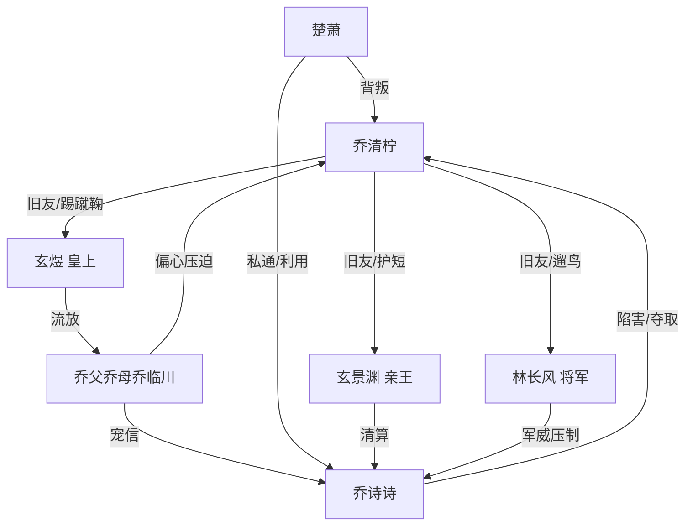

# 角色标签图谱

## 角色清单

### 乔清柠 — 野路子团宠大女主
- 叙事功能: 被污名化的主角，负责承受压迫并完成身份资源反杀。
- 核心标签: 假千金、野丫头、朋友多
- 弧光: 相府团宠 → 万人嫌 → 独立门户王妃
- 台词风格: 口语、俏皮、反讽，危机中仍能拱火。
- 关键行为: 忍耐、发急信、反设局、断亲。
- 读者情绪关系: 前半心疼，后半爽，结尾甜。

### 乔诗诗 — 贪婪绿茶真千金
- 叙事功能: 主反派，制造亲情、名节、生死三重压迫。
- 核心标签: 绿茶、蛇蝎、贪权
- 弧光: 回府受宠 → 设计陷害 → 身败名裂惨死
- 台词风格: 装弱与恶毒切换快。
- 关键行为: 炖鸡、抢鸟、逼嫁、下毒、雇凶、二次下药。
- 读者情绪关系: 强恨点，清算对象。

### 玄景渊 — 护短亲王/甜宠男主
- 叙事功能: 女主最强情感补偿与权力护盾。
- 核心标签: 富贵逼人、腹黑、宠溺
- 弧光: 旧友 → 救场者 → 王妃归宿
- 台词风格: 慵懒、戏谑、温柔。
- 关键行为: 抱住女主、配合演戏、二次设局、求婚。
- 读者情绪关系: 安全感、甜感。

### 玄煜 — 当朝皇上/终极权力背书
- 叙事功能: 最高权力打脸工具，终结乔家幻想。
- 核心标签: 皇权、旧友、护短
- 弧光: 蹴鞠朋友 → 圣驾亲临 → 下旨流放
- 台词风格: 直白威压。
- 关键行为: 点名找清柠、识破乔诗诗、下旨清算。
- 读者情绪关系: 爽点放大器。

### 林长风 — 镇国将军/战鸟主人
- 叙事功能: 鹦鹉线回收者，暴力威慑。
- 核心标签: 玄甲、战功、冷硬
- 弧光: 遛鸟旧友 → 一脚踹门 → 长剑清算
- 台词风格: 简短、军法式。
- 关键行为: 救场、架剑、揭示战鸟价值。
- 读者情绪关系: 爽、可靠。

### 乔父乔母乔临川 — 失衡亲情共同体
- 叙事功能: 温度反转承载者，从宠爱到偏心再到求和失败。
- 核心标签: 偏心、懦弱、势利
- 弧光: 宠女 → 施压者 → 被牵连流放
- 台词风格: 礼法压人、事后求情。
- 关键行为: 打女主、逼跪、逼嫁、二次设局。
- 读者情绪关系: 先恨后复杂，但必须断开。

### 楚萧 — 背叛未婚夫
- 叙事功能: 婚约羞辱线与二次狗咬狗工具。
- 核心标签: 薄情、势利、舔狗
- 弧光: 未婚夫 → 真千金帮凶 → 被反利用
- 台词风格: 轻蔑侮辱。
- 关键行为: 私通、撕婚书、打乔诗诗。
- 读者情绪关系: 厌恶、辅助爽点。

## 关系网络

## 角色功能对照表（供改编参考）

| 原角色 | 极致标签 | 叙事功能 | 读者情绪功能 | 改编时必须保留的 |
|--------|---------|---------|-------------|---------------|
| 乔清柠 | 野路子假千金 | 被污名化的强社交主角 | 心疼+爽 | 缺点反成资源 |
| 乔诗诗 | 绿茶真千金 | 主动施害者 | 恨 | 至少三次主动陷害 |
| 玄景渊 | 腹黑亲王 | 爱情补偿与设局搭档 | 甜+安全 | 懂女主、配合演戏 |
| 玄煜 | 皇上旧友 | 最高权力打脸 | 爽 | 最后一层身份权威 |
| 林长风 | 镇国将军 | 武力与鹦鹉线回收 | 爽 | 战鸟/宠物价值反转 |
| 乔家 | 偏心亲人 | 情绪债来源 | 憋屈+复杂 | 曾爱过，后偏心 |
| 楚萧 | 薄情世子 | 婚约羞辱 | 厌恶 | 背叛与狗咬狗 |
