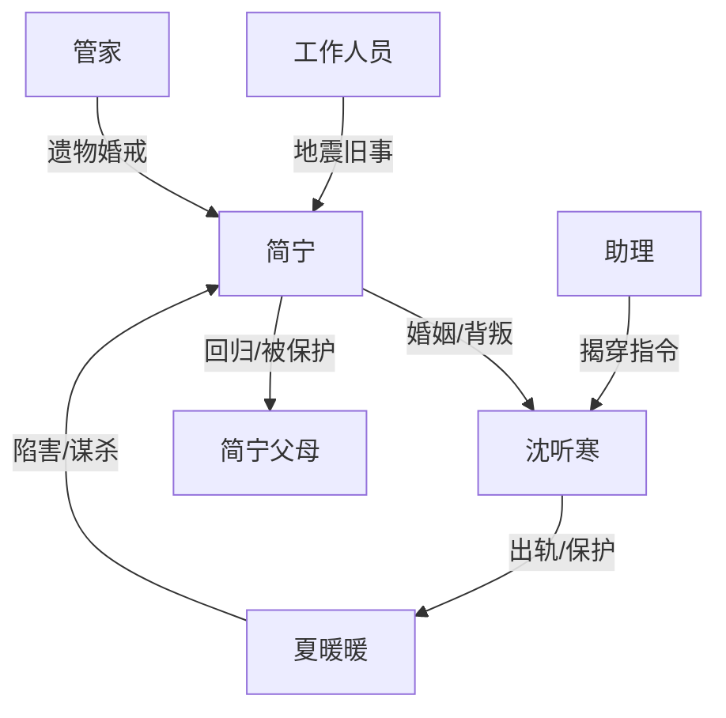

# 角色标签图谱

## 角色清单

### 简宁 — 清醒复仇型残疾大女主
- 叙事功能: 承受伤害、识破“玩笑”规则、完成离婚与精神切割。
- 核心标签: 克制、清醒、被背叛者
- 弧光: 相信浪子回头 → 被逼成疯子 → 清醒离婚 → 回家站起 → 往前看
- 台词风格: 冷静反问、短句审判
- 关键行为: 签离婚协议、上线证据、假死脱身、法庭离婚、捐掉婚戒
- 读者情绪关系: 心疼、代入、爽

### 沈听寒 — 花心浪子型迟悔施害者
- 叙事功能: 核心压迫源，也是温度反转承载者。
- 核心标签: 浪子、滥情、自欺
- 弧光: 雨中求娶 → 愚人节放纵 → 二次害命 → 失去后悔 → 赎罪死亡
- 台词风格: 先漫不经心，后哀求破碎
- 关键行为: 摘婚戒、失约、撕证据、重演车祸、公布证据、做交警赎罪
- 读者情绪关系: 恨、复杂、迟来的痛快

### 夏暖暖 — 孕期绿茶小三/外显恶
- 叙事功能: 推动女主受害升级，外化婚姻背叛。
- 核心标签: 挑衅、恶毒、装弱
- 弧光: 地下情人 → 怀孕上位 → 设计杀人 → 断腿入狱
- 台词风格: 装可怜与私下狠毒切换
- 关键行为: 骗女主上高速、炫耀朋友圈、拆安全设施、开车撞人
- 读者情绪关系: 恨、期待报应

### 简宁父母 — 原生保护力量
- 叙事功能: 承接女主回归，提供复健和身份资源。
- 核心标签: 心疼、清醒、家族后盾
- 弧光: 反对婚姻 → 失去女儿六年 → 接女儿回家
- 台词风格: 克制责备中带心疼
- 关键行为: 接女主回家、请医生、举办归家宴
- 读者情绪关系: 安慰、补偿

### 管家/助理/民政局工作人员 — 见证者群像
- 叙事功能: 提供旧事证词、推进真相、完成结尾物件交接。
- 核心标签: 旁观、见证、补叙
- 弧光: 从误劝到见证切割
- 台词风格: 功能性强
- 关键行为: 讲述地震旧爱、说出死亡消息、递交遗物
- 读者情绪关系: 信息补足、情绪推进

## 关系网络

## 角色功能对照表（供改编参考）

| 原角色 | 极致标签 | 叙事功能 | 读者情绪功能 | 改编时必须保留的 |
|--------|---------|---------|-------------|---------------|
| 简宁 | 清醒残疾大女主 | 受害与切割主体 | 心疼、爽 | 从“还爱”到“不认”的弧光 |
| 沈听寒 | 花心迟悔浪子 | 核心施害者 | 恨、迟来悔恨 | 曾经爱过 + 后来亲手毁掉 |
| 夏暖暖 | 孕期绿茶小三 | 外显恶与升级器 | 恨、报应期待 | 私下真恶与公开装弱 |
| 简家父母 | 家族后盾 | 补偿与资源回归 | 安慰 | 女主不是无处可去 |
| 管家/助理 | 见证者 | 信息补缝 | 可信度 | 关键真相由旁人确认 |
