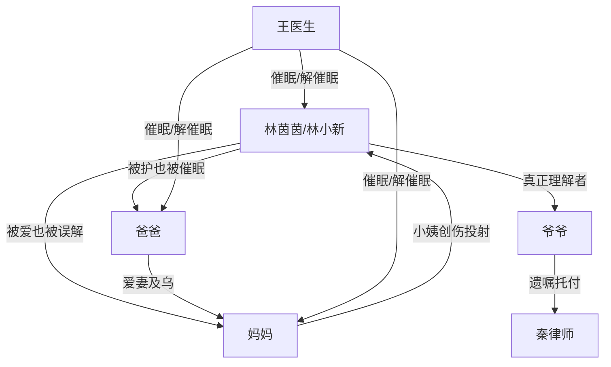

# 角色标签图谱

## 角色清单

### 林茵茵 / 林小新 — 被催眠的清醒自我
- 叙事功能: 主视角、谜题承载者、最终真相本身
- 核心标签: 高考状元、被压抑的男性自我、家庭创伤中心
- 弧光: 恐惧找弟弟 → 怀疑自己 → 找回记忆 → 被接纳成林小新
- 台词风格: 连续追问、急切自证、后期克制道歉
- 关键行为: 回老宅、打开密室、要求解开催眠、最终接受新身份
- 读者情绪关系: 前半心疼与紧张，后半替他获得补偿式爽感

### 爷爷 — 残酷表象下的守护者
- 叙事功能: Hook 发起者、遗嘱规则制定者、真相守门人
- 核心标签: 宠孙、逆转时空、理解者
- 弧光: 疑似索命反派 → 最后一次帮忙 → 祝福投胎
- 台词风格: 威胁式托梦与温柔称呼并存
- 关键行为: 留遗嘱、托梦、用阴德逆转时空、最后祝福小新
- 读者情绪关系: 从恐惧怀疑转为感动心疼

### 妈妈 — 创伤投射型母亲
- 叙事功能: 家庭反对力量与最终道歉者
- 核心标签: 小姨创伤、应激控制、母爱修复
- 弧光: 否认与改造 → 催眠逃避 → 承认错误 → 接纳孩子
- 台词风格: 前期暴躁、后期抽噎忏悔
- 关键行为: 发现秘密、试图送特殊学校、同意催眠、最终道歉
- 读者情绪关系: 前期憋屈与不满，后期复杂理解

### 爸爸 — 爱妻护女但逃避真相的人
- 叙事功能: 家庭压力放大器、阻拦真相者、最终接纳者
- 核心标签: 孝顺、爱妻、逃避
- 弧光: 怀疑私生子 → 崩溃自杀真相 → 绑女儿催眠 → 改口接纳
- 台词风格: 家庭口语、情绪重压下短句
- 关键行为: 调查弟弟、阻止主角看真相、绑主角、成人礼支持
- 读者情绪关系: 让读者愤怒又理解其创伤链条

### 秦律师 — 遗嘱执行人与密室引路人
- 叙事功能: 官方信息源、真相入口
- 核心标签: 见证者、守约者、怜悯旁观
- 弧光: 送来催命遗嘱 → 指向生日密码
- 台词风格: 稳定、克制、职业化
- 关键行为: 出示录像、等待来人、告知密码
- 读者情绪关系: 提供可信度与悬念推进

### 王医生 — 催眠真相执行者
- 叙事功能: 解释催眠机制、推动记忆恢复
- 核心标签: 专业者、伦理见证、真相旁白
- 弧光: 曾帮全家忘记 → 现在建议面对
- 台词风格: 冷静、提醒风险
- 关键行为: 说明不能二次催眠、唤醒主角
- 读者情绪关系: 稳定混乱局面，提供真相可信度

## 关系网络

## 角色功能对照表（供改编参考）

| 原角色 | 极致标签 | 叙事功能 | 读者情绪功能 | 改编时必须保留的 |
|--------|---------|---------|-------------|---------------|
| 林茵茵/林小新 | 被压抑的真实自我 | 谜题本体 | 心疼、补偿爽 | “要找的人其实是自己”的结构 |
| 爷爷 | 残酷守护者 | 规则制定者 | 误解后反转感动 | 表面逼迫、实则守护 |
| 妈妈 | 创伤母亲 | 阻力与忏悔 | 恨、心疼、释然 | 反对必须有创伤来源 |
| 爸爸 | 逃避型父亲 | 加重家庭压力 | 愤怒、理解 | 从阻拦到支持 |
| 秦律师 | 规则见证者 | 信息可信源 | 稳定悬念 | 第三方背书 |
| 王医生 | 记忆钥匙 | 解释催眠 | 真相落地 | 不能省略记忆机制解释 |
