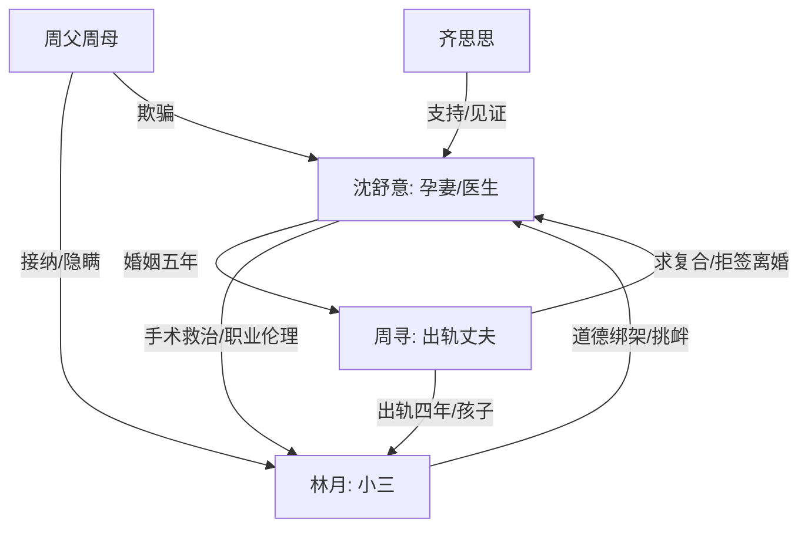

# 角色标签图谱

## 角色清单

### 沈舒意 — 清醒止损型女医生
- 叙事功能: 第一视角受害者、真相见证者、最终清算者。
- 核心标签: 孕妻、妇产科医生、清醒大女主。
- 弧光: 被手术台真相击碎 → 忍痛引产离婚 → 事业晋升自救。
- 台词风格: 前半克制，后半反问连击，结尾平静。
- 关键行为: 做完剖腹产、预约引产、搬离、拒绝复合、进修晋升。
- 读者情绪关系: 心疼、代入、爽。

### 周寻 — 伪深情出轨渣男
- 叙事功能: 主要施害者，制造背叛、羞辱和悔恨反噬。
- 核心标签: 出轨四年、双面丈夫、迟来悔恨。
- 弧光: 得意隐瞒 → 谎言暴露 → 崩溃求和 → 事业受阻。
- 台词风格: 责怪、PUA、逃避责任，后期哀求。
- 关键行为: 陪林月生产、拿走婴儿用品、换药、拒签离婚、求复合。
- 读者情绪关系: 恨、厌恶、想看报应。

### 林月 — 绿茶小三/自食恶果者
- 叙事功能: 第三者刺激源，推动女主认清婚姻，也承担后期反噬。
- 核心标签: 小三、装可怜、雌竞脑。
- 弧光: 被全家宠爱炫耀 → 道德绑架女主 → 与周寻内斗 → 失去子宫后道歉。
- 台词风格: 哭诉、示弱、挑拨。
- 关键行为: 发小号刺激舒意、塞孩子、下药怀孕、术后说“你赢了”。
- 读者情绪关系: 恨、烦、看报应。

### 齐思思 — 见证型闺蜜/医疗支撑
- 叙事功能: 陪伴者、医学真相确认者、读者情绪缓冲。
- 核心标签: 好友、同事、理性支援。
- 弧光: 震惊担忧 → 支持引产 → 见证舒意晋升。
- 台词风格: 简洁担忧。
- 关键行为: 扯掉口罩关心、确认激素药、术后陪护。
- 读者情绪关系: 安全感、支撑感。

### 周父周母 — 共谋家庭
- 叙事功能: 扩大背叛范围，让婚姻背叛升级为全家欺骗。
- 核心标签: 知情、偏心、伪和睦。
- 弧光: 在小三全家福里亮相 → 后期劝和无效。
- 台词风格: 间接呈现。
- 关键行为: 接纳林月和孩子，评论“一家和睦”。
- 读者情绪关系: 恶心、愤怒。

## 关系网络

## 角色功能对照表（供改编参考）

| 原角色 | 极致标签 | 叙事功能 | 读者情绪功能 | 改编时必须保留的 |
|--------|---------|---------|-------------|---------------|
| 沈舒意 | 清醒女医生 | 受害者兼清算者 | 心疼转爽 | 职业能力、自我救赎、拒绝复合 |
| 周寻 | 伪深情渣男 | 主施害者 | 恨与报应期待 | 双面温柔、出轨隐瞒、迟来悔恨 |
| 林月 | 绿茶小三 | 刺激源与反噬对象 | 厌恶与清算爽 | 装可怜、炫耀、雌竞失败 |
| 齐思思 | 支援闺蜜 | 信息确认与陪伴 | 安全感 | 医学或证据确认功能 |
| 周父周母 | 共谋家人 | 扩大背叛面 | 群体厌恶 | “全家都知道”的二次暴击 |
