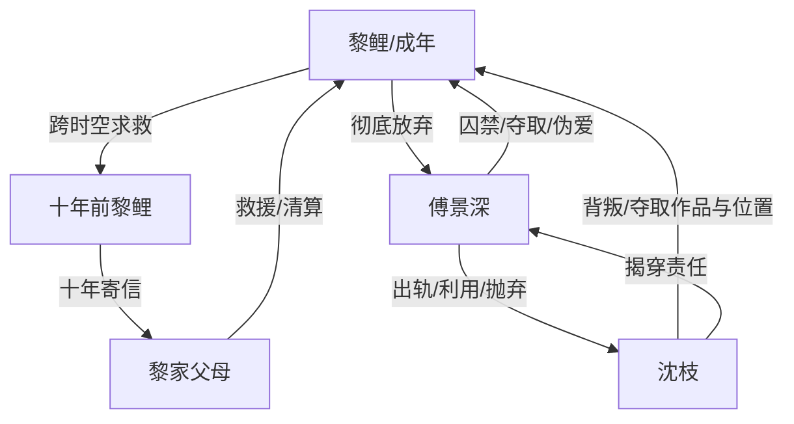

# 角色标签图谱

## 角色清单

### 黎鲤 — 囚禁原配/自救大女主
- 叙事功能: 承受情绪债、发起跨时空自救、完成价值观收束。
- 核心标签: 编剧、被夺取者、清醒自救
- 弧光: 为爱私奔的少女 → 被囚禁的妻子 → 被自己救出的自由创作者
- 台词风格: 前期崩溃质问，后期短句冷判。
- 关键行为: 回复十年前帖子、拖沈枝入水、丢弃剧本、拒绝傅景深。
- 读者情绪关系: 心疼、代入、后期强爽。

### 傅景深 — 伪深情疯批丈夫
- 叙事功能: 最大压迫源；制造温度反转和悔恨火葬场。
- 核心标签: 占有欲、双标、迟来悔恨
- 弧光: 舍命少年 → 出轨囚禁者 → 失去两个时空黎鲤的囚犯
- 台词风格: 控制式温柔、威胁式安抚、后期乞求。
- 关键行为: 囚禁黎鲤、救沈枝弃黎鲤、夺作品补偿沈枝、求复合自残。
- 读者情绪关系: 恨、恶心、看其崩塌的爽。

### 沈枝 — 心机受益者/背叛型小三
- 叙事功能: 第三者触发器，夺取作品、孩子位置与婚姻名分。
- 核心标签: 野心、算计、忘恩
- 弧光: 大山走出的新人 → 被扶持女主角 → 反噬恩人的诱捕者 → 被傅景深抛弃
- 台词风格: 前期柔弱，后期挑衅，临败时揭穿傅景深。
- 关键行为: 寄亲密照、跳河博同情、假意帮逃、告密诱捕。
- 读者情绪关系: 恨，但后期成为揭穿男主罪责的工具人。

### 十年前的黎鲤 — 少女自救者
- 叙事功能: 时空救援的执行者，主题“我救我自己”的实体化。
- 核心标签: 清醒、行动力、未被污染的自我
- 弧光: 心动少女 → 警觉求证 → 远离傅景深 → 连续十年寄信
- 台词风格: 简洁、理性、行动导向。
- 关键行为: 要证据、远离少年傅景深、寄出十封求救信。
- 读者情绪关系: 安心、敬佩、补偿感。

### 黎家父母/部下 — 迟到但有效的保护系统
- 叙事功能: 提供身份反差和现实清算能力。
- 核心标签: 军官家庭、愧疚、守护
- 弧光: 严厉父母 → 失女寻找者 → 康复陪伴者
- 台词风格: 克制、愧疚、亲情补偿。
- 关键行为: 救出黎鲤、陪伴治疗、打击傅景深公司。
- 读者情绪关系: 安慰、补偿、现实安全感。

## 关系网络

## 角色功能对照表（供改编参考）

| 原角色 | 极致标签 | 叙事功能 | 读者情绪功能 | 改编时必须保留的 |
|--------|---------|---------|-------------|---------------|
| 黎鲤 | 囚禁原配/自救大女主 | 承债与自救 | 心疼→爽 | 她最终救自己，不靠新男主 |
| 傅景深 | 伪深情疯批 | 压迫与悔恨 | 恨→看崩塌 | 曾经真爱+后来施虐并存 |
| 沈枝 | 心机小三 | 诱发背叛和二次坠落 | 恨 | 假救援真诱捕 |
| 十年前黎鲤 | 少女自救者 | 反转执行 | 安心、补偿 | 远离男主并持续寄信 |
| 黎家 | 保护系统 | 身份反差与清算 | 安全感 | 后段出场、能力足够反压 |
