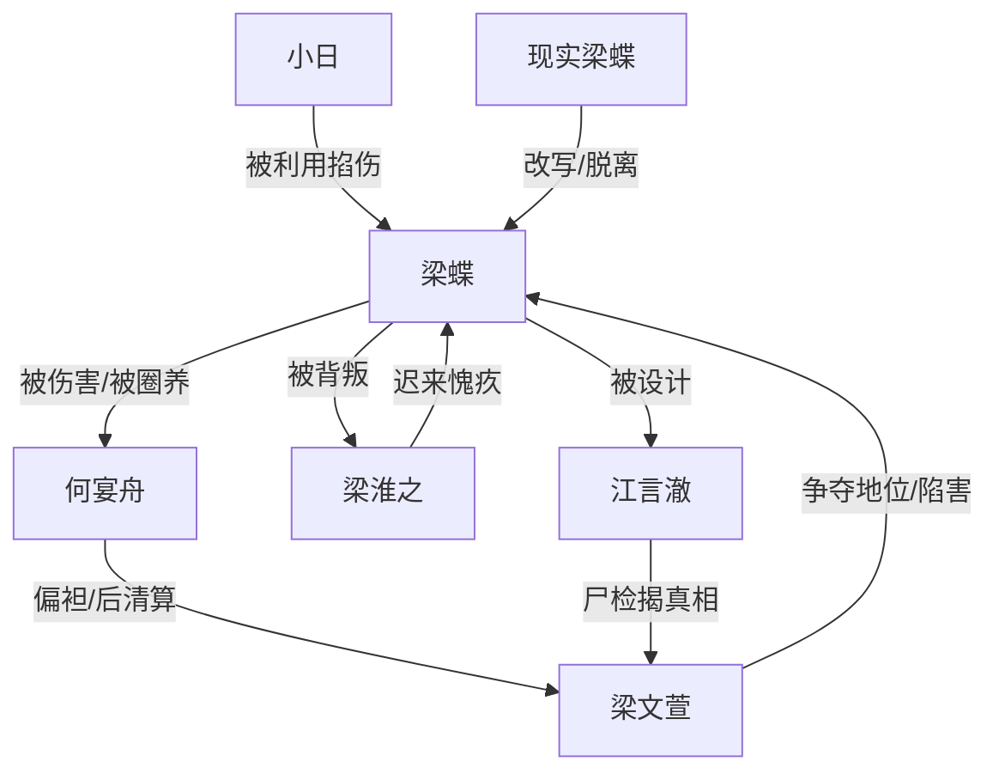

# 角色标签图谱

## 角色清单

### 梁蝶 — 麻木虐文女主 / 被创造的痛苦容器
- 叙事功能: 承载全部情绪债，以死亡触发后半清算。
- 核心标签: 创伤麻木、顺从求死、真实人性。
- 弧光: 被圈养折磨的“女主角” → 死亡解脱 → 现实中会饿会馋的人。
- 台词风格: 道歉式、请求式、规训复述式。
- 关键行为: 说出第四胎、问“不会伤害我了吗”、死在杂物间。
- 读者情绪关系: 极致心疼、代偿性愤怒。

### 何宴舟 — 伪深情施害者 / 规矩制定者
- 叙事功能: 最大亲密背叛者，负责制造“爱与伤害”的反差。
- 核心标签: 自私、控制、迟来悔恨。
- 弧光: 以爱之名圈养梁蝶 → 再次下令惩罚 → 自残自焚。
- 台词风格: 先温柔规训，后冷淡审判，最后崩溃追问。
- 关键行为: 骗穿越、关杂物间、把文萱送入同款牢笼、自焚。
- 读者情绪关系: 恨、恶心、看其崩塌的爽。

### 梁文萱 — 假千金绿茶 / 镜像受罚对象
- 叙事功能: 明面反派，推动最直接的陷害与暴力。
- 核心标签: 恶毒、伪善、鸠占鹊巢。
- 弧光: 稳坐赢家位置 → 自导自演害死梁蝶 → 被送进伪穿越成为瞎眼瘸腿奴婢。
- 台词风格: 表面柔软，实则威胁、甩锅。
- 关键行为: 指使小日掐人、摔孩子嫁祸、被按府规惩罚。
- 读者情绪关系: 强恨点，承担主要爽点清算。

### 梁淮之 — 背叛亲弟 / 迟来愧疚者
- 叙事功能: 放大家庭背叛痛感，提供“亲人不救”的二次伤害。
- 核心标签: 软弱、共谋、崩溃。
- 弧光: 戴面具当管家参与骗局 → 短暂心疼却袖手旁观 → 撞死墓碑。
- 台词风格: 姐弟温情残影与自责并存。
- 关键行为: 揭下面具、推轮椅安慰、在墓碑前自杀。
- 读者情绪关系: 恨其软弱，爽其自毁。

### 江言澈 — 青梅医生 / 理性骗局设计者
- 叙事功能: 代表“专业能力被用于伤害”，也是尸检真相揭露者。
- 核心标签: 冷酷、偏执、医生身份反讽。
- 弧光: 参与设计伪穿越 → 抢救尸体失败 → 解剖自己试图救人。
- 台词风格: 前期冷静，后期偏执命令式。
- 关键行为: 承认布局、检查梁蝶、尸检揭真相、自体试验自杀。
- 读者情绪关系: 先恨，后看其精神崩塌。

### 小日 — 工具化孩子 / 陷害道具
- 叙事功能: 被梁文萱操控的陷害载体。
- 核心标签: 无知、被利用、证据源。
- 弧光: 掐伤梁蝶 → 摔倒哭闹 → DNA 证据揭示真相。
- 台词风格: 甜腻喊“姨姨”。
- 关键行为: 掐梁蝶手臂。
- 读者情绪关系: 不主要被恨，更多厌恶其母操控。

### 现实梁蝶 — 元叙事受益者 / 真正的人
- 叙事功能: 终结虐文逻辑，证明“幸福人生”是脱离剧情操控。
- 核心标签: 普通社畜、会饿会馋、被拯救。
- 弧光: 读完 AI 虐文 → 获得奖励 → 忘记网页去吃粉。
- 台词风格: 日常、轻松、口语。
- 关键行为: 点螺蛳粉加炸蛋。
- 读者情绪关系: 释然、补偿、余味。

## 关系网络

## 角色功能对照表（供改编参考）

| 原角色 | 极致标签 | 叙事功能 | 读者情绪功能 | 改编时必须保留的 |
|--------|---------|---------|-------------|---------------|
| 梁蝶 | 麻木创伤女主 | 承债与死亡触发 | 心疼、愤怒 | 麻木复述规矩、死亡解脱、现实补偿 |
| 何宴舟 | 伪深情施害者 | 爱与伤害反差 | 恨、爽 | “不伤害”承诺被自己打破 |
| 梁文萱 | 恶毒假千金 | 陷害与镜像受罚 | 主要恨点 | 自导自演后进入同款惩罚 |
| 梁淮之 | 背叛亲弟 | 家庭背叛 | 心痛、愤怒 | 本可救却袖手旁观 |
| 江言澈 | 偏执医生 | 专业背叛与尸检 | 恨、惊悚 | 医生身份参与伤害又无法救回 |
| 现实梁蝶 | 活生生的人 | 主题补偿 | 释然 | 普通生活细节落点 |
