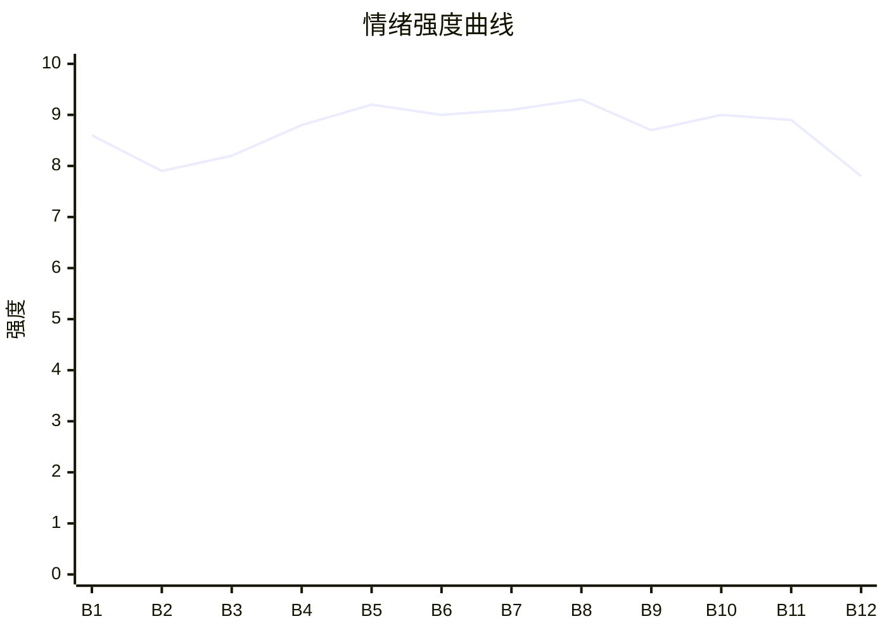

# Beat Sheet 节拍器

## 全文概况

- 总字数: 约 13200 字
- 节拍数: 12 幕
- 核心母题（Logline）: 天生异象的嗜睡神女温月，被宣扬科学和平等的穿越女沈知意当众羞辱；沈知意越是否认神迹，越被神迹与皇帝护短双重碾压，最终败于自己的傲慢。
- 情绪模式: 违和开局 → 极致羞辱 → 神迹警告 → 当众审判 → 皇帝护短 → 诛心挑拨 → 天灾失控 → 逼跪清算 → 轻爽回收

## 节拍详表

### Beat 1: 科学女踹门，神女一哭地动 [开篇-序章末]
- **字数**: 约 620 字（占比 4.7%）
- **核心事件**: 沈知意闯入摘星阁，扇温月耳光，温月落泪后地动。
- **情绪标签**: 震惊、违和、委屈
- **情绪强度**: 8.6/10
- **情绪方向**: ⚡突变
- **冲突类型**: 大转折
- **悬念钩子**: 她到底是真神女，还是巧合？
- **叙事速度**: 快
- **对话占比**: 42%
- **reversal_mechanism**: [M7]
- **hook_strength**: 8.8/10
- **关键句**: “下一秒，脚下的土地开始剧烈摇晃。”
- **原文摘录**: “我天生嗜睡。皇帝在宫内为我建造摘星阁，不许任何人靠近……‘装神弄鬼，这世界上根本就没有神！你们就是不懂科学！’……女子气势汹汹的走到我面前，一巴掌扇向我……我摸着红肿的脸，嘴一瘪，两串泪珠落下来。下一秒，脚下的土地开始剧烈摇晃。”

### Beat 2: 沈知意设定落地，科学话术压神女 [1-摘星阁冲突]
- **字数**: 约 1100 字（占比 8.3%）
- **核心事件**: 交代沈知意穿越女身份，她把神迹解释为自然现象并继续辱骂。
- **情绪标签**: 憋屈、愤怒、荒唐
- **情绪强度**: 7.9/10
- **情绪方向**: ↑上升
- **冲突类型**: 微冲突
- **悬念钩子**: 她继续刺激温月，会引发多大灾祸？
- **叙事速度**: 中
- **对话占比**: 48%
- **reversal_mechanism**: [M7, M3]
- **hook_strength**: null
- **关键句**: “她说，她要亲手拆穿我。”
- **原文摘录**: “她说自己来自千年后，懂科学，懂制度，懂文明……说我这个住在摘星阁里、什么都不做却锦衣玉食的神女，更是封建糟粕里的糟粕……‘不过是地震而已……这是正常的地壳运动，和她有什么关系！’”

### Beat 3: 强拖出阁，特权话术变成暴力 [摘星阁-御道]
- **字数**: 约 1050 字（占比 8.0%）
- **核心事件**: 沈知意强行拖温月离开摘星阁，宣讲“人格独立”“公众检验”。
- **情绪标签**: 心疼、厌恶、紧张
- **情绪强度**: 8.2/10
- **情绪方向**: ↑上升
- **冲突类型**: 微冲突
- **悬念钩子**: 神女离开安全区会怎样？
- **叙事速度**: 快
- **对话占比**: 44%
- **reversal_mechanism**: [M3]
- **hook_strength**: null
- **关键句**: “可她嘴里的道理，永远只对别人讲。”
- **原文摘录**: “她死死攥着我的手腕，指甲都掐进了我肉里……‘这世上没有神，只有装神弄鬼的人！’……‘既然享了这么多供奉，就该接受公众检验。’”

### Beat 4: 前朝公开审判，百官围观沉默 [御道-金殿]
- **字数**: 约 1350 字（占比 10.2%）
- **核心事件**: 沈知意把温月拖到百官面前，捏下巴、拍脸、用火器威胁众人。
- **情绪标签**: 羞辱、窒息、愤怒
- **情绪强度**: 8.8/10
- **情绪方向**: ↑上升
- **冲突类型**: 大转折
- **悬念钩子**: 没人敢救温月，谁来打破局面？
- **叙事速度**: 中快
- **对话占比**: 46%
- **reversal_mechanism**: [M6, M3]
- **hook_strength**: null
- **关键句**: “她不过是皇帝用来稳固人心的一块牌坊。”
- **原文摘录**: “她当着文武百官的面，伸手捏住我的下巴……‘她哪里像神？’……沈知意却直接从袖中掏出一件东西……‘这是我做的火器，威力比你们的刀剑强百倍。’”

### Beat 5: 金殿羞辱到极点，温月被骂寄生虫 [金殿审判]
- **字数**: 约 1550 字（占比 11.7%）
- **核心事件**: 沈知意坐上审判位，逼温月解释“骗局”，将她骂成寄生虫和废物。
- **情绪标签**: 极致憋屈、心疼、压迫
- **情绪强度**: 9.2/10
- **情绪方向**: ↑上升
- **冲突类型**: 大转折
- **悬念钩子**: 温月会不会哭到失控？
- **叙事速度**: 中
- **对话占比**: 50%
- **reversal_mechanism**: [M6, M3]
- **hook_strength**: null
- **关键句**: “寄生虫。这三个字砸下来，我整个人都懵了。”
- **原文摘录**: “‘她不是神。她只是既得利益者。是靠着你们的恐惧活着的寄生虫！’……她不耐烦了，抬脚踢在我肩上……‘她就是被你们供出来的一个骗子！’”

### Beat 6: 皇帝回宫，护短第一层清算 [皇帝入殿]
- **字数**: 约 1250 字（占比 9.5%）
- **核心事件**: 皇帝看见温月受辱，当众掌掴沈知意，下令押入天牢。
- **情绪标签**: 爽、解气、紧绷
- **情绪强度**: 9.0/10
- **情绪方向**: ⚡突变
- **冲突类型**: 大转折
- **悬念钩子**: 沈知意还有“未来技术”筹码，皇帝会不会让步？
- **叙事速度**: 快
- **对话占比**: 45%
- **reversal_mechanism**: [M5, M6]
- **hook_strength**: null
- **关键句**: “朕捧在手心里连一句重话都舍不得说的人，你也敢碰。”
- **原文摘录**: “皇帝抬眼看见殿中这一幕……只一瞬。皇帝的脸色，骤然阴沉到了极点……‘啪！’一记耳光，狠狠甩在她脸上……‘先掌嘴五十，再押入天牢。’”

### Beat 7: 旁观群臣动摇，温月开始怀疑被爱理由 [殿中二次危机]
- **字数**: 约 1300 字（占比 9.8%）
- **核心事件**: 温月问群臣是否不信她，沈知意趁机挑拨她与皇帝的关系。
- **情绪标签**: 不安、诛心、心痛
- **情绪强度**: 9.1/10
- **情绪方向**: ↑上升
- **冲突类型**: 大转折
- **悬念钩子**: 温月若信了挑拨，天灾会失控到什么程度？
- **叙事速度**: 中
- **对话占比**: 43%
- **reversal_mechanism**: [M5, M6]
- **hook_strength**: null
- **关键句**: “我到底是因为‘我’才被珍重。还是因为‘神女’这个身份，才被珍重。”
- **原文摘录**: “‘哥哥，他们是不是都不信我？’……沈知意突然笑了起来……‘若有一日她没用了，第一个抛弃她的就是皇帝。’……‘如果我不是神女，你还会要我吗？’”

### Beat 8: 情感确认，沈知意揭出禁忌情愫，温月昏倒 [皇帝告白-皇城震颤]
- **字数**: 约 900 字（占比 6.8%）
- **核心事件**: 皇帝确认温月不是因神女身份被爱，沈知意转而攻击二人关系，温月受刺激昏倒。
- **情绪标签**: 甜痛、震惊、失控
- **情绪强度**: 9.3/10
- **情绪方向**: ⚡突变
- **冲突类型**: 大转折
- **悬念钩子**: 温月昏迷后，灾祸会不会吞掉皇城？
- **叙事速度**: 快
- **对话占比**: 48%
- **reversal_mechanism**: [M5, M6]
- **hook_strength**: null
- **关键句**: “你不是因为是神女，才被朕护着。是因为你是温月。”
- **原文摘录**: “‘阿月，就算你什么都不是，朕也会要你。’……沈知意放声大笑：‘堂堂帝王，竟对一个神女人伦不清……’……我眼前忽然一黑……整座皇城，都在这一刻剧烈震颤起来。”

### Beat 9: 昏迷天灾，外部舆论反噬 [摘星阁]
- **字数**: 约 1150 字（占比 8.7%）
- **核心事件**: 温月昏迷引发更大异象，沈知意追随者在宫外借题闹事。
- **情绪标签**: 危机、压抑、期待清算
- **情绪强度**: 8.7/10
- **情绪方向**: →高位维持
- **冲突类型**: 微冲突
- **悬念钩子**: 皇帝会如何让温月“消气”？
- **叙事速度**: 中
- **对话占比**: 35%
- **reversal_mechanism**: [M6, M7]
- **hook_strength**: null
- **关键句**: “只有她自己不难过了，这场天灾才会停。”
- **原文摘录**: “太医跪了满地……‘神女是惊惧过度，心神受损。’……‘宫外已经有她的追随者在闹了。’……‘他们好吵。都在看我，都在说我……’”

### Beat 10: 皇帝押沈知意赔罪，疯批护短升级 [摘星阁外-内殿]
- **字数**: 约 1150 字（占比 8.7%）
- **核心事件**: 皇帝给沈知意两个选择：跪下赔罪，或杀她与党羽。
- **情绪标签**: 爽、压迫反转、惊惧
- **情绪强度**: 9.0/10
- **情绪方向**: ↑上升
- **冲突类型**: 大转折
- **悬念钩子**: 沈知意会不会真的跪？
- **叙事速度**: 快
- **对话占比**: 42%
- **reversal_mechanism**: [M5, M6]
- **hook_strength**: null
- **关键句**: “在朕眼里，你们所有人加起来，都比不过她一根头发。”
- **原文摘录**: “‘沈知意，朕给你两个选择。第一，跪下给她赔罪……第二，朕杀了你，再诛你所有党羽。’……‘那你也该知道，在朕眼里，你们所有人加起来，都比不过她一根头发。’”

### Beat 11: 温月用平等反问，击穿沈知意伪善 [赔罪对峙]
- **字数**: 约 1250 字（占比 9.5%）
- **核心事件**: 沈知意被迫下跪，仍不服；温月反问“你们那里也能随便打骂人吗”，皇帝点破她用科学和平等压人。
- **情绪标签**: 反讽、清算、痛快
- **情绪强度**: 8.9/10
- **情绪方向**: ↓释放
- **冲突类型**: 大转折
- **悬念钩子**: 沈知意最终如何被处置？
- **叙事速度**: 中
- **对话占比**: 56%
- **reversal_mechanism**: [M3, M6]
- **hook_strength**: null
- **关键句**: “你嘴里的科学和平等，也不过是你压人的刀。”
- **原文摘录**: “‘那你们那里的人，若是不喜欢谁，也可以随便打她，骂她，拖着她走吗？’……皇帝冷眼看着她：‘你口口声声说众生平等，原来也不过如此。’……‘你嘴里的科学和平等，也不过是你压人的刀。’”

### Beat 12: 神女归位，天意金句收束 [结尾]
- **字数**: 约 980 字（占比 7.4%）
- **核心事件**: 沈知意消失，温月仍被天下供奉；大旱祈雨后用“别惹我”轻爽收尾。
- **情绪标签**: 安心、轻爽、余韵
- **情绪强度**: 7.8/10
- **情绪方向**: ↓平稳
- **冲突类型**: 无/收束
- **悬念钩子**: 无，完成情绪兑现
- **叙事速度**: 慢
- **对话占比**: 32%
- **reversal_mechanism**: [M3, M7]
- **hook_strength**: null
- **关键句**: “天意说，别惹我。”
- **原文摘录**: “神庙照旧香火不断……后来有一年大旱，百官跪在摘星阁外求我祈雨……‘看天意。’……‘那天意说了什么？’……‘天意说，别惹我。’……这一回，再没人敢来吵我了。”

## 情绪曲线可视化

## 节拍密度检测

- 平均每 1100 字一个节拍
- 微冲突密度: 每 1800 字一次
- 大转折密度: 每 1400 字一次
- 判定: 符合高频节拍器标准

## 反转机制清单(Reversal Mechanisms)

| 机制 ID | 机制名 | 承载 Beat | 关键段落/金句 | 等价改编提示 |
|--------|--------|-----------|--------------|-------------|
| M7 | 降维打击 | Beat 1, 2, 9, 12 | “随着我掉泪……整片天，都像被惊动了。” | 必须保留两套规则：理性解释规则 vs 超自然真实规则；反派用旧规则攻击，最终旧规则失效。 |
| M6 | 多层递进反转 | Beat 4-11 | 公开审判 → 皇帝护短 → 情感诛心 → 押跪清算 | 反转层数不能少，需从公共羞辱升到权力、情感、价值观清算。 |
| M3 | 因果回旋反讽 | Beat 2, 3, 11, 12 | “你嘴里的科学和平等，也不过是你压人的刀。” | 必须让反派的正义话术在结尾被原结构反打。 |
| M5 | 温度反转曲线 | Beat 6-10 | “你不是因为是神女，才被朕护着。是因为你是温月。” | 必须显式写出被珍爱的具体场景，清算不是只为神女身份，而是为“她本人”。 |
