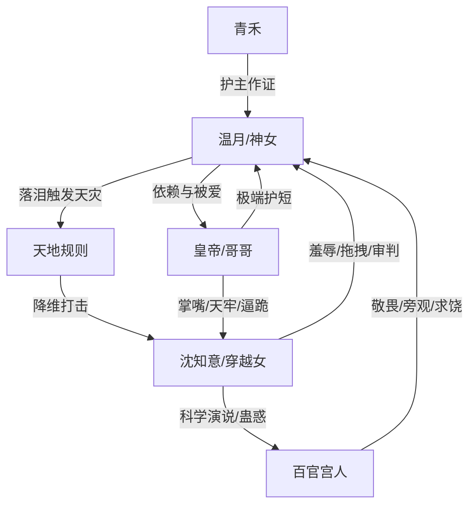

# 角色标签图谱

## 角色清单

### 温月 — 嗜睡软萌神女 / 被世界偏爱的天意本身
- 叙事功能: 被压迫中心、神迹规则载体、读者心疼对象与最终爽点来源。
- 核心标签: 嗜睡、怕吵、委屈即天灾
- 弧光: 被闯入惊醒 → 被拖拽审判 → 怀疑自身价值 → 被确认珍爱 → 重新归位
- 台词风格: 短、软、直接，如“我疼”“你打我”“别惹我”
- 关键行为: 落泪、发问、祈雨、用天意金句收束
- 读者情绪关系: 心疼、保护欲、轻爽代入

### 沈知意 — 现代傲慢穿越女 / 伪平等施暴者
- 叙事功能: 压迫者、价值观对立面、打脸承载体。
- 核心标签: 科学优越、道德绑架、暴力拆神
- 弧光: 高举科学闯阁 → 当众审判神女 → 被神迹动摇 → 被迫下跪 → 败于傲慢
- 台词风格: 演说式、逼问式、现代概念密集
- 关键行为: 扇耳光、拖拽、骂寄生虫、挑拨皇帝与温月、拒不认错
- 读者情绪关系: 恨、厌恶、期待她被打脸

### 皇帝 / 哥哥 — 疯批护短帝王 / 温月唯一情感锚
- 叙事功能: 情感偿还者、权力清算者、温月价值确认者。
- 核心标签: 护短、疯批、把温月置于江山之上
- 弧光: 回宫震怒 → 掌掴关押 → 表白确认 → 逼反派下跪 → 长期守护
- 台词风格: 冷短命令 + 哄孩子式温柔
- 关键行为: 掌嘴、押天牢、抱住温月、逼沈知意赔罪
- 读者情绪关系: 爽、安心、甜感

### 青禾 — 忠心宫女 / 受害见证者
- 叙事功能: 证明温月被欺负、传递宫人恐惧与忠心。
- 核心标签: 忠心、焦急、护主
- 弧光: 拦不住沈知意 → 哭诉皇帝 → 陪温月恢复
- 台词风格: 哭求、急切
- 关键行为: 求沈知意停手、向皇帝告状、解释赔罪
- 读者情绪关系: 增加心疼与真实感

### 百官 / 宫人 — 群体风向标
- 叙事功能: 放大公开羞辱，体现“供奉但未必真信”的现实冷酷。
- 核心标签: 敬畏、迟疑、趋利避害
- 弧光: 惊惧跪拜 → 金殿旁观 → 地动后求饶 → 恢复恭敬
- 台词风格: 惊呼、请罪、求神女息怒
- 关键行为: 旁观、下跪、求饶、祈雨
- 读者情绪关系: 轻微厌恶，衬托温月孤独

## 关系网络

## 角色功能对照表（供改编参考）

| 原角色 | 极致标签 | 叙事功能 | 读者情绪功能 | 改编时必须保留的 |
|--------|---------|---------|-------------|---------------|
| 温月 | 嗜睡神女 | 规则核心、受害中心 | 心疼+爽 | 软弱姿态、委屈触发灾异、怕吵 |
| 沈知意 | 傲慢穿越女 | 施压与伪善价值观 | 恨、等打脸 | 正义话术包裹暴力 |
| 皇帝 | 疯批护短帝王 | 情感与权力偿还 | 爽、甜、安心 | “她本人比规则重要”的确认 |
| 青禾 | 忠仆 | 受害证词 | 辅助心疼 | 哭求、告状、护主 |
| 百官宫人 | 群体风向 | 放大公开羞辱 | 厌恶与压迫感 | 旁观迟疑后跪地求饶 |
