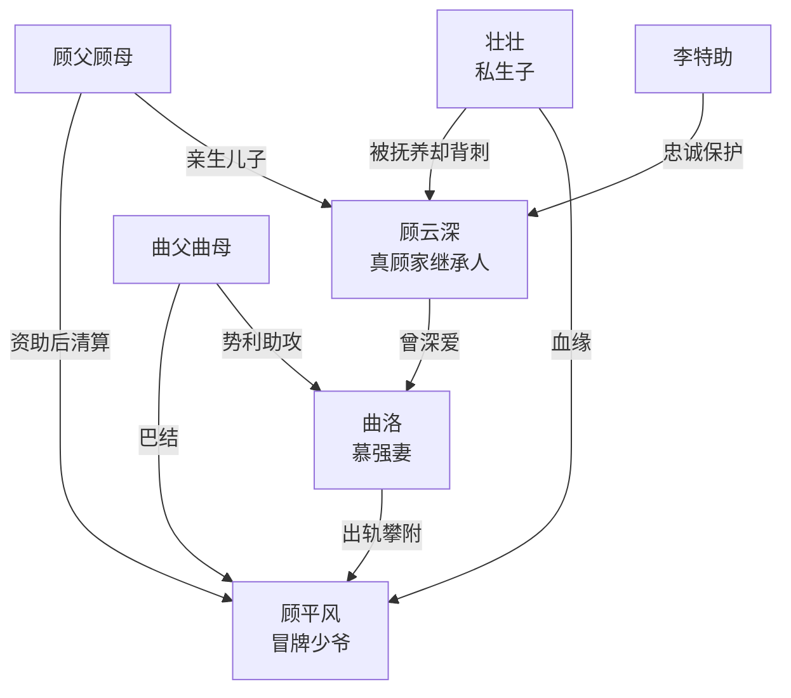

# 角色标签图谱

## 角色清单

### 顾云深 — 隐藏豪门继承人/清醒断舍离男主
- 叙事功能: 被压迫者、真身份承载者、最终清算者。
- 核心标签: 隐忍、重情、冷醒
- 弧光: 为爱离家隐瞒身份 → 被全员背叛 → 回归家族并切割旧爱
- 台词风格: 短句、克制、关键处冷判
- 关键行为: 封高速、跟踪游轮、救李特助、当众清算、拒绝复合
- 读者情绪关系: 前半心疼，后半爽和释然

### 曲洛 — 慕强出轨妻/算计型伪悔恨者
- 叙事功能: 核心背叛者，制造情绪债。
- 核心标签: 慕强、甩锅、冷血
- 弧光: 嫌弃丈夫 → 攀附假少爷 → 真相揭开后求复合 → 挡刀死亡
- 台词风格: 前期理直气壮，后期撒娇甩锅
- 关键行为: 高速弃夫、偷签离婚、掰断手指、复合归咎男主
- 读者情绪关系: 恨、恶心、拒绝怜悯

### 顾平风 — 冒牌少爷/贫困生反噬者
- 叙事功能: 假身份靶子，承载身份反转打脸。
- 核心标签: 冒名、贪婪、残暴
- 弧光: 假少爷作威作福 → 被真顾家揭穿 → 持刀行凶 → 死刑
- 台词风格: 侮辱性强，喜欢以“顾家”压人
- 关键行为: 冒充继承人、设订婚宴、殴打男主、持刀杀人
- 读者情绪关系: 恨，期待被当众揭穿

### 壮壮 — 白眼狼儿子/血缘反转道具
- 叙事功能: 补足血缘背叛和亲情债。
- 核心标签: 势利、无情、私生子
- 弧光: 被男主养大 → 当众踹手叫新爸爸 → 认祖幻想破灭
- 台词风格: 模仿母亲，幼稚但残忍
- 关键行为: 船舷踹手、否认顾云深身份
- 读者情绪关系: 心寒、厌恶

### 曲父曲母 — 势利岳家/帮凶
- 叙事功能: 家庭伦理压迫群像，放大男主多年付出被践踏。
- 核心标签: 贪婪、势利、翻脸快
- 弧光: 羞辱女婿 → 巴结假少爷 → 得知真相后互咬
- 台词风格: 市侩、泼辣、羞辱性
- 关键行为: 拿离婚证、看男主遇险、试图攀亲家
- 读者情绪关系: 厌恶，期待报应

### 李特助 — 忠诚见证者/救命锚点
- 叙事功能: 证明男主身份，承载善意回报。
- 核心标签: 忠诚、机警、护主
- 弧光: 接男主 → 为救男主重伤 → 定位报警救全局
- 台词风格: 直白护主，带轻喜剧感
- 关键行为: 跟车、挡球棍、定位报警、术后吐槽
- 读者情绪关系: 信任、心疼、轻松补偿

### 顾父顾母 — 高维权力/最终裁判
- 叙事功能: 身份揭穿和清算执行者。
- 核心标签: 豪门权力、清醒、护短
- 弧光: 曾反对婚姻 → 关键时刻救子 → 交付公司
- 台词风格: 冷、准、压迫感强
- 关键行为: 直升机登船、揭穿顾平风、清算曲家
- 读者情绪关系: 爽，安全感

## 关系网络

## 角色功能对照表（供改编参考）

| 原角色 | 极致标签 | 叙事功能 | 读者情绪功能 | 改编时必须保留的 |
|--------|---------|---------|-------------|---------------|
| 顾云深 | 隐藏真少爷 | 被辱后翻盘 | 心疼转爽 | 隐瞒身份、先爱后断 |
| 曲洛 | 慕强出轨妻 | 核心背叛 | 恨与厌恶 | 亲手伤害男主 |
| 顾平风 | 冒牌权贵 | 身份打脸靶 | 爽点对象 | 冒名压人 |
| 壮壮 | 白眼狼孩子 | 血缘刀 | 心寒 | 被养大却补刀 |
| 曲父曲母 | 势利帮凶 | 群体羞辱 | 憋屈债 | 见风使舵 |
| 李特助 | 忠诚助力 | 证据与救援 | 安全感 | 为主角受伤 |
| 顾父顾母 | 高维裁判 | 降维清算 | 爽 | 当众揭穿假货 |
