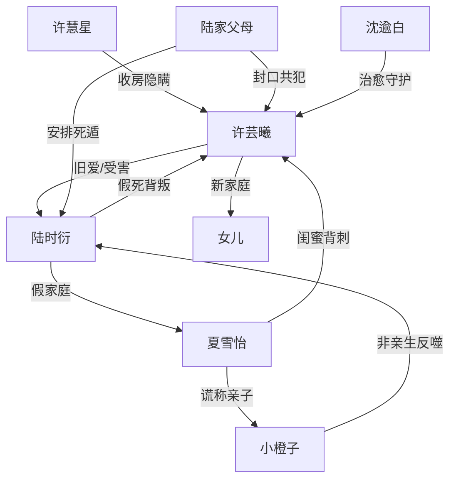

# 角色标签图谱

## 角色清单

### 许芸曦 — 清醒断爱大女主
- 叙事功能: 被背叛者、情绪债承载者、最终审判者。
- 核心标签: 守坟六年、冷静切割、重获新生。
- 弧光: 为旧爱守活寡 → 发现群体背叛 → 焚毁信物远走 → 接受健康亲密关系 → 对旧人彻底无感。
- 台词风格: 短句、冷句、少解释。
- 关键行为: 查群聊、飞广州、焚手串、注销旧身份、拒绝陆时衍、回国不回头。
- 读者情绪关系: 心疼、代入、爽。

### 陆时衍 — 死遁渣男/追妻火葬场男主
- 叙事功能: 主施害者、悔恨承受者、旧爱坐标崩塌体。
- 核心标签: 假死、逃避、迟来的悔恨。
- 弧光: 用假死逃离女主 → 享受体面家庭 → 被焚串击穿 → 经历假失去与非亲子打击 → 跪求无果 → 余生困在旧宅与病痛。
- 台词风格: 前期推责安抚，后期急促哀求。
- 关键行为: 死遁、与夏雪怡组建家庭、拿补偿封口、伸手捞灰、追到芬兰。
- 读者情绪关系: 恨、鄙夷、后期痛快看他悔。

### 许慧星 — 收钱背刺亲姐
- 叙事功能: 亲情背叛放大器。
- 核心标签: 共犯、为你好、贪婪。
- 弧光: 陪妹妹扫墓装悲伤 → 被拆穿收房 → 赶到包厢劝拿钱 → 追讨封口费 → 房产冻结入狱。
- 台词风格: 先心虚，后理直气壮。
- 关键行为: 隐瞒四年、收房、劝签协议、索要尾款。
- 读者情绪关系: 强恨点，负责制造“家人也背叛我”的痛感。

### 夏雪怡 — 白莲闺蜜/婚姻欺诈者
- 叙事功能: 情感背叛与假家庭泡沫的具象化。
- 核心标签: 伪善、表演、欺诈。
- 弧光: 闺蜜出国哭别 → 成为陆太太 → 用孩子挡刀 → 被亲子鉴定击穿 → 入狱。
- 台词风格: 柔弱、道歉式攻击、孩子绑架。
- 关键行为: 打翻热汤、拿孩子卖惨、伪造 B 超、婚姻欺诈。
- 读者情绪关系: 厌恶、期待被揭穿。

### 沈逾白 — 治愈系新欢/健康亲密关系
- 叙事功能: 价值补偿者，证明女主值得被正常爱。
- 核心标签: 稳、日常照顾、边界感。
- 弧光: 房东医生 → 生活陪伴者 → 恋人 → 丈夫与孩子父亲。
- 台词风格: 平和、直给、少追问。
- 关键行为: 治病、送早饭、铲雪、求婚、在陆时衍面前护住女主。
- 读者情绪关系: 安心、补偿、甜。

### 陆家父母 — 体面共犯
- 叙事功能: 社会性封口与利益压迫者。
- 核心标签: 公事公办、封口、体面。
- 弧光: 隐瞒死遁 → 五百万封口 → 保护假家庭 → 被丑闻反噬。
- 台词风格: 客气但冷酷。
- 关键行为: 推支票、签协议、安排死遁手续。
- 读者情绪关系: 讨厌，强化阶层压迫感。

### 小橙子/女儿 — 对照性孩子意象
- 叙事功能: 小橙子被用作借口；女儿象征女主真正的家。
- 核心标签: 被利用的孩子 / 新生家庭结晶。
- 弧光: 小橙子从挡箭牌变为非亲生真相；女儿带出“回家”闭环。
- 台词风格: 儿童化。
- 关键行为: 小橙子让陆时衍假家庭成立；女儿说“妈妈，回家”。
- 读者情绪关系: 前者复杂，后者治愈。

## 关系网络

## 角色功能对照表（供改编参考）

| 原角色 | 极致标签 | 叙事功能 | 读者情绪功能 | 改编时必须保留的 |
|--------|---------|---------|-------------|---------------|
| 许芸曦 | 清醒断爱大女主 | 情绪债承载与最终审判 | 心疼、爽 | 不纠缠、不原谅、不回头 |
| 陆时衍 | 死遁渣男 | 主施害者与悔恨对象 | 恨、看火葬场 | 先推责，后不可逆失去 |
| 许慧星 | 贪婪亲姐 | 亲情背刺 | 二次伤害 | “为你好”外衣下的利益交易 |
| 夏雪怡 | 白莲欺诈闺蜜 | 情感替代者 | 厌恶、等揭穿 | 柔弱表演与实质欺诈 |
| 沈逾白 | 治愈新欢 | 补偿与新坐标 | 安心、甜 | 尊重边界，用行动照顾 |
| 陆家父母 | 体面共犯 | 权钱封口 | 憋屈、愤怒 | 支票/协议类羞辱载体 |
