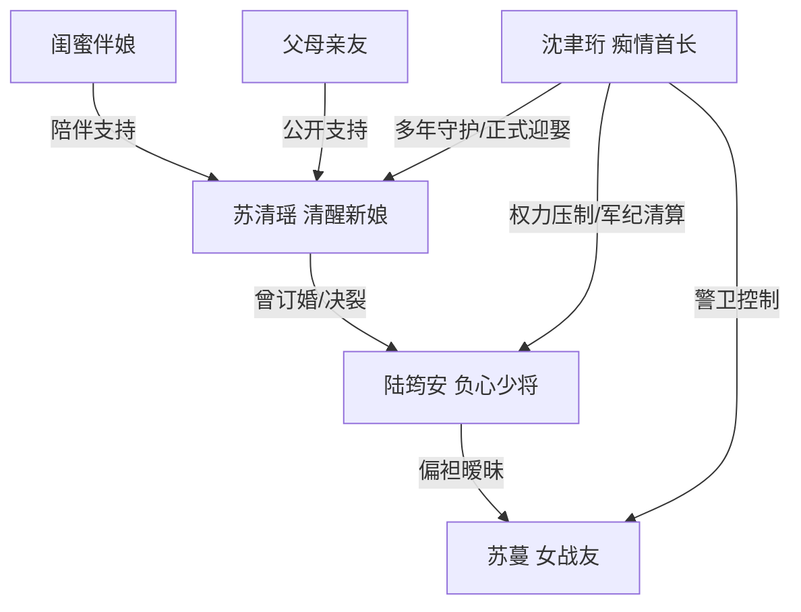

# 角色标签图谱

## 角色清单

### 苏清瑶 — 清醒止损新娘
- 叙事功能: 第一人称受害者与反击执行者，承担读者代入和尊严回收。
- 核心标签: 被辜负、清醒、敢转身
- 弧光: 期待婚礼 → 被当众羞辱 → 看清背叛 → 当众退婚 → 获得偏爱
- 台词风格: 前期克制，后期短句清算
- 关键行为: 回复沈聿珩“好”；宣布不嫁；扔戒指；拉黑陆筠安
- 读者情绪关系: 心疼、代入、为她爽

### 陆筠安 — 傲慢偏心负心少将
- 叙事功能: 核心施害者，制造前半所有情绪债。
- 核心标签: 自负、轻慢、双标
- 弧光: 掌控婚礼 → 偏袒苏蔓 → 被当众揭穿 → 被军纪清算 → 后悔终生
- 台词风格: 命令式、轻描淡写、PUA 式
- 关键行为: 暂停接亲；让苏蔓坐副驾；挪女方父母座位；长期出国陪苏蔓
- 读者情绪关系: 恨、厌恶、期待报应

### 沈聿珩 — 痴情高位守护者
- 叙事功能: 替代男主、补偿来源、高位秩序执行者。
- 核心标签: 痴情、克制、护短
- 弧光: 默默等待 → 备好婚礼 → 当众护妻 → 正式求婚 → 长期宠爱
- 台词风格: 稳、短、承诺落地
- 关键行为: 准备对面婚礼；护住女主；公开宣告；陪伴婚后生活
- 读者情绪关系: 安心、甜、补偿爽

### 苏蔓 — 挑衅绿茶女战友
- 叙事功能: 外部第三者，引爆婚礼冲突与陆筠安双标。
- 核心标签: 挑衅、得意、越界
- 弧光: 闯入接亲 → 享受偏爱 → 被当众揭穿 → 被开除军籍
- 台词风格: 装无辜、兄弟式暧昧、挑衅
- 关键行为: 勾陆筠安脖子；拿手捧花；发亲密照；试图溜走
- 读者情绪关系: 厌恶、期待被打脸

### 闺蜜/伴娘 — 情绪见证者
- 叙事功能: 替读者说出不满，辅助女主离场。
- 核心标签: 心疼、清醒、护短
- 弧光: 手足无措 → 愤怒指出不公 → 支持女主不嫁
- 台词风格: 直接、护短
- 关键行为: 指出婚车不对；陪女主上车；情绪托底
- 读者情绪关系: 代言读者怒气

### 女主父母与亲友 — 正义观众席
- 叙事功能: 公开支持女主，消解“婚礼丢脸”的社会压力。
- 核心标签: 支持、心疼、见证
- 弧光: 原本被挪座 → 站到女主身后
- 台词风格: 朴素直接
- 关键行为: 母亲说“不嫁就不嫁”；父亲认可沈聿珩
- 读者情绪关系: 安慰、补位

## 关系网络

## 角色功能对照表（供改编参考）

| 原角色 | 极致标签 | 叙事功能 | 读者情绪功能 | 改编时必须保留的 |
|--------|---------|---------|-------------|---------------|
| 苏清瑶 | 清醒止损新娘 | 代入与反击 | 心疼转爽 | 当场止损，不回头 |
| 陆筠安 | 傲慢偏心前任 | 制造情绪债 | 恨点 | 轻慢句、偏心动作、后悔崩塌 |
| 沈聿珩 | 痴情高位守护者 | 补偿与秩序 | 安全感 | 早有准备、公开护短、长期偏爱 |
| 苏蔓 | 绿茶越界者 | 引爆冲突 | 厌恶 | 当众挑衅、享受资源、被清算 |
| 闺蜜/亲友 | 正义观众 | 见证与支持 | 代言 | 证明女主不是孤立无援 |
