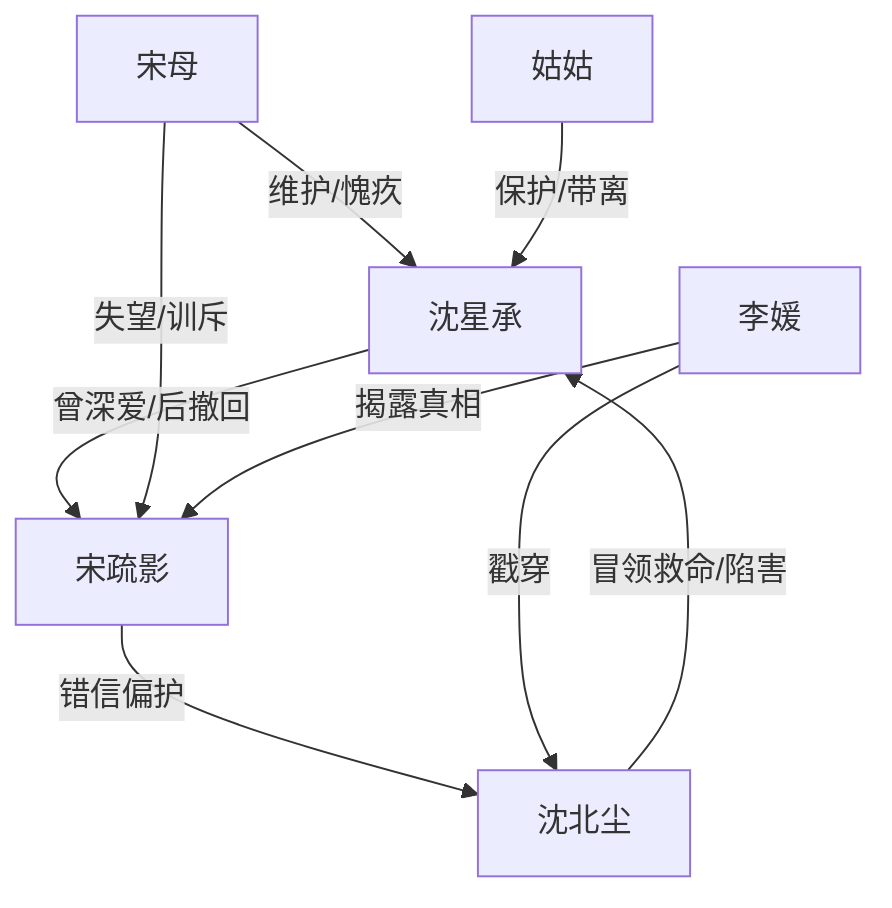

# 角色标签图谱

## 角色清单

### 沈星承 — 病弱深情退场男主
- 叙事功能: 承载读者心疼与最终“爱撤回”的爽点。
- 核心标签: 救命恩人、母亲遗物执念、心脏病濒危
- 弧光: 痴恋追逐 → 被误解折磨 → 主动退婚 → 假死隔绝 → 新生拒爱
- 台词风格: 前期克制请求，后期冷静切割。
- 关键行为: 捞戒指、捡遗物、否认救命、离开上沪、拒绝复合。
- 读者情绪关系: 心疼、替他憋屈、最后为他痛快。

### 宋疏影 — 错信白月光的追妻火葬场女主
- 叙事功能: 前半施压者，后半悔恨偿债者。
- 核心标签: 高傲、错认救命恩人、迟来悔悟
- 弧光: 厌恶沈星承 → 偏护沈北尘 → 真相崩塌 → 赎罪无门 → 遵守不见
- 台词风格: 前期冷硬命令，后期卑微哀求。
- 关键行为: 官宣沈北尘、逼誓、取消婚礼、追到国外、求再爱一次。
- 读者情绪关系: 前期恨，后期看她痛而爽。

### 沈北尘 — 绿茶冒领者
- 叙事功能: 制造误会、放大女主偏信、承载反派恨点。
- 核心标签: 私生子、冒领功劳、装可怜
- 弧光: 胜利者姿态 → 谎言暴露 → 婚礼崩盘 → 精神崩坏
- 台词风格: 表面柔弱，背地挑衅。
- 关键行为: 摔碎手镯、伪造短信、冒领救命、交易双生镯。
- 读者情绪关系: 厌恶、期待报应。

### 宋母 — 清醒长辈
- 叙事功能: 证明沈星承并非无人爱护，也推动宋疏影认知裂缝。
- 核心标签: 护短、明理、愧疚
- 弧光: 维护婚约 → 反对沈北尘 → 得知病危 → 与沈星承和解
- 台词风格: 直接、长辈式压迫。
- 关键行为: 要宋疏影补偿、告知出国、提供手术地址。
- 读者情绪关系: 提供少量安慰。

### 姑姑 — 生路守护者
- 叙事功能: 把沈星承从旧关系中救出，执行假死隔绝。
- 核心标签: 强势、护犊、理性
- 弧光: 催手术 → 保护术后沈星承 → 安排新生
- 台词风格: 冷硬、简短。
- 关键行为: 催回国手术、对宋疏影宣布“手术失败”、安排疗养。
- 读者情绪关系: 安全感、替读者护主角。

### 李媛 — 真相引爆者
- 叙事功能: 在婚礼高点投放证据，打断错误婚姻。
- 核心标签: 旁观清醒、行动派、证据链
- 弧光: 迟到者 → 真相揭露者
- 台词风格: 直接、证据导向。
- 关键行为: 婚礼闯入、指向救援队和旧友。
- 读者情绪关系: 爽，终于有人说出真相。

## 关系网络

## 角色功能对照表（供改编参考）

| 原角色 | 极致标签 | 叙事功能 | 读者情绪功能 | 改编时必须保留的 |
|--------|---------|---------|-------------|---------------|
| 沈星承 | 病弱深情退场者 | 承压与最终拒爱 | 心疼、痛快 | 救命被冒领、母亲遗物、病危离开、拒绝复合 |
| 宋疏影 | 错信追妻者 | 施压与偿债 | 恨、看悔恨 | 前期必须真错，后期必须真痛 |
| 沈北尘 | 绿茶冒领者 | 误会发动机 | 恨点 | 装弱、冒领、背地挑衅 |
| 宋母 | 清醒长辈 | 外部道德坐标 | 安慰 | 她要看见主角的好 |
| 姑姑 | 护主逃生者 | 切断旧关系 | 安全感 | 假死隔绝或等价保护 |
| 李媛 | 真相爆破者 | 婚礼反转 | 爽 | 公开场合证据引爆 |
