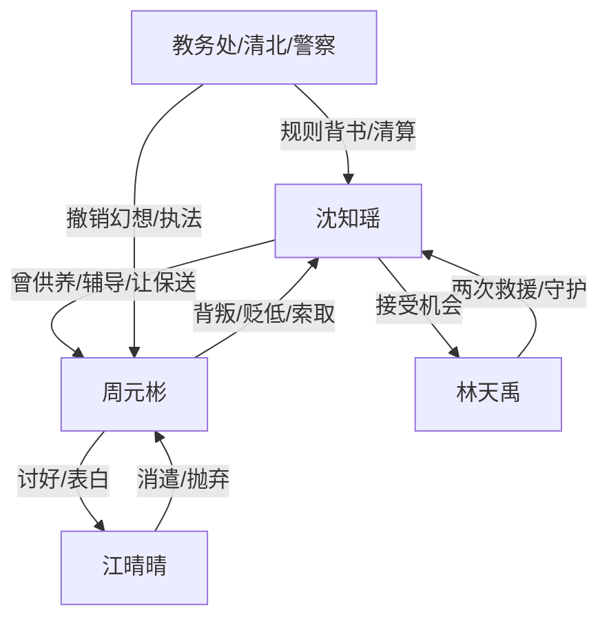

# 角色标签图谱

## 角色清单

### 沈知瑶 — 清醒学霸女主

- 叙事功能: 被背叛者、供养者、反击执行者、价值观锚点。
- 核心标签: 学霸、清醒、克制反杀。
- 弧光: 恋爱滤镜中的付出者 → 收回资源和情感的掌控者 → 拥有学业爱情自由的新生者。
- 台词风格: 短、冷、直接，关键时刻用反问刺穿对方。
- 关键行为: 收回保送名额、断供生活费、公开切割、报警取证。
- 读者情绪关系: 前期心疼，中期替她憋屈，后期为她爽和释然。

### 周元彬 — 吸血自负竹马/追妻火葬场反派

- 叙事功能: 施害者、情绪债制造者、反讽承受者。
- 核心标签: 软饭硬吃、自负、甩锅。
- 弧光: 被女主托举的优等生 → 误以为自己天然优秀 → 前途爱情尊严全崩塌。
- 台词风格: 说教、贬低、道德绑架，失势后哀求。
- 关键行为: 高考试卷表白、索要生活费、贬低女主、侵犯威胁。
- 读者情绪关系: 恨、恶心、期待报应、最后无须怜悯。

### 江晴晴 — 富家玩咖天降/虚假自由符号

- 叙事功能: 诱发周元彬堕落，拆穿其阶层幻想。
- 核心标签: 富家女、玩咖、现实。
- 弧光: 被周元彬奉为“懂生活”对象 → 当众撇清 → 暴露他只是消遣搭子。
- 台词风格: 轻慢、直白、带阶层优越感。
- 关键行为: 附和贬低女主，拒绝周元彬入职和订亲。
- 读者情绪关系: 讨厌但工具性强，她负责给周元彬第二刀。

### 林天禹 — 阳光体育男/正确补偿型男主

- 叙事功能: 救援者、价值观对照、女主新生活入口。
- 核心标签: 正直、守护、阳光。
- 弧光: 初雪夜救人者 → 教室危机再次救援 → 女主新生活伴侣。
- 台词风格: 直接、温柔、边界清楚。
- 关键行为: 初雪夜救女主、破门阻止周元彬、表白、维护女主享受生活的权利。
- 读者情绪关系: 安全感、补偿感、甜爽。

### 教务处老师/清北领导/警察 — 秩序清算力量

- 叙事功能: 第三方背书，确保打脸不是女主空口反击。
- 核心标签: 规则、公正、证据。
- 弧光: 确认名额归属 → 送出奖学金 → 完成法律清算。
- 台词风格: 事实型、程序型。
- 关键行为: 提交保送、公开真相、接警处理。
- 读者情绪关系: 爽点合法化。

## 关系网络

## 角色功能对照表（供改编参考）

| 原角色 | 极致标签 | 叙事功能 | 读者情绪功能 | 改编时必须保留的 |
|--------|---------|---------|-------------|---------------|
| 沈知瑶 | 清醒学霸女主 | 承债与反击 | 心疼到爽 | 资源撤回、冷静切割、独立新生 |
| 周元彬 | 吸血自负竹马 | 制造压迫 | 恨与报应期待 | 软饭硬吃、贬低女主、失势甩锅 |
| 江晴晴 | 富家玩咖 | 二次打击 | 讽刺和阶层反噬 | 她必须亲口否认真心 |
| 林天禹 | 阳光守护者 | 补偿线 | 安全与甜 | 两次救援、尊重女主选择 |
| 老师/警察 | 秩序背书 | 合法清算 | 爽点可信 | 文件/监控/程序化证据 |
