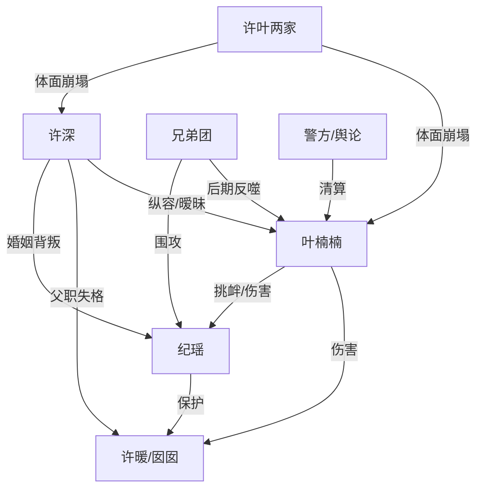

# 角色标签图谱

## 角色清单

### 纪瑶 — 清醒离婚母亲/克制复仇者
- 叙事功能: 受害者、道德锚点、清算执行者。
- 核心标签: 隐忍、护女、决绝。
- 弧光: 为女儿忍耐 → 签字离婚 → 带女出逃 → 公开清算 → 新生。
- 台词风格: 短句、反问、冷静审判。
- 关键行为: 当众签协议；保存证据；报警；群发出轨资料；拒绝复合。
- 读者情绪关系: 心疼、代入、期待她反杀。

### 许深 — 拎不清渣夫/迟来悔恨者
- 叙事功能: 婚姻背叛者，推动女主失望累积与后期悔恨偿债。
- 核心标签: 偏心、逃避、伪深情。
- 弧光: 纵容叶楠楠 → 抛弃妻女 → 被证据打脸 → 跪求复合 → 报应失控。
- 台词风格: 推责、指责、迟来道歉。
- 关键行为: 护叶楠楠；打女主；抛下腰伤妻子；跪求原谅。
- 读者情绪关系: 恨、恶心、看他崩溃才爽。

### 叶楠楠 — 绿茶女兄弟/恶意入侵者
- 叙事功能: 婚姻入侵者、压迫源、清算对象。
- 核心标签: 挑衅、恶毒、伪兄弟。
- 弧光: 装无辜挑衅 → 抢夺许深 → 伤害婴儿 → 生日宴社死 → 被警方带走。
- 台词风格: 撒娇、激将、倒打一耙。
- 关键行为: 塞丁字裤与离婚协议；发床照；喂女儿羊奶；逼婚。
- 读者情绪关系: 强恨点，承担最大道德债。

### 许暖/囡囡 — 无辜女儿/道德锚点
- 叙事功能: 让女主所有决绝合法化；检验许深父职失败。
- 核心标签: 幼小、脆弱、被伤害。
- 弧光: 周岁宴被羞辱 → 被惊吓与过敏 → 随母离开 → 花园新生。
- 台词风格: 无有效台词，以哭声和身体反应推动情绪。
- 关键行为: 抓阄抓出真相；过敏濒危；结尾扑进女主怀里。
- 读者情绪关系: 心疼、保护欲、要求报应。

### 兄弟团 — 帮凶/反噬见证者
- 叙事功能: 前期围攻女主，后期揭穿叶楠楠，完成社交反噬。
- 核心标签: 起哄、势利、虚伪。
- 弧光: 帮叶羞辱女主 → 发现被欺骗 → 反咬叶楠楠。
- 台词风格: 粗俗、站队快、羞辱性强。
- 关键行为: 逼女主道歉；生日宴质问；揭穿叶楠楠国外黑料。
- 读者情绪关系: 前期恨，后期工具性爽。

## 关系网络

## 角色功能对照表（供改编参考）

| 原角色 | 极致标签 | 叙事功能 | 读者情绪功能 | 改编时必须保留的 |
|--------|---------|---------|-------------|---------------|
| 纪瑶 | 清醒离婚母亲 | 主角/清算者 | 心疼到爽 | 不哭求、不和解、保护孩子 |
| 许深 | 拎不清渣夫 | 主要负债人 | 恨与看悔 | 反复选择第三者 |
| 叶楠楠 | 绿茶女兄弟 | 外部入侵者 | 强恨点 | 以“玩笑/兄弟”包装恶意 |
| 女儿 | 无辜孩子 | 道德锚点 | 保护欲 | 真实受到伤害但最终安全 |
| 兄弟团 | 帮凶群像 | 羞辱与反噬 | 憋屈后爽 | 前期围攻，后期反水 |
