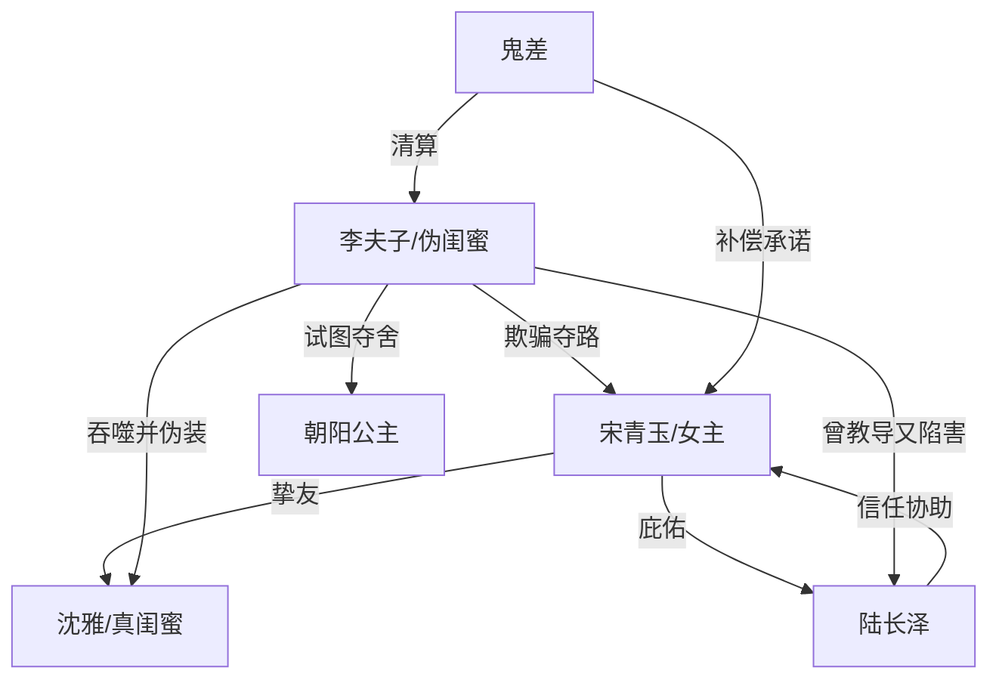

# 角色标签图谱

## 角色清单

### 宋青玉/女主 — 清醒护友型保家仙
- 叙事功能: 第一视角侦探、情绪承受者、最终清算者
- 核心标签: 护短、敏锐、重情
- 弧光: 轻信闺蜜 → 怀疑自责 → 细节拆穿 → 狠厉复仇 → 回归圆满
- 台词风格: 短句质问、逻辑拆解、后段冷硬
- 关键行为: 试探房梁、挣脱假隧道、识破李夫子、阻止夺路、吞噬反派魂魄
- 读者情绪关系: 心疼、代入、爽

### 沈雅/真闺蜜 — 被夺身份的阳光闺蜜
- 叙事功能: 情绪债核心、友情补偿对象
- 核心标签: 仗义、鲜活、自由
- 弧光: 开篇被伪装覆盖 → 真相中确认受害 → 结尾复原
- 台词风格: 现代口语、玩笑感、亲密
- 关键行为: 现代救过女主；被李夫子吞噬；结尾回归
- 读者情绪关系: 心疼、惋惜、补偿期待

### 李夫子/伪闺蜜 — 被执念吞噬的伪装恶灵
- 叙事功能: 核心反派、身份反转承载者
- 核心标签: 嫉妒、伪装、执念成魔
- 弧光: 伪装闺蜜 → 露出破绽 → 身份败露 → 夺路失败 → 魂飞魄散
- 台词风格: 前期网感伪装，后期怨毒控诉
- 关键行为: 吞噬沈雅、制造假隧道、困住女主本命牌位、伤害陆长泽、试图夺舍公主
- 读者情绪关系: 先亲近，后痛恨

### 陆长泽 — 正直感恩型状元
- 叙事功能: 真相验证器、规则支点、道德见证人
- 核心标签: 感恩、正直、信任女主
- 弧光: 受庇佑寒门秀才 → 高中状元 → 配合试探 → 挡路清邪
- 台词风格: 恭敬、诚恳、古代书生感
- 关键行为: 指出只有一位保家仙；供奉恩师；阴时试探；挡住隧道入口
- 读者情绪关系: 信任、认可

### 朝阳公主 — 无辜被卷入者
- 叙事功能: 婚礼场景锚点、后段夺舍危机承载者
- 核心标签: 新婚、善良、无辜
- 弧光: 新婚动容 → 危机中差点被夺舍
- 台词风格: 简短关切
- 关键行为: 与陆长泽拜堂；发现陆长泽昏倒
- 读者情绪关系: 担心

### 鬼差 — 秩序清算者
- 叙事功能: 外部公权力、结尾补偿承诺
- 核心标签: 冷面、秩序、补救
- 弧光: 背景契约者 → 终局执行者
- 台词风格: 平静、官方
- 关键行为: 灭杀李夫子残魂；承诺送回沈雅
- 读者情绪关系: 安心

## 关系网络

## 角色功能对照表（供改编参考）

| 原角色 | 极致标签 | 叙事功能 | 读者情绪功能 | 改编时必须保留的 |
|--------|---------|---------|-------------|---------------|
| 宋青玉 | 清醒护友女主 | 侦探+清算者 | 代入与爽感 | 从轻信到冷静识破的过程 |
| 沈雅 | 被夺身份挚友 | 情绪债核心 | 心疼与补偿 | 至少 3 个独有生活习惯 |
| 李夫子 | 伪装恶灵 | 反派+反转 | 恨点 | 可怜动机 + 不可原谅行为 |
| 陆长泽 | 正直状元 | 证人+规则支点 | 信任 | “看不到但相信女主”的行动 |
| 鬼差 | 秩序执行者 | 终局清算 | 安心 | 外部规则补偿，不能抢女主高光 |
