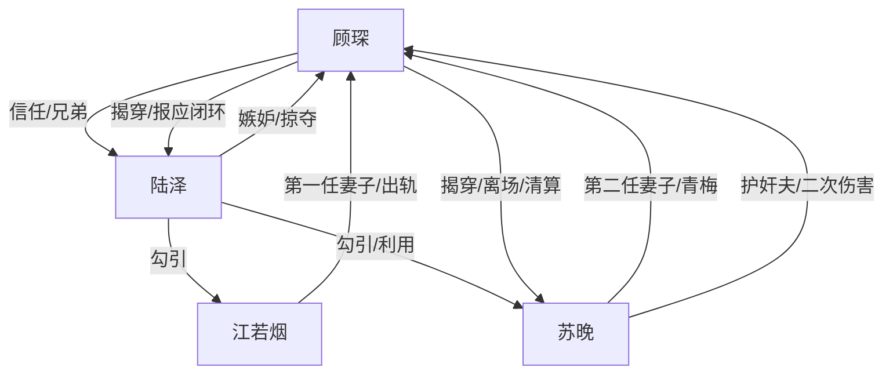

# 角色标签图谱

## 角色清单

### 顾琛 — 惨遭双重背叛的清醒复仇者

- 叙事功能: 第一视角受害者、情绪债承载者、最终清算者
- 核心标签: 截肢失能、被兄弟夺妻、离场重生
- 弧光: 感恩依赖 → 真相崩塌 → 自毁触底 → 冷静揭穿 → 独立翻身
- 台词风格: 质问式、短句砸脸、冷静反讽
- 关键行为: 网店识破陆泽、调取监控、提出离婚、离城创业、拒绝复合
- 读者情绪关系: 前半心疼，后半替他爽，结尾获得补偿性满足

### 陆泽 — 绿茶兄弟/嫉妒型掠夺者

- 叙事功能: 主施害者、背叛源头、两段婚姻毁灭者
- 核心标签: 装可怜、抢兄弟女人、嫉妒成魔
- 弧光: 假兄弟照顾 → 自曝露馅 → 继续伪装 → 被揭穿 → 疯癫惨死
- 台词风格: 哭诉、示弱、反复说“不是故意”
- 关键行为: 勾引江若烟、勾引苏晚、车内下药、安排劫持、用孩子要挟
- 读者情绪关系: 强恨点；越哭越令人厌恶

### 苏晚 — 爱意转移的背叛妻子/破产悔妇

- 叙事功能: 温度反转核心、二次伤害执行者、后期悔恨载体
- 核心标签: 总裁妻、青梅、出轨护奸夫
- 弧光: 深情守护 → 欲望沦陷 → 护陆泽伤顾琛 → 迟来后悔 → 卑微求复合
- 台词风格: 前期强硬维护陆泽，后期卑微道歉
- 关键行为: 车内下药偷情、车祸逃跑、踩过残肢救陆泽、净身出户、求复合
- 读者情绪关系: 由可惜转恨，再到报应满足

### 江若烟 — 第一任背叛妻子/前史证人

- 叙事功能: 证实陆泽第一次夺妻，证明背叛不是偶发
- 核心标签: 医生、前妻、迟来忏悔
- 弧光: 出轨隐瞒 → 承认真相 → 后期入狱
- 台词风格: 后悔、解释、软弱
- 关键行为: 与陆泽出轨，电话承认真相
- 读者情绪关系: 次级恨点，主要用于加重陆泽罪行

## 关系网络

## 角色功能对照表（供改编参考）

| 原角色 | 极致标签 | 叙事功能 | 读者情绪功能 | 改编时必须保留的 |
|--------|---------|---------|-------------|---------------|
| 顾琛 | 清醒复仇者 | 受害与清算主线 | 心疼→爽 | 肉身损失、亲密背叛、拒绝回头 |
| 陆泽 | 绿茶兄弟 | 主动掠夺者 | 恨 | “抢两次”的递进恶意和嫉妒动机 |
| 苏晚 | 背叛妻子 | 温度反转 | 恨与报应满足 | 曾经深情、后来护奸夫的强对照 |
| 江若烟 | 前史证人 | 证明恶意延续 | 补充恨点 | 电话确认第一段背叛 |
