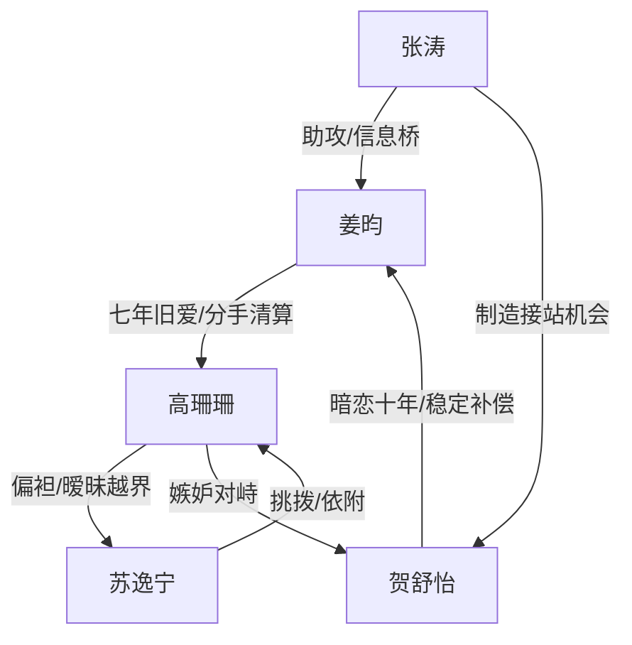

# 角色标签图谱

## 角色清单

### 姜昀 — 清醒抽离型男主
- 叙事功能: 受伤者、清算者、读者代入对象。
- 核心标签: 七年深情、边界清醒、冷静断舍离。
- 弧光: 依赖旧爱 → 看清轻慢 → 彻底抽离 → 接受被珍惜。
- 台词风格: 短句、平静、反问多。
- 关键行为: 退票改道上海、退出群聊、播放录音、扔掉腕表。
- 读者情绪关系: 前半心疼，后半爽和释然。

### 高珊珊 — 迟钝傲慢旧爱
- 叙事功能: 主要情绪债来源，追悔火葬场承担者。
- 核心标签: 恃宠而骄、边界模糊、迟来醒悟。
- 弧光: 笃定被爱 → 轻慢偏袒 → 慌乱追悔 → 永久错过。
- 台词风格: 先轻佻哄劝，后崩溃求复合。
- 关键行为: 留邻座给苏逸宁、录音分手、护苏逸宁、追到上海、送腕表。
- 读者情绪关系: 前半恨，后半看她悔而不得。

### 苏逸宁 — 绿茶男实习生
- 叙事功能: 外部诱因、关系边界测试器、女主傲慢放大器。
- 核心标签: 示弱装乖、越界依附、嫉妒破防。
- 弧光: 被保护的实习生 → 挑拨成功 → 被厌弃 → 病房破防。
- 台词风格: 委屈、撒娇、责任转嫁。
- 关键行为: 坐邻座、少订房、发亲密照片、打电话责备、病房质问。
- 读者情绪关系: 主要厌恶对象之一，承担“绿茶被反噬”的爽点。

### 贺舒怡 — 克制直球型新爱
- 叙事功能: 情感补偿、价值对照、男主新生锚点。
- 核心标签: 成熟、尊重、长情。
- 弧光: 暗恋旁观 → 主动接住 → 稳定陪伴 → 订婚归家。
- 台词风格: 清冷、平稳、直白。
- 关键行为: 狗咬事件九分钟赶到、接站、坦白暗恋、挡住高珊珊、订婚告白。
- 读者情绪关系: 安心、甜、补偿感。

### 张涛 — 助攻兄弟
- 叙事功能: 信息桥、轻喜剧缓冲、推动贺舒怡接站。
- 核心标签: 嘴快、助攻、心虚。
- 弧光: 接站承诺者 → 制造独处 → 说漏上海。
- 台词风格: 口语化、调侃。
- 关键行为: 让贺舒怡接站，说漏男主去上海。
- 读者情绪关系: 缓和沉重情绪。

## 关系网络

## 角色功能对照表（供改编参考）

| 原角色 | 极致标签 | 叙事功能 | 读者情绪功能 | 改编时必须保留的 |
|--------|---------|---------|-------------|---------------|
| 姜昀 | 清醒抽离男主 | 代入、清算、转身 | 心疼到爽 | 不纠缠、不跪求、关键时刻冷静 |
| 高珊珊 | 恃宠而骄旧爱 | 压迫债来源 | 恨与追悔满足 | 前期笃定男主不会走，后期彻底慌 |
| 苏逸宁 | 绿茶实习生 | 外部诱因 | 厌恶与打脸 | 装弱、越界、甩锅、破防 |
| 贺舒怡 | 克制直球新爱 | 补偿系统 | 安心和甜 | 尊重边界、长情伏笔、稳定行动 |
| 张涛 | 助攻兄弟 | 信息转场 | 轻松缓冲 | 推动新线但不喧宾夺主 |
