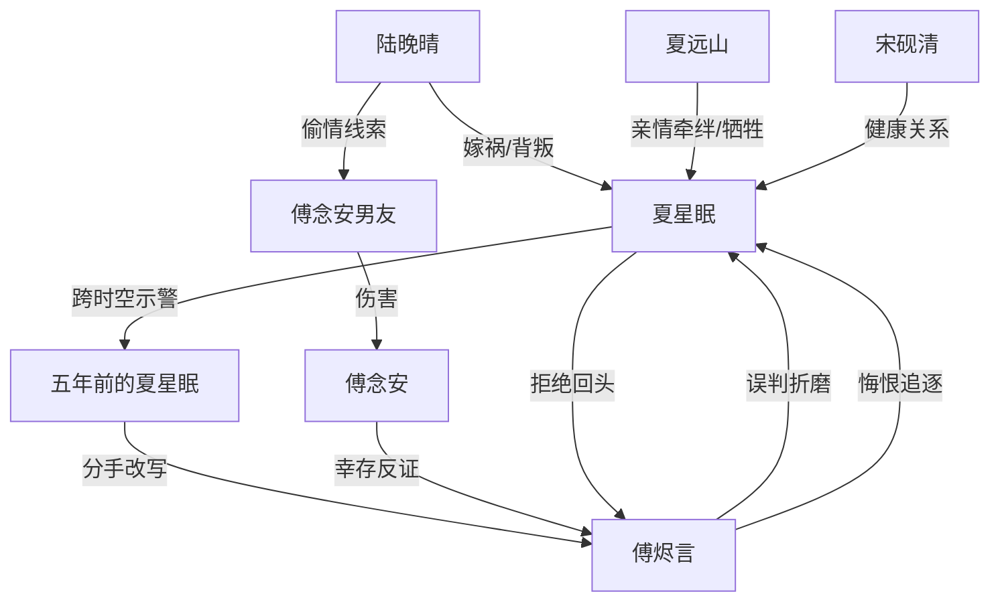

# 角色标签图谱

## 角色清单

### 夏星眠 — 清醒断爱大女主
- 叙事功能: 受害者、示警者、命运改写者、拒绝火葬场的执行者
- 核心标签: 冷静、破碎后自救、事业型
- 弧光: 被羞辱困住 → 父死触底 → 改写命运 → 自由生活
- 台词风格: 短句、克制、不解释
- 关键行为: 警告五年前的自己、离开傅烬言、拒绝项目与道歉、拉黑旧爱
- 读者情绪关系: 心疼、代入、爽

### 五年前的夏星眠 — 鲜活的自救分身
- 叙事功能: 改写命运的执行者，承载“还来得及”的希望
- 核心标签: 天真、震碎、决绝
- 弧光: 幸福待嫁 → 目睹未来地狱 → 决绝分手
- 台词风格: 追问密集，情绪外露
- 关键行为: 相信未来的自己，拒绝求婚后断联
- 读者情绪关系: 心疼、紧张、期待她逃脱

### 傅烬言 — 悔恨困海男主/迟到真相施害者
- 叙事功能: 主要压迫者与火葬场对象
- 核心标签: 偏执、傲慢、迟钝悔恨
- 弧光: 掌控羞辱 → 世界崩塌 → 查明真相 → 精神腐烂
- 台词风格: 前期威胁命令，后期哽咽忏悔
- 关键行为: 用父亲医疗资源威胁女主，毁掉工作室，误判四年，后期查真相
- 读者情绪关系: 恨、等他悔、拒绝原谅的爽

### 陆晚晴 — 绿茶闺蜜/真凶
- 叙事功能: 外部背叛者，误会源头
- 核心标签: 嫁祸、挑衅、伪友
- 弧光: 上位挑衅 → 被线索指向 → 成为真凶闭环
- 台词风格: 娇笑、阴阳怪气
- 关键行为: 勾引傅烬言、挑衅夏星眠、旧时空下药嫁祸
- 读者情绪关系: 恨、期待清算

### 夏远山 — 亲情锁链/牺牲父亲
- 叙事功能: 女主无法离开的现实锚点，也是触底反弹的引爆点
- 核心标签: 温柔、愧疚、牺牲
- 弧光: 病弱被困 → 看见女儿受辱 → 自断锁链 → 新时空健康回归
- 台词风格: 家常、温柔、隐忍
- 关键行为: 拔掉呼吸机，留下“你自由了”
- 读者情绪关系: 强心疼、泪点、补偿期待

### 傅念安 — 真相坐标
- 叙事功能: 证明女主无罪的关键变量
- 核心标签: 妹妹、误会引线、幸存证据
- 弧光: 旧时空死亡 → 新时空活着 → 反证嫁祸
- 台词风格: 日常、轻松
- 关键行为: 接起电话，透露前男友与陆晚晴关系
- 读者情绪关系: 释疑、推动真相

### 宋砚清 — 正常爱与新生活证明
- 叙事功能: 提供健康关系对照，证明女主值得被尊重
- 核心标签: 稳定、专业、踏实
- 弧光: 合作对象 → 生活陪伴者 → 新未来
- 台词风格: 克制、专业、温和
- 关键行为: 认真分析作品、陪伴端午、给女主披外套
- 读者情绪关系: 安慰、补偿、安心

## 关系网络

## 角色功能对照表（供改编参考）

| 原角色 | 极致标签 | 叙事功能 | 读者情绪功能 | 改编时必须保留的 |
|--------|---------|---------|-------------|---------------|
| 夏星眠 | 清醒断爱大女主 | 被害者到自救者 | 心疼转爽 | 不复合、不解释、靠离开赢 |
| 五年前的夏星眠 | 鲜活分身 | 执行命运改写 | 希望感 | 必须从不信到决绝 |
| 傅烬言 | 悔恨施害者 | 压迫与悔恨容器 | 恨与爽 | 必须保留“误判后亲手毁她” |
| 陆晚晴 | 绿茶真凶 | 外部恶源 | 恨点 | 必须既是闺蜜又是真凶 |
| 夏远山 | 牺牲父亲 | 女主困境锚点 | 泪点 | 必须是女主走不了的合理原因 |
| 宋砚清 | 稳定新爱 | 补偿生活 | 安心 | 不能喧宾夺主 |
