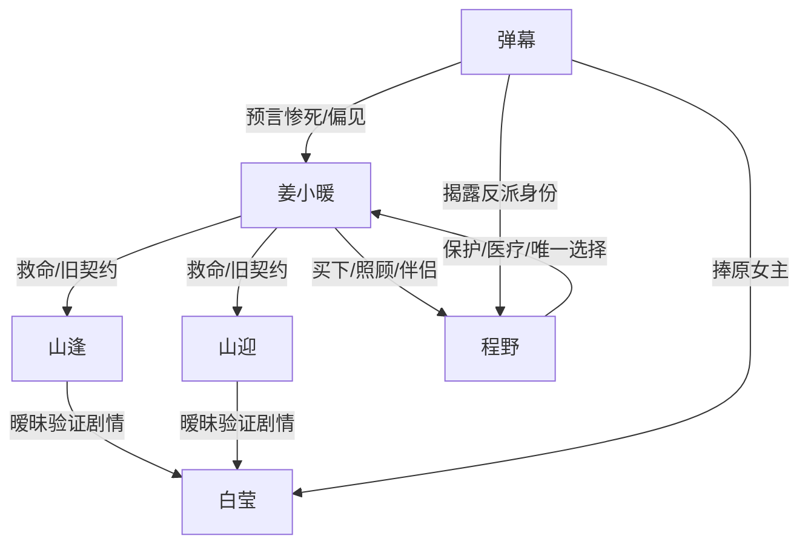

# 角色标签图谱

## 角色清单

### 姜小暖 — 清醒病弱女配 / 被剧情误判的救赎者

- 叙事功能: 主视角、情绪债承受者、原剧情反抗者。
- 核心标签: 皮肤饥渴症、救命恩人、清醒断舍离。
- 弧光: 依赖白虎双胞胎 → 看见弹幕警醒 → 被封锁病发 → 选择程野和新生活。
- 台词风格: 直白克制，关键处短句判决。
- 关键行为: 主动解契、买下程野、揭穿双标、拒绝复合。
- 读者情绪关系: 心疼、代入、爽。

### 山逢 — 冷静控制型旧男主

- 叙事功能: 旧关系中的理性压迫者，负责制定“冷她一次”的封锁策略。
- 核心标签: 冰山指挥官、聪明、控制欲。
- 弧光: 笃定女主离不开他们 → 发现女主真离开 → 落泪求复合。
- 台词风格: 冷静、判断式、解释欲强。
- 关键行为: 护住白莹、同意解契、封锁资源、后期求女主留下。
- 读者情绪关系: 前期恨，后期追悔爽。

### 山迎 — 毒舌占有型旧男主

- 叙事功能: 情绪外放的压迫者，负责制造羞辱、误读和修罗场冲突。
- 核心标签: 毒舌、冲动、占有欲。
- 弧光: 嘲笑女主作 → 怕女主不要他们 → 被程野碾压 → 跪求主人别走。
- 台词风格: 刺耳、急躁、带强烈占有。
- 关键行为: 误以为女主求亲密、骂她作、质问新伴侣、跪求挽回。
- 读者情绪关系: 恨、烦、后期打脸爽。

### 程野 — 黑市雪豹 / 补偿型反派男主

- 叙事功能: 新伴侣、补偿机制、战力反转和命运改写证明。
- 核心标签: 小雪豹、双S、医疗属性、原著大反派。
- 弧光: 失忆黑市兽奴 → 温柔照顾者 → 碾压S级白虎 → 只选择女主的伴侣。
- 台词风格: 软甜撒娇与护短强势并存。
- 关键行为: 满足女主病症、照顾喂粥、护住女主、打败双胞胎、带她去雪山城。
- 读者情绪关系: 甜、爽、补偿。

### 白莹 — S级妹宝 / 原剧情女主

- 叙事功能: 触发弹幕偏见和旧男主误判的剧情中心。
- 核心标签: S级雌性、兔子兽人、被偏爱的妹宝。
- 弧光: 被弹幕捧为救赎者 → 未真正胜出 → 剧情中心坍塌。
- 台词风格: 甜美求助。
- 关键行为: 请求双胞胎陪任务。
- 读者情绪关系: 轻微反感，更多是作为偏心机制载体。

### 弹幕 — 偏见合唱团 / 元叙事裁判

- 叙事功能: Hook、预言、误导、爽点放大器。
- 核心标签: 站妹宝、骂女配、剧透。
- 弧光: 一边倒骂女配 → 震惊剧情崩坏 → 内部开始为女主争吵。
- 台词风格: 网感、夸张、情绪化。
- 关键行为: 预告惨死、播报白莹进展、揭露程野身份、立场分裂。
- 读者情绪关系: 被讨厌，同时提供爽点放大。

## 关系网络

## 角色功能对照表（供改编参考）

| 原角色 | 极致标签 | 叙事功能 | 读者情绪功能 | 改编时必须保留的 |
|--------|---------|---------|-------------|---------------|
| 姜小暖 | 清醒病弱女配 | 承债与反抗 | 心疼、代入 | 被剧情误判但不自证，最终主动选择 |
| 山逢 | 冷静控制旧男主 | 理性伤害 | 恨、追悔爽 | 用“为你好”实施控制 |
| 山迎 | 毒舌占有旧男主 | 情绪伤害 | 憋屈、打脸爽 | 嘲讽女主又害怕失去 |
| 程野 | 补偿型反派男主 | 新爽点与战力反转 | 甜、爽 | 低身份登场，高价值爆发 |
| 白莹 | 原剧情妹宝 | 触发误判 | 反衬 | 不必深写，但必须有剧情引力 |
| 弹幕 | 偏见合唱团 | 元叙事钩子 | 追读、吐槽 | 既剧透又误导，后期反转立场 |
