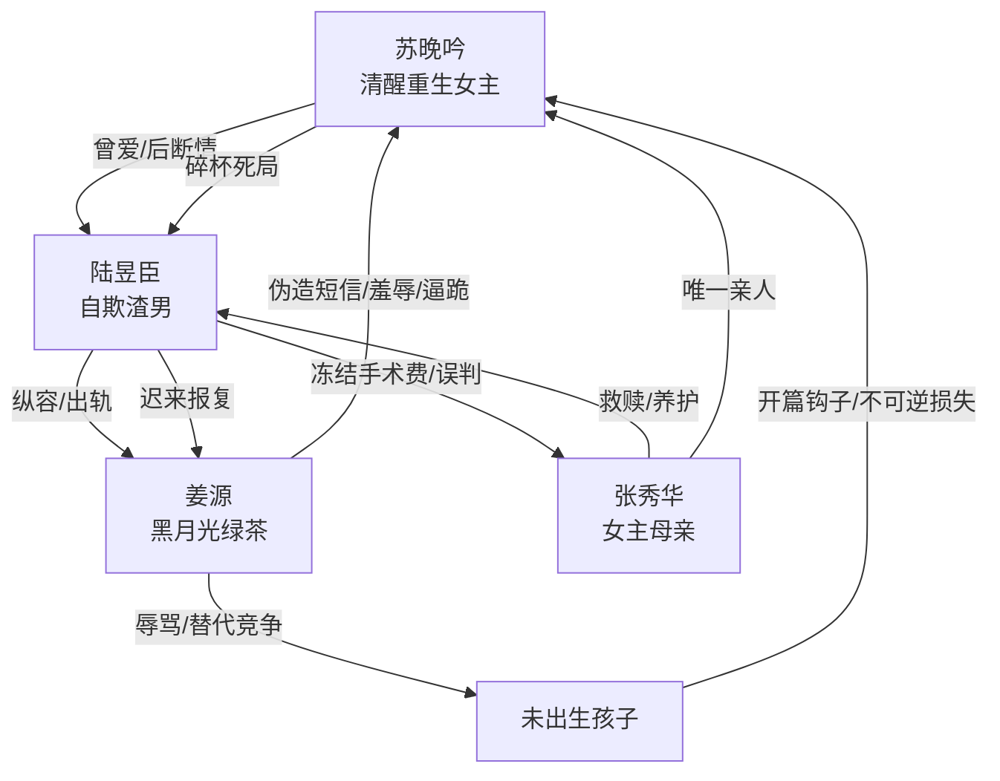

# 角色标签图谱

## 角色清单

### 苏晚吟 — 清醒重生复仇女主
- 叙事功能: 受害者、见证者、清算者；用重生信息差避开上一世死局。
- 核心标签: 清醒、能忍、不可回头
- 弧光: 误入虐恋局的妻子 → 重生顺势退场 → 失母后彻底断情 → 冷静完成离婚
- 台词风格: 前期少说、顺着男主借口说；后期反问精准，一句封死。
- 关键行为: 主动人流、提出离婚、为救母跪行、带骨灰离开、用碎杯拒绝复合。
- 读者情绪关系: 心疼、替她憋屈、期待她彻底离开并让男主悔疯。

### 陆昱臣 — 自欺型迟来深情渣男
- 叙事功能: 主要施害者；用“报复姜源”包装出轨和伤害，后期承担悔恨火葬场。
- 核心标签: 自欺、偏袒、迟来悔恨
- 弧光: 高高在上纵容姜源 → 冻结救命钱 → 知情崩溃 → 求复合失败
- 台词风格: 前期命令式、自我合理化；后期道歉连句、语无伦次。
- 关键行为: 放纵短信骗局、让姜源住进主卧、冻结女主银行卡、误信姜源、强迫姜源引产、签离婚协议。
- 读者情绪关系: 恨、恶心、后期看他崩溃获得爽感，但不能被原谅。

### 姜源 — 娇纵黑月光绿茶反派
- 叙事功能: 外部挑衅者和显性恶人；不断制造羞辱、栽赃和伦理刺激。
- 核心标签: 恶毒、挑衅、恃宠而骄
- 弧光: 得意入住 → 逼迫女主下跪 → 被男主反向清算 → 残废退场
- 台词风格: 轻佻、侮辱性强、常用笑声和昵称制造羞辱。
- 关键行为: 伪造未来短信、炫耀怀孕、辱骂女主孩子、逼女主跪十公里、挑拨男主。
- 读者情绪关系: 强恨点，承担最直接的打脸和身体报应。

### 张秀华/妈妈 — 最高情绪债锚点
- 叙事功能: 女主唯一亲人、道德坐标、不可偿还损失。
- 核心标签: 善良、病弱、母爱
- 弧光: 曾救赎男主 → 病情恶化 → 因手术费被断而死亡 → 成为女主断情理由
- 台词风格: 主要存在于回忆中，温和朴素。
- 关键行为: 高中时照顾失母的陆昱臣，拿积蓄支持他回陆家争继承权。
- 读者情绪关系: 心疼和愤怒的核心来源；她死后，任何复合都不被允许。

### 未出生的孩子 — 被牺牲的伦理符号
- 叙事功能: 开篇 Hook、第一笔情绪债、后期镜像报应的依据。
- 核心标签: 无辜、被算计、不可替代
- 弧光: 未来短信中的“孩子” → 女主主动打掉 → 被姜源辱骂为“烂肉” → 结尾成为不可复原问题
- 台词风格: 短信体，懂事到反常，制造违和。
- 关键行为: 通过短信触发女主人流与重生秘密。
- 读者情绪关系: 心疼；让读者接受女主拒绝“以后还会有孩子”的逻辑。

## 关系网络

## 角色功能对照表（供改编参考）

| 原角色 | 极致标签 | 叙事功能 | 读者情绪功能 | 改编时必须保留的 |
|--------|---------|---------|-------------|---------------|
| 苏晚吟 | 清醒重生复仇女主 | 信息差持有者、最终裁决者 | 心疼、爽、敬佩 | 明知骗局仍照做；不复合；用不可逆物象封死 |
| 陆昱臣 | 自欺型迟来深情渣男 | 主要施害者和悔恨载体 | 恨、看他崩溃 | 前期纵容，后期悔疯；不能早早醒悟 |
| 姜源 | 娇纵黑月光绿茶 | 外显反派和羞辱制造机 | 强恨点、打脸爽点 | 伪造关键信息；逼迫女主尊严受辱；被镜像清算 |
| 张秀华 | 善良病母 | 道德锚点与最高情绪债 | 心疼、愤怒 | 曾对男主有恩；死于男主断救命钱 |
| 未出生孩子 | 无辜牺牲品 | Hook、伦理债、镜像报应 | 心疼、愤怒 | 不能被“以后还会有”替代 |
