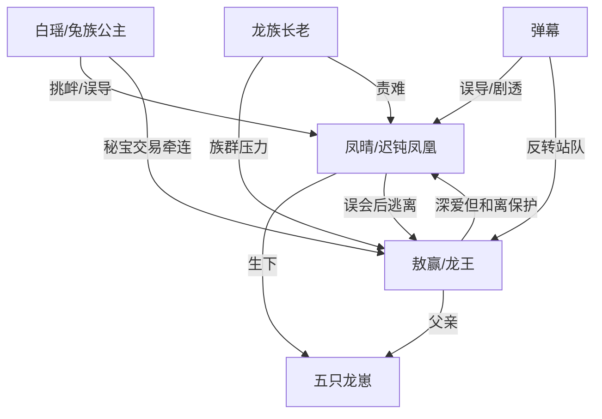

# 角色标签图谱

## 角色清单

### 凤晴 — 迟钝护崽凤凰女主
- 叙事功能: 误会承受者、萌点来源、终局救主者。
- 核心标签: 天然迟钝、母性护崽、隐藏凤凰。
- 弧光: 被叫傻子野鸡精 → 独自带崽逃亡 → 张翅护夫 → 凤凰重生。
- 台词风格: 直线思维，短句，常把羞辱听成字面问题。
- 关键行为: 接受和离、忘说龙蛋、带崽逃走、归还逆鳞、挡天劫。
- 读者情绪关系: 前半心疼和好笑，后半敬佩与爽。

### 敖赢 — 隐忍赴死龙王
- 叙事功能: 误会制造者、温度反转对象、被拯救的爱人。
- 核心标签: 克制深情、责任压身、口是心非。
- 弧光: 冷面和离 → 暗中护妻 → 被误解抛妻弃子 → 真相显露 → 粘人丈夫。
- 台词风格: 前期命令式克制，危机时暴怒失控，结尾直白告白。
- 关键行为: 给逆鳞、拒绝联姻、扫野鸡窝、独扛天劫、交出龙王位。
- 读者情绪关系: 前半被怀疑，后半被心疼，最终被原谅。

### 白瑶 — 骄纵误导型女配
- 叙事功能: 外部误会触发器、弹幕站错 CP 的载体。
- 核心标签: 兔族公主、宣誓主权、嫉妒。
- 弧光: 以为自己能上位 → 被逆鳞打脸 → 被敖赢质问 → 退出核心战场。
- 台词风格: 高姿态羞辱、情绪外露。
- 关键行为: 挑衅凤晴、诬陷龙崽、带敖赢看凤晴、拒绝/无力借秘宝。
- 读者情绪关系: 前半招恨，后半工具化降级。

### 五只龙崽 — 萌点与亲缘铁证
- 叙事功能: 亲缘真相、家庭补偿、推动凤晴母性觉醒。
- 核心标签: 金龙蛋、奶声奶气、懂事。
- 弧光: 被遗忘的蛋 → 破壳喊爹 → 跟娘逃亡 → 回归龙宫。
- 台词风格: 重复萌语，“爹爹”“娘亲”。
- 关键行为: 破壳、喊爹、抱腿挽留。
- 读者情绪关系: 萌、心疼、家庭团圆期待。

### 龙族长老 — 集体压力与道德反衬
- 叙事功能: 龙族责任具象化，逼出敖赢牺牲与凤晴救主。
- 核心标签: 催生、保族、责难。
- 弧光: 逼纳妾/求秘宝 → 骂凤晴扫把星 → 见证凤凰 → 不再催妾。
- 台词风格: 集体责骂，权威压迫。
- 关键行为: 阻拦凤晴进天劫、拖住敖赢。
- 读者情绪关系: 厌烦但可理解，终局被凤凰反打脸。

### 弹幕 — 读者误导与真相播报器
- 叙事功能: 信息差控制、吐槽节奏、情绪放大器。
- 核心标签: 站错 CP、剧透、实时评论。
- 弧光: 误导凤晴跑路 → 吹捧男女主 → 揭示敖赢真相 → 见证凤凰。
- 台词风格: 网感强，密集感叹。
- 关键行为: 提供秘宝/天劫/逆鳞信息。
- 读者情绪关系: 代替读者弹性站队，增强爽点爆炸。

## 关系网络

## 角色功能对照表（供改编参考）

| 原角色 | 极致标签 | 叙事功能 | 读者情绪功能 | 改编时必须保留的 |
|--------|---------|---------|-------------|---------------|
| 凤晴 | 迟钝护崽隐藏凤凰 | 承压、误会、终局救主 | 心疼、好笑、爽 | 迟钝但不软弱；护崽本能；最终身份升维 |
| 敖赢 | 隐忍赴死龙王 | 制造误会与后续补偿 | 先疑后疼 | 逆鳞级护妻物；赴死级责任 |
| 白瑶 | 骄纵女配 | 误导和挑衅 | 招恨、打脸 | 宣誓主权失败；抢不走核心爱意 |
| 五崽 | 萌崽铁证 | 亲缘真相和家庭补偿 | 萌、心疼 | 破壳喊爹；抱腿挽留 |
| 弹幕 | 站错 CP 的旁观者 | 信息差调度 | 追读、吐槽 | 前误导后揭真相 |
