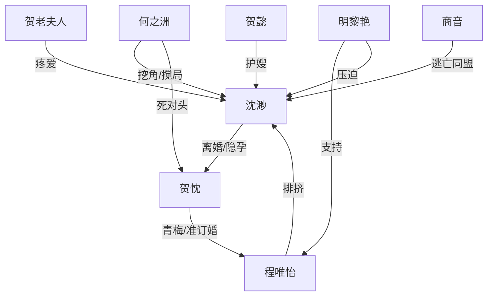

# 角色标签图谱

## 角色清单

### 沈渺 — 清醒隐忍带球跑前妻
- 叙事功能: 视角核心、孕情信息差载体、逃离目标发起者
- 核心标签: 孤女、能干秘书、隐孕母亲
- 弧光: 暗恋服软 → 离婚清醒 → 带球逃离 → 被困后寻找破局
- 台词风格: 客气、克制、边界感强
- 关键行为: 否认孩子、递辞职信、隐瞒孕吐、签解约书、孕检逃避
- 读者情绪关系: 心疼、代入、替她憋屈

### 贺忱 — 嘴硬冷感占有型霸总
- 叙事功能: 男主、压迫源、潜在追妻偿债人
- 核心标签: 冷漠、权势、占有欲
- 弧光: 误会抢娃 → 拒绝复婚 → 不许离职 → 因觊觎者出手
- 台词风格: 短句、命令式、低情绪
- 关键行为: 抢抚养权、强行调回、拒绝离职、灌倒何之洲
- 读者情绪关系: 又恨又期待其追妻火葬场

### 程唯怡 — 娇纵绿茶准未婚妻
- 叙事功能: 女主外部压迫者、男主偏爱参照物
- 核心标签: 青梅、娇纵、占有欲强
- 弧光: 准未婚妻自信 → 使唤沈渺 → 伪造解约 → 借何之洲逼走沈渺
- 台词风格: 撒娇、控诉、命令
- 关键行为: 删除请假短信、使唤买东西、骗签解约书、联系何之洲
- 读者情绪关系: 恨点集中载体

### 明黎艳 — 门第压迫型豪门母亲
- 叙事功能: 家族阶层压迫、程唯怡后台
- 核心标签: 势利、护短、强势
- 弧光: 看不起沈渺 → 逼她离开 → 帮程唯怡伪造解约 → 派人偷拍
- 台词风格: 命令、羞辱、上位者口吻
- 关键行为: 甩支票、训斥沈渺、给程唯怡兜底
- 读者情绪关系: 阶层屈辱恨点

### 贺懿 — 护嫂直球妹妹
- 叙事功能: 女主温暖支点、贺家误会推进器
- 核心标签: 单纯、护短、直球
- 弧光: 认定沈渺是嫂子 → 发现孕情 → 误判何之洲是父亲
- 台词风格: 直白、急躁、可爱
- 关键行为: 带沈渺回贺家、办住院、调病历、跟踪何之洲
- 读者情绪关系: 缓冲甜点、亲情补偿

### 贺老夫人 — 无条件护女主的家族长辈
- 叙事功能: 女主被爱的证明、贺家内部反向站队
- 核心标签: 慈爱、护短、敏锐
- 弧光: 心疼离婚沈渺 → 知孕后担心她被欺负 → 准备暗中主持公道
- 台词风格: 家常、护犊、带怒气
- 关键行为: 骂贺忱、邀请过年、让贺懿查孩子父亲
- 读者情绪关系: 温暖与心疼

### 何之洲 — 搅局纨绔男二
- 叙事功能: 刺激男主占有欲、制造误会与外部出口
- 核心标签: 张扬、嘴欠、看热闹
- 弧光: 挖角沈渺 → 偷拍威胁 → 替她掏违约金 → 被贺忱灌倒
- 台词风格: 痞气、挑衅、密集输出
- 关键行为: 给名片、发照片、录音、医院偶遇
- 读者情绪关系: 搅局爽点与误会工具

### 商音 — 女主闺蜜/逃亡同盟
- 叙事功能: 女主的现实后援，提供逃离方案
- 核心标签: 不婚主义、清醒、嘴快
- 弧光: 支持沈渺生娃 → 规划离京 → 劝她找何之洲
- 台词风格: 口语、直接、吐槽式
- 关键行为: 提供止吐药、规划城市、情绪支持
- 读者情绪关系: 安全感与陪伴

## 关系网络

## 角色功能对照表（供改编参考）

| 原角色 | 极致标签 | 叙事功能 | 读者情绪功能 | 改编时必须保留的 |
|--------|---------|---------|-------------|---------------|
| 沈渺 | 清醒带球跑前妻 | 信息差核心 | 心疼/代入 | 隐孕、离职逃离、克制 |
| 贺忱 | 冷感占有霸总 | 压迫与追妻债务源 | 恨/期待 | 嘴硬伤人、行动占有 |
| 程唯怡 | 绿茶准未婚妻 | 外部逼迫 | 恨 | 使唤、删信息、伪造解约 |
| 明黎艳 | 势利豪门母 | 阶层压迫 | 屈辱 | 门第羞辱、甩钱、偷拍 |
| 贺懿 | 护嫂妹妹 | 温情支点 | 轻松/暖 | 误会孩子父亲 |
| 贺老夫人 | 护短奶奶 | 亲情补偿 | 暖/心疼 | 无条件站女主 |
| 何之洲 | 纨绔搅局男二 | 刺激占有欲 | 看热闹/爽 | 挖角、录音、误会父亲 |
| 商音 | 清醒闺蜜 | 后援 | 安全感 | 带她逃离京北 |
