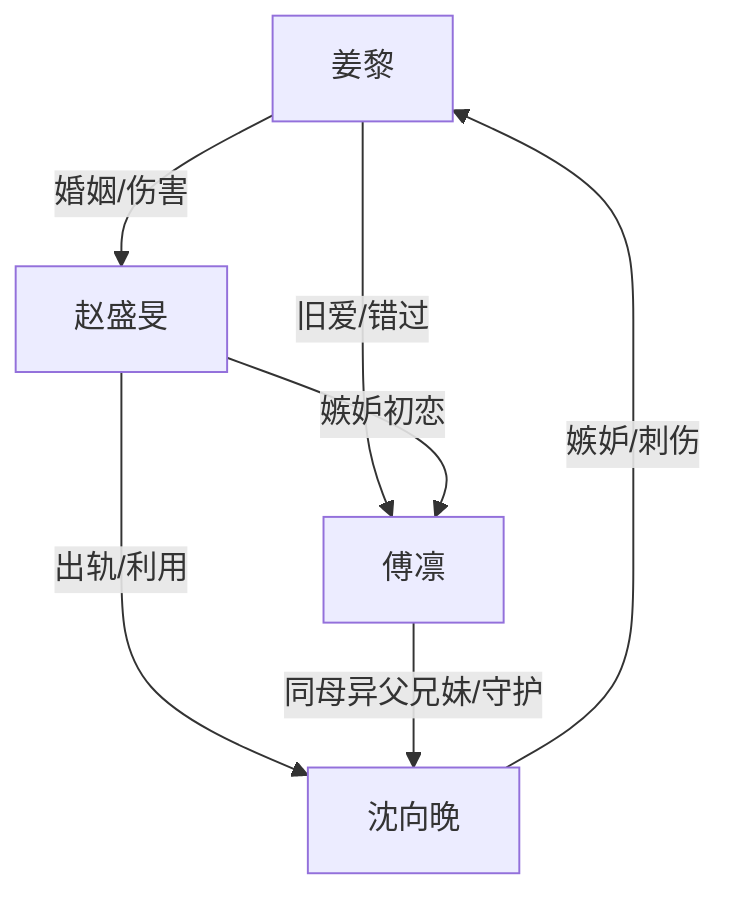

# 角色标签图谱

## 角色清单

### 姜黎 — 清醒离场型大女主

- 叙事功能: 第一人称主视角，承载所有信息差与最终价值判断。
- 核心标签: 克制、清醒、旧伤深重
- 弧光: 误以为旧爱回头 → 看清所有人的利用 → 拒绝双男重启人生
- 台词风格: 短句、冷静、带刺
- 关键行为: 签离婚协议、逼问傅凛、拒绝破镜重圆、南下生活
- 读者情绪关系: 心疼、认同、爽

### 傅凛 — 旧爱补偿型初恋

- 叙事功能: 制造“破镜重圆”期待并亲手打碎。
- 核心标签: 深情、拧巴、保护欲错位
- 弧光: 以律师身份回归 → 被揭穿为沈向晚铺路 → 得知旧年真相后悔
- 台词风格: 温柔、解释型、压抑
- 关键行为: 接离婚官司、隐匿财产线索、安慰沈向晚、医院告白
- 读者情绪关系: 惋惜、恨其不纯、意难平

### 赵盛旻 — 幼稚偏执型前夫

- 叙事功能: 婚姻压迫源，也是情感债核心债主。
- 核心标签: 占有欲、幼稚、迟来悔悟
- 弧光: 出轨刺激姜黎 → 伤害导致流产 → 求复合失败 → 与沈向晚结婚
- 台词风格: 质问、失控、求饶
- 关键行为: 养小三、掐伤姜黎、拒签离婚、求复合
- 读者情绪关系: 恨、厌、少量唏嘘

### 沈向晚 — 工具人反噬型小三

- 叙事功能: 引爆婚姻与兄妹旧爱的交叉矛盾。
- 核心标签: 上位、伪弱、失控
- 弧光: 秘书小三 → 假孕逼婚 → 真怀孕却被抛弃 → 刺伤姜黎 → 嫁给赵盛旻
- 台词风格: 委屈、质问、崩溃
- 关键行为: 发送照片视频、假孕割腕、冲进姜黎家、刺伤姜黎
- 读者情绪关系: 厌恶、看报应、部分怜悯

## 关系网络

## 角色功能对照表（供改编参考）

| 原角色 | 极致标签 | 叙事功能 | 读者情绪功能 | 改编时必须保留的 |
|--------|---------|---------|-------------|---------------|
| 姜黎 | 清醒离场大女主 | 价值锚点 | 心疼与爽 | 不原谅、不复合、重启人生 |
| 傅凛 | 旧爱补偿型初恋 | 破镜期待 | 意难平 | 爱是真的，但行动不纯 |
| 赵盛旻 | 偏执前夫 | 婚姻伤害源 | 恨与报应 | 因幼稚占有造成不可逆伤害 |
| 沈向晚 | 工具人小三 | 冲突引爆器 | 厌恶与反噬爽 | 既害人也被利用 |
