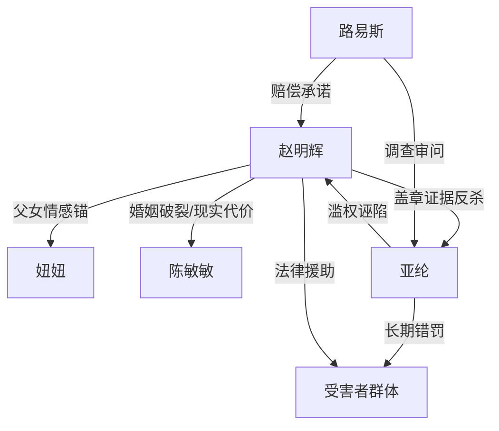

# 角色标签图谱

## 角色清单

### 赵明辉 — 被逼到绝路的冷静反杀者
- 叙事功能: 第一人称主角，承受冤屈并完成规则反杀。
- 核心标签: 普通老板、父亲、死磕者
- 弧光: 想解释清白的普通人 → 被毁掉事业家庭的受害者 → 用证据掀翻腐败链的行动者
- 台词风格: 前期急切解释，后期短句逼问。
- 关键行为: 要求检测；认罪同时要求律师和公证；索要盖章说明；索赔十四点六亿；设立法律援助点。
- 读者情绪关系: 前半心疼，后半爽，结尾敬佩。

### 亚纶 — 滥权经验主义反派
- 叙事功能: 主要施害者，制造误判、威胁、腐败链。
- 核心标签: 老资历、傲慢、贪腐
- 弧光: “闭眼都能认”的权力者 → 大厅冒汗的被质询者 → 牢里糊纸盒的囚犯
- 台词风格: 武断、压迫、轻蔑。
- 关键行为: 把盒饭定为菌种；拒看小票；带走主角；用三百块羞辱赔偿；参与罚款回流。
- 读者情绪关系: 恨、厌恶、期待其崩塌。

### 路易斯 — 制度清算执行者
- 叙事功能: 公权内部纠偏者，将个人反杀推向制度清算。
- 核心标签: 处长、审查者、秩序修复者
- 弧光: 怀疑主角索赔 → 发现异常 → 成立专项调查组 → 承诺赔偿
- 台词风格: 简短、权威、程序化。
- 关键行为: 叫来亚纶对质；询问围观者；带走亚纶；审银行流水。
- 读者情绪关系: 提供安全感和官方兑现感。

### 陈敏敏 — 被现实压垮的妻子
- 叙事功能: 呈现冤案对家庭的真实杀伤。
- 核心标签: 妻子、母亲、现实退场者
- 弧光: 共同创业伴侣 → 扛不住生活压力提出离婚 → 回国后道歉但无法回到从前
- 台词风格: 克制、愧疚、现实。
- 关键行为: 变卖家产；离婚；带妞妞等主角回家。
- 读者情绪关系: 复杂，既心疼又遗憾，不是主要恨点。

### 妞妞 — 情绪软肋与补偿对象
- 叙事功能: 放大主角被逼认罪的痛点，也是结尾补偿的核心。
- 核心标签: 两岁女儿、无辜、亲情锚点
- 弧光: 审讯室哭喊爸爸 → 喊别人爸爸 → 回国后重新扑向主角
- 台词风格: 稚嫩、短句。
- 关键行为: 审讯室哭；喊陌生男人爸爸；结尾要主角戴发卡。
- 读者情绪关系: 心疼，强化反派罪不可恕。

### 老头/年轻女孩/受害者群体 — 公共冤屈放大器
- 叙事功能: 证明亚纶不是误判一次，而是长期作恶。
- 核心标签: 普通人、被错罚者、证人
- 弧光: 围观者 → 站出来举证 → 被补偿或致谢
- 台词风格: 具体金额、具体遭遇。
- 关键行为: 当场揭露拼图、咖啡豆等错罚案；法庭后下跪感谢。
- 读者情绪关系: 激发公愤和公共正义爽点。

## 关系网络

## 角色功能对照表（供改编参考）

| 原角色 | 极致标签 | 叙事功能 | 读者情绪功能 | 改编时必须保留的 |
|--------|---------|---------|-------------|---------------|
| 赵明辉 | 被逼到绝路的冷静反杀者 | 承压、取证、反杀、升华 | 心疼→爽→敬佩 | 普通人身份、家庭事业被毁、盖章反杀 |
| 亚纶 | 滥权老资历反派 | 制造压迫与死环对象 | 恨、期待报应 | 经验主义傲慢、拒绝证据、长期牟利 |
| 路易斯 | 制度清算者 | 让反杀有执行结果 | 安全感 | 更高权力介入、专项调查 |
| 陈敏敏 | 被现实压垮的亲人 | 展示代价不可逆 | 遗憾、复杂 | 离婚/家庭裂痕不可轻易圆满 |
| 妞妞 | 无辜软肋 | 情绪刺点与补偿 | 心疼 | 审讯室或等价场景的孩子压迫 |
| 受害者群体 | 公共冤屈证人 | 扩大案件量级 | 公愤、泪点 | 至少 2 个具体受害案例 |
