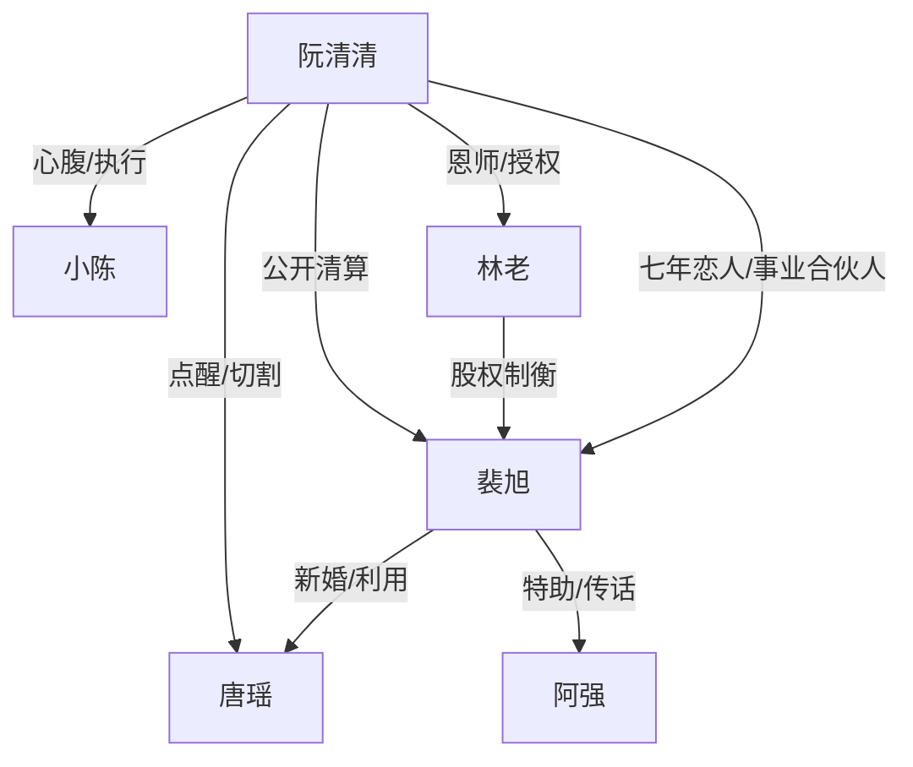

# 角色标签图谱

## 角色清单

### 阮清清 — 清醒事业型复仇大女主

- 叙事功能: 主视角、受害者、布局者、清算者。
- 核心标签: 冷静、能忍、专业强者。
- 弧光: 被背叛的未婚妻 → 掌控海外分部的 CEO → 胜利后承受失去的人。
- 台词风格: 短句、冷嘲、证据导向。
- 关键行为: 诱导签独立协议、迁移核心团队、移走雷区预案、公开挪用证据、切割旧情。
- 读者情绪关系: 心疼她七年被辜负，又爽她理性反杀。

### 裴旭 — 既要又要的负心总裁

- 叙事功能: 核心反派、情绪债制造者、温度反转对象。
- 核心标签: 自负、贪婪、控制欲。
- 弧光: 自以为能掌控两边 → 项目和权力失控 → 看守所崩溃自杀。
- 台词风格: 先命令，后哀求，再威胁。
- 关键行为: 支走女主、和唐瑶领证、夺项目、泼脏水、阻止发布会。
- 读者情绪关系: 让读者恨、厌、最后产生有限复杂感。

### 唐瑶 — 绿茶新婚妻/工具型第三者

- 叙事功能: 激化背叛，暴露裴旭贪婪。
- 核心标签: 示弱、挑衅、无能。
- 弧光: 得意上位 → 接不住项目 → 下跪求饶 → 流产崩溃。
- 台词风格: 表面柔弱，激动时尖利。
- 关键行为: 穿裴旭衬衫示威、接手星海、辱骂女主、求女主撤诉。
- 读者情绪关系: 前期招恨，后期转为反衬裴旭自私。

### 小陈 — 忠诚心腹/事业见证者

- 叙事功能: 执行女主计划，提供信息，承接读者惊讶。
- 核心标签: 忠诚、能干、情绪外显。
- 弧光: 国内心腹 → 海外团队成员 → 清越见证者。
- 台词风格: 直接、急切、带年轻员工感。
- 关键行为: 压合同、搭架构、转消息、协助发布会。
- 读者情绪关系: 增强女主不是孤军奋战的安全感。

### 林老 — 创始人恩师/权力托底者

- 叙事功能: 提供海外合法性与股权授权。
- 核心标签: 老练、清醒、信任女主。
- 弧光: 被裴旭边缘化的创始人 → 女主反杀的盟友。
- 台词风格: 稳、点到即止。
- 关键行为: 接纳女主、确认剥离、授权表决权。
- 读者情绪关系: 给读者“女主有后手”的爽感。

### 阿强 — 裴旭特助/余波传递者

- 叙事功能: 传达裴旭软硬兼施，结尾送出遗物。
- 核心标签: 夹缝、服从、见证。
- 弧光: 替裴旭请女主回国 → 送来裴旭遗物。
- 台词风格: 恳求、为难。
- 关键行为: 递钻戒发票、送遗物纸箱。
- 读者情绪关系: 让裴旭的悔意具象落地。

## 关系网络

## 角色功能对照表（供改编参考）

| 原角色 | 极致标签 | 叙事功能 | 读者情绪功能 | 改编时必须保留的 |
|--------|---------|---------|-------------|---------------|
| 阮清清 | 清醒事业大女主 | 布局与清算 | 心疼+爽 | 专业能力、冷静姿态、合法反杀 |
| 裴旭 | 既要又要负心男 | 制造情绪债 | 恨+后期复杂 | 自负、撒谎、控制、悔恨 |
| 唐瑶 | 绿茶上位者 | 激化背叛 | 厌恶+反衬 | 示威、无能接盘、求饶 |
| 小陈 | 忠诚心腹 | 执行计划 | 安全感 | 协助迁移团队与信息传递 |
| 林老 | 权力托底者 | 合法背书 | 稳定爽感 | 授权/资源支持 |
| 阿强 | 余波信使 | 传递悔意 | 尾声伤感 | 遗物或证据送达 |
