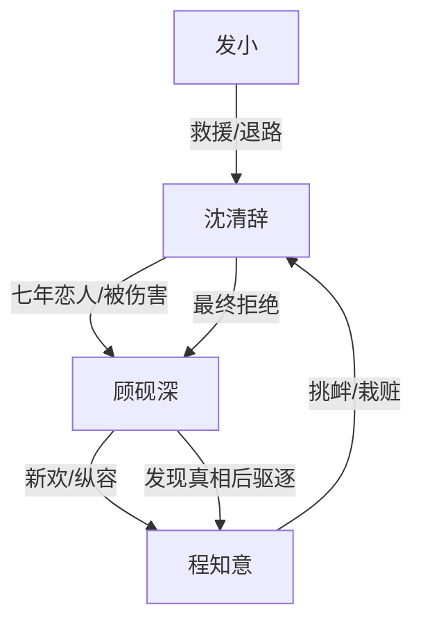

# 角色标签图谱

## 角色清单

### 沈清辞 — 受伤清醒女主
- 叙事功能: 承载被羞辱、被夺取、被伤害后的清醒离开。
- 核心标签: 被三受害者、无家感、最终清醒
- 弧光: 依附顾砚深的孤女 → 失去孩子的受害者 → 远走挪威的新生者
- 台词风格: 前期哽咽解释，后期平静判决
- 关键行为: 压回孕检单、联系发小、拒绝原谅、离开、拒绝复合
- 读者情绪关系: 心疼、憋屈、最终解气

### 顾砚深 — 自负追妻火葬场男主
- 叙事功能: 最大情绪债制造者，也是后半火葬场偿债对象。
- 核心标签: 霸总、傲慢、迟到悔恨
- 弧光: 救赎者 → 加害者 → 悔恨者 → 永久失去者
- 台词风格: 前期理所当然，后期卑微祈求
- 关键行为: 拒婚、官宣程知意、赶女主出家、逼跪、误伤流产、追到挪威
- 读者情绪关系: 前期恨，后期看他痛苦获得补偿爽

### 程知意 — 伪小白花第三者
- 叙事功能: 外部压迫源，推动顾砚深暴露真实立场。
- 核心标签: 绿茶、伪装、栽赃
- 弧光: 被宠新人 → 得寸进尺 → 真相败露被驱逐
- 台词风格: 撒娇、装弱、道歉绑架
- 关键行为: 挑衅女主、夺家、杀猫栽赃、下跪求原谅
- 读者情绪关系: 厌恶、期待被揭穿

### 发小 — 退路提供者
- 叙事功能: 让女主离开不是嘴上说说，而有实际路径。
- 核心标签: 忠诚、旧友、救援
- 弧光: 远方承诺者 → 兑现承诺者
- 台词风格: 简洁可靠
- 关键行为: 准备材料、三天后接走女主
- 读者情绪关系: 安心、替女主获得支撑

## 关系网络

## 角色功能对照表（供改编参考）

| 原角色 | 极致标签 | 叙事功能 | 读者情绪功能 | 改编时必须保留的 |
|--------|---------|---------|-------------|---------------|
| 沈清辞 | 受伤清醒女主 | 承债与最终拒绝 | 心疼、解气 | 旧伤、孕检、离开、拒绝复合 |
| 顾砚深 | 火葬场男主 | 制造债务并偿债失败 | 恨、爽 | 前期傲慢和后期卑微落差 |
| 程知意 | 伪小白花 | 外部挑衅与栽赃 | 恨 | 装弱夺取、栽赃真相 |
| 发小 | 退路锚点 | 让女主行动可信 | 安心 | 早埋承诺，后兑现 |
