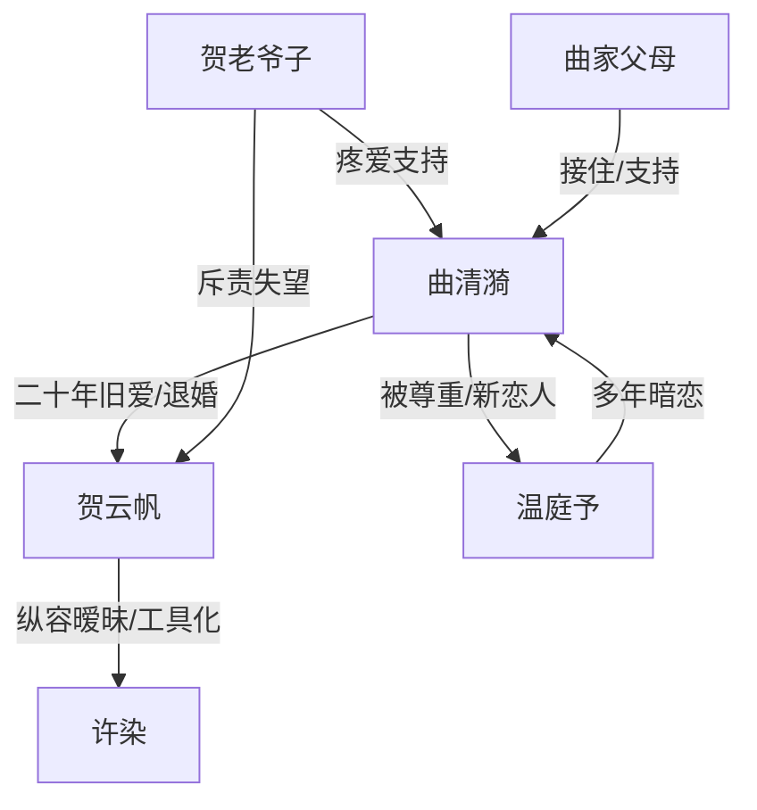

# 角色标签图谱

## 角色清单

### 曲清漪 — 清醒退婚大小姐
- 叙事功能: 主视角、情绪债承受者、最终价值判断者。
- 核心标签: 清醒、体面、边界感。
- 弧光: 满心旧爱 → 冷静退婚 → 接纳新爱。
- 台词风格: 短句、克制、刀口精准。
- 关键行为: 谈妥退婚、飞加拿大、拒绝纠缠、选择温庭予。
- 读者情绪关系: 心疼、代入、爽。

### 贺云帆 — 普信掌权人/迟来追悔旧爱
- 叙事功能: 施压者、情绪债制造者、追悔清算对象。
- 核心标签: 傲慢、错判、迟钝。
- 弧光: 掌控自信 → 发现退婚 → 追悔失控 → 婚礼旁观。
- 台词风格: 命令式、自我辩护、后期哀求。
- 关键行为: 带许染越界、贬低女主、追到加拿大、见证婚礼。
- 读者情绪关系: 恨、嘲讽、看报应。

### 温庭予 — 克制守候型男二/正牌新郎
- 叙事功能: 情感补偿者、健康亲密关系对照组。
- 核心标签: 温柔、耐心、边界感。
- 弧光: 旧日暗恋者 → 合作伙伴 → 被女主选择的爱人。
- 台词风格: 温和、尊重、不逼迫。
- 关键行为: 接机、接电话、等待女主、停车场保护、婚礼订盟。
- 读者情绪关系: 安心、甜、补偿。

### 许染 — 心机小助理/误以为上位者
- 叙事功能: 引爆关系裂痕的第三人。
- 核心标签: 装怯、炫耀、越界。
- 弧光: 被纵容 → 晒暧昧 → 被工具化羞辱 → 出局。
- 台词风格: 撒娇、装无辜、茶味。
- 关键行为: 发帖、订一间房、坐秋千、留宿照顾。
- 读者情绪关系: 厌恶、嘲讽。

### 贺老爷子 — 道德裁判/退婚见证人
- 叙事功能: 豪门内部正义坐标。
- 核心标签: 疼爱、清醒、威严。
- 弧光: 劝阻退婚 → 看清孙子 → 支持清漪。
- 台词风格: 直斥、长辈威严。
- 关键行为: 寿宴训斥、确认退婚、通知女主前任追来。
- 读者情绪关系: 信任、解气。

## 关系网络

## 角色功能对照表（供改编参考）

| 原角色 | 极致标签 | 叙事功能 | 读者情绪功能 | 改编时必须保留的 |
|--------|---------|---------|-------------|---------------|
| 曲清漪 | 清醒退婚大小姐 | 主视角与价值裁判 | 心疼、爽 | 不闹、不争、不回头 |
| 贺云帆 | 普信旧爱 | 制造伤害与追悔 | 恨、看报应 | 用“空间/规矩”合理化越界 |
| 温庭予 | 克制守候者 | 情感补偿 | 安心、甜 | 尊重女主恢复节奏 |
| 许染 | 越界小助理 | 刺激裂痕 | 厌恶 | 公开晒暧昧、装无辜 |
| 贺老爷子 | 豪门良心 | 见证退婚 | 解气 | 支持女主而非包庇孙子 |
