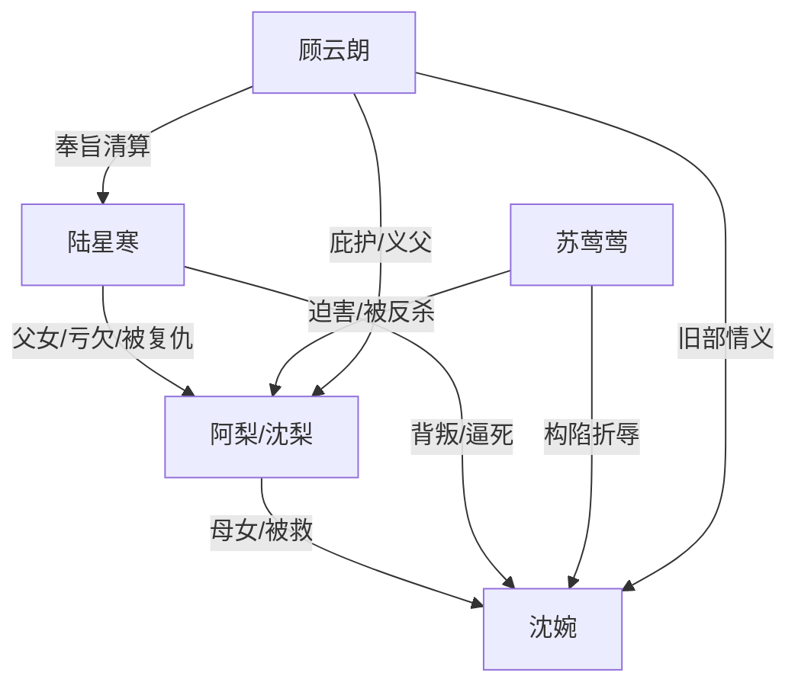

# 角色标签图谱

## 角色清单

### 阿梨 / 沈梨 — 冰冷复仇孤女
- 叙事功能: 第一人称见证者、幸存者、后半复仇执行者。
- 核心标签: 母亲遗孤、假失忆、冷静清算。
- 弧光: 被保护的孩子 → 背负母债的复仇者 → 完成清算的幸存者。
- 台词风格: 前半哭喊哀求，后半短句冷审判。
- 关键行为: 记住倒计时、假装失忆回府、诱苏莺莺认罪、毒杀陆星寒、引禁军查抄。
- 读者情绪关系: 前半心疼，后半代入爽。

### 沈婉 — 被逼死的将门嫡女/献祭母亲
- 叙事功能: 情绪债核心来源，复仇合法性的道德锚点。
- 核心标签: 世家千金、受辱正妻、舍命护女。
- 弧光: 被背叛的妻子 → 被折辱的母亲 → 以死换女儿生还。
- 台词风格: 克制、决绝，临终温柔。
- 关键行为: 提和离、护阿梨、交玉簪、跳城楼换女儿平安。
- 读者情绪关系: 极致心疼与惋惜。

### 陆星寒 — 负心渣爹/迟来悔恨者
- 叙事功能: 最大施害者与终局清算对象。
- 核心标签: 旧日爱人、偏听偏信、伪忏悔。
- 弧光: 守诺将军 → 宠妾灭妻 → 短暂悔恨 → 被女儿毒杀抄家。
- 台词风格: 前期高高在上，后期破碎求原谅。
- 关键行为: 烧和离书、罚四十鞭、逼女儿上美人台、抱走苏莺莺、求阿梨原谅。
- 读者情绪关系: 恨、恶心、等待报应。

### 苏莺莺 — 青楼绿茶妾/构陷者
- 叙事功能: 具体施害工具人，承担女性恶意与镜像报复对象。
- 核心标签: 装柔弱、会构陷、嫉妒正妻。
- 弧光: 受宠平妻候选 → 假蛊败露 → 被发卖回暗娼寮。
- 台词风格: 茶言茶语、哭诉装弱、败露后恶毒。
- 关键行为: 逼冰湖捞耳环、自导落水、假蛊构陷、辱骂沈婉。
- 读者情绪关系: 强烈厌恶，期待同态报应。

### 顾云朗 — 外部正义/复仇资源
- 叙事功能: 阿梨逃生与终局公权力清算的支点。
- 核心标签: 忠靖侯、沈家旧人、禁军引入者。
- 弧光: 玉簪线索中的保护者 → 义父 → 抄家执行者。
- 台词风格: 威严公文式。
- 关键行为: 收阿梨为义女，奉旨查抄将军府。
- 读者情绪关系: 安全感与正义补偿。

## 关系网络

## 角色功能对照表（供改编参考）

| 原角色 | 极致标签 | 叙事功能 | 读者情绪功能 | 改编时必须保留的 |
|--------|---------|---------|-------------|---------------|
| 阿梨 | 冷静复仇孤女 | 见证与清算 | 心疼转爽 | 假弱势回归、亲手审判父亲 |
| 沈婉 | 献祭母亲 | 情绪债核心 | 极致心疼 | 为女儿牺牲，死亡不可逆 |
| 陆星寒 | 悔恨渣爹 | 最大施害者 | 恨与报应期待 | 曾经爱过、后来亲手毁掉 |
| 苏莺莺 | 青楼绿茶妾 | 具体构陷者 | 厌恶与报复期待 | 装弱构陷、被同态发卖 |
| 顾云朗 | 正义外援 | 权力收束 | 安全感 | 保护女主并完成公权力清算 |
