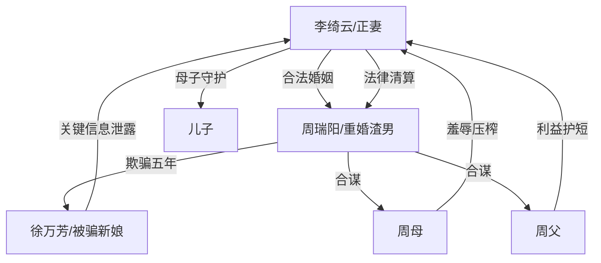

# 角色标签图谱

## 角色清单

### 李绮云 — 清醒复仇正妻
- 叙事功能: 第一视角承受伤害、收集证据、公开审判、法律清算。
- 核心标签: 正妻、母亲、冷静清算者。
- 弧光: 被欺骗的付出者 → 当众揭穿者 → 自立建家者。
- 台词风格: 短句、反问、账目清算。
- 关键行为: 婚礼现场夺麦、列账、扇耳光、起诉离婚与重婚。
- 读者情绪关系: 心疼、代入、爽。

### 周瑞阳 — 双面重婚渣男
- 叙事功能: 核心施害者，制造婚姻、财产、身份三重背叛。
- 核心标签: 重婚、伪善、利己。
- 弧光: 完美新郎 → 谎言败露 → 获刑。
- 台词风格: 哄骗、压低声音求稳、事后求和。
- 关键行为: 伪造前妻母子死亡、伪造结婚证、转移共同财产。
- 读者情绪关系: 恨、恶心、期待惩罚。

### 周母/婆婆 — 吸血势利婆婆
- 叙事功能: 强化家庭伦理压迫，承载“白送”“彩礼”“金条”羞辱。
- 核心标签: 势利、刻薄、贪财。
- 弧光: 主桌红光满面 → 当众埋头 → 法庭旁听席佝偻。
- 台词风格: 夹枪带棒、胡搅蛮缠。
- 关键行为: 骂女主丧门星，索要八万八，惦记金条。
- 读者情绪关系: 恨、想看她被公开羞辱。

### 周父/公公 — 帮凶型父权长辈
- 叙事功能: 家族合谋的沉默背书与利益护盘。
- 核心标签: 附和、护短、算计。
- 弧光: 坐主桌受祝福 → 帮腔争财产 → 失势。
- 台词风格: 简短粗暴，利益至上。
- 关键行为: 附和嫌弃女主，阻挠财产分割。
- 读者情绪关系: 厌恶。

### 徐万芳 — 被骗新娘/对照组
- 叙事功能: 作为待遇对照，放大女主被亏待；同时成为揭穿渣男的二级受害者。
- 核心标签: 被骗、优越感破碎、受害者。
- 弧光: 幸福新娘 → 惊愕质问 → 愿意退还财产。
- 台词风格: 前期甜蜜优越，后期崩溃质问。
- 关键行为: 说出戒烟、熬汤、假结婚证等关键信息。
- 读者情绪关系: 前期刺痛，后期复杂同情。

### 儿子 — 被抹杀的无辜者
- 叙事功能: 把婚姻背叛升级为母性伦理伤害，并提供结尾补偿。
- 核心标签: 无辜、被诅咒、未来。
- 弧光: 被父亲谎称死亡 → 回到母亲身边搭新家。
- 台词风格: 天真、生活化。
- 关键行为: 结尾搭积木房子。
- 读者情绪关系: 心疼、保护欲、治愈。

## 关系网络

## 角色功能对照表（供改编参考）

| 原角色 | 极致标签 | 叙事功能 | 读者情绪功能 | 改编时必须保留的 |
|--------|---------|---------|-------------|---------------|
| 李绮云 | 清醒复仇正妻 | 承债与清算 | 爽、心疼 | 不哭求，不原谅，走法律闭环 |
| 周瑞阳 | 双面重婚渣男 | 核心施害者 | 恨、恶心 | 五年欺骗、假证/假身份、财产转移 |
| 婆婆 | 吸血势利婆婆 | 家庭压迫 | 想看打脸 | 彩礼/改口费/侮辱性称呼 |
| 公公 | 父权帮凶 | 护短争利 | 厌恶 | 公然站队儿子利益 |
| 徐万芳 | 被骗新娘 | 对照与证人 | 刺痛、复杂同情 | 她必须不知情，且说出关键证据 |
| 儿子 | 被抹杀无辜者 | 情绪底线 | 心疼、补偿 | 被父亲“写死”，结尾与母亲重建家 |
