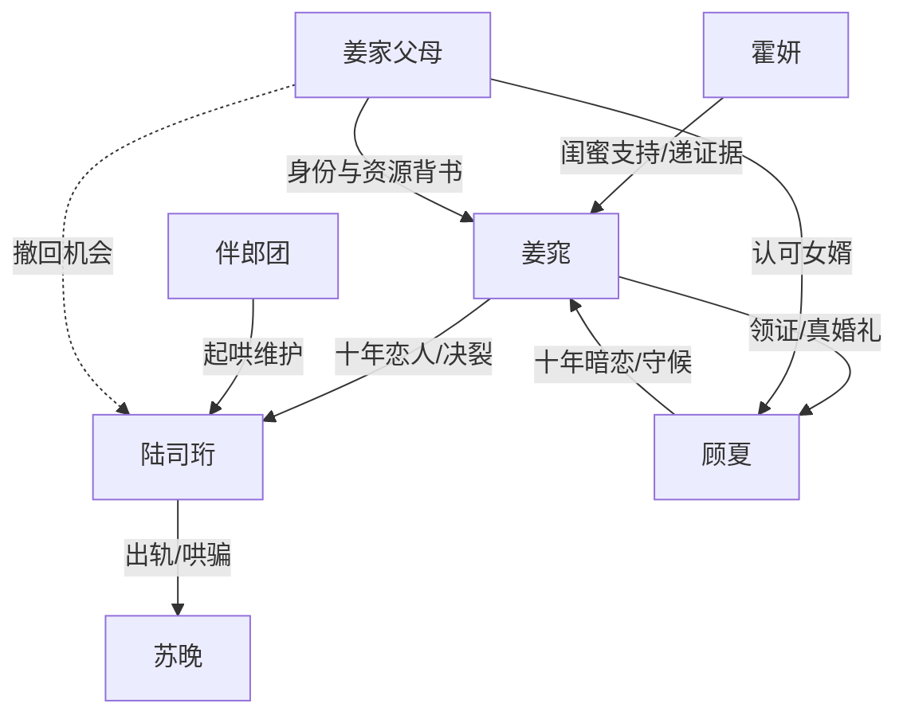

# 角色标签图谱

## 角色清单

### 姜窕 — 清醒反杀大女主
- 叙事功能: 承受背叛、启动换新郎反杀、揭开身份与资源真相。
- 核心标签: 冷静、能扛事、船王千金。
- 弧光: 十年恋爱赌局中的隐忍者 → 当众换新郎的掌局者 → 被真正珍视的人。
- 台词风格: 短句、平静、宣判式。
- 关键行为: 摘戒指、婚礼换新郎、亮结婚证、拒见陆司珩。
- 读者情绪关系: 心疼她被辜负，爽于她冷静反杀。

### 陆司珩 — 傲慢失控渣男
- 叙事功能: 制造羞辱规则，贡献情绪债，被规则反噬。
- 核心标签: 自负、贪婪、迟来悔恨。
- 弧光: “她离不开我”的掌控者 → 婚礼失控的抢人者 → 资源断裂的跪求者。
- 台词风格: 命令式、羞辱式、后期哀求式。
- 关键行为: 婚前出轨、婚礼当天离场、报警反扑、雨夜下跪。
- 读者情绪关系: 强恨点；他的崩溃提供主要爽感。

### 顾夏 — 钓系死对头真爱
- 叙事功能: 新郎替代者、甜宠补偿者、资源清算执行者。
- 核心标签: 腹黑、深情、港岛贵公子。
- 弧光: 表面死对头 → 婚礼救场新郎 → 十年暗恋守候者。
- 台词风格: 克制、调情、短句占有。
- 关键行为: 领证、走红毯、戴戒指、转接澳城项目。
- 读者情绪关系: 提供安全感、苏感和补偿性甜爽。

### 苏晚 — 绿茶诱因
- 叙事功能: 触发陆司珩背叛，放大女主羞辱。
- 核心标签: 年轻、撒娇、炫耀。
- 弧光: 被宠小三 → 投资失效的麻烦源。
- 台词风格: 撒娇、挑衅。
- 关键行为: 约陆司珩领证、发朋友圈挑衅。
- 读者情绪关系: 引恨，但不是终极反派。

### 霍妍 — 情绪嘴替闺蜜
- 叙事功能: 替读者骂醒女主，揭露女主付出和身份伏笔。
- 核心标签: 仗义、火爆、清醒。
- 弧光: 愤怒劝离 → 递出证据辅助反杀。
- 台词风格: 直白、密集输出。
- 关键行为: 揭陆司珩靠女主起家，递合同文件。
- 读者情绪关系: 代替读者发泄。

### 陈柏言/周嘉文 — 渣男伴郎团
- 叙事功能: 群体羞辱、放大男方阵营傲慢。
- 核心标签: 起哄、油滑、墙头草。
- 弧光: 嘲笑女主 → 惊慌失控。
- 台词风格: 下流玩笑、圆场套话。
- 关键行为: 视频通风报信、试图撑场。
- 读者情绪关系: 次级恨点，衬托陆司珩圈层烂。

## 关系网络

## 角色功能对照表（供改编参考）

| 原角色 | 极致标签 | 叙事功能 | 读者情绪功能 | 改编时必须保留的 |
|--------|---------|---------|-------------|---------------|
| 姜窕 | 清醒大女主 | 反杀执行者 | 心疼+爽 | 冷静、不求、不解释、证据落槌 |
| 陆司珩 | 傲慢渣男 | 情绪债来源 | 恨与报应快感 | 亲口制定羞辱规则 |
| 顾夏 | 钓系真爱死对头 | 补偿与升维 | 苏感、安全感 | 早有准备、长期暗恋证据 |
| 苏晚 | 绿茶小三 | 背叛触发器 | 厌恶 | 炫耀挑衅，不能过强抢主反派位置 |
| 霍妍 | 嘴替闺蜜 | 信息揭露 | 代读者骂 | 揭示女主真实价值 |
| 伴郎团 | 帮凶群像 | 放大羞辱 | 群体打脸 | 起哄、嘲讽、后期僵住 |
