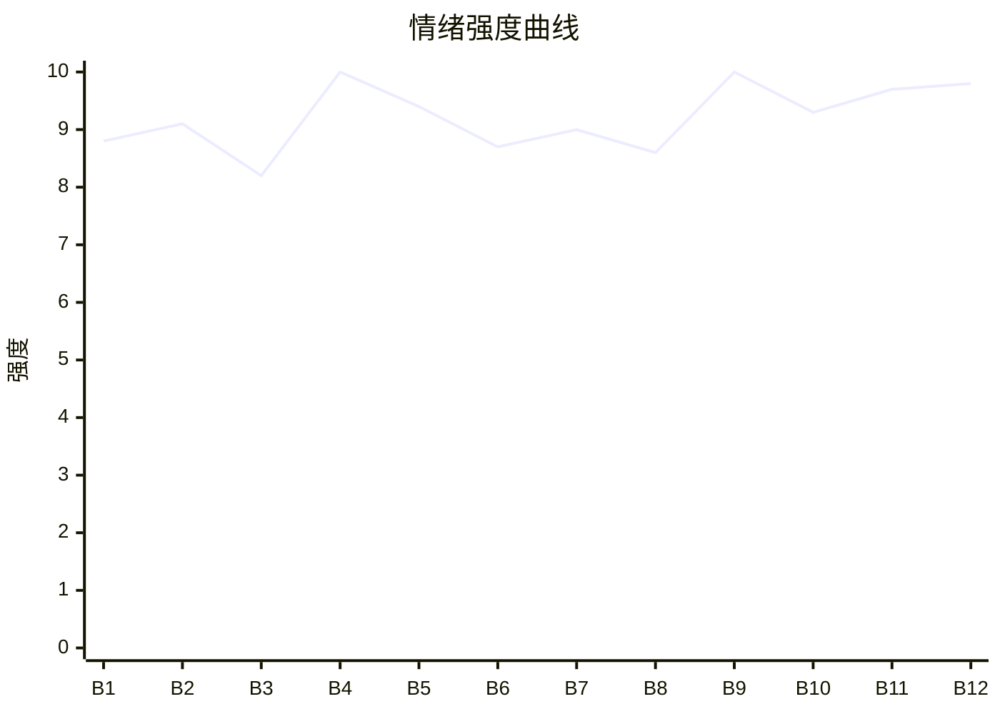

# Beat Sheet 节拍器

## 全文概况

- 总字数: 约 15000 字
- 节拍数: 12 幕
- 核心母题（Logline）: 高定婚纱师沈宁被丈夫和假孕秘书联手羞辱、囚禁并害到流产后，借设计备案、录音与诱导抄袭完成公开反杀，最终拒绝悔恨丈夫的原谅并重获新生。
- 情绪模式: 极致羞辱 → 职业摧毁 → 身体触底 → 冷静蓄谋 → 晚宴爆杀 → 悔恨偿债 → 新生补偿

## 节拍详表

### Beat 1: 怀孕秘书试白纱，原配被迫量尺寸 [开篇-签字撕支票]

- **字数**: 约 950 字（占比 6%）
- **核心事件**: 陆泽川带怀孕秘书到沈宁店里试婚纱，逼她接受小三上位和净身出户。
- **情绪标签**: 震惊、憋屈、压迫
- **情绪强度**: 8.8/10
- **情绪方向**: ⚡突变
- **冲突类型**: 大转折
- **悬念钩子**: 沈宁为什么毫不犹豫签字并撕碎支票？
- **叙事速度**: 快
- **对话占比**: 45%
- **reversal_mechanism**: [M3, M5]
- **hook_strength**: 9.0/10（极端度 3，信息密度 2.7，悬念 1.6，节奏 1.7）
- **关键句**: “陆泽川将怀着孕的秘书，带到我的高定婚纱店试白纱。”
- **原文摘录**: “他的兄弟们在VIP室打赌，我会在第几套婚纱前情绪失控。”“她连孩子都不能生，全靠我养着。”“我毫不犹豫地签了字，随手将那张两百万的支票撕得粉碎。”

### Beat 2: 砸店毁纱，旧戒指暴露矛盾余温 [砸婚纱-录让位视频]

- **字数**: 约 1300 字（占比 9%）
- **核心事件**: 陆泽川命保镖砸毁婚纱店，却本能护住初恋对戒，又逼沈宁录退位视频。
- **情绪标签**: 愤怒、荒诞、恶心
- **情绪强度**: 9.1/10
- **情绪方向**: ↑上升
- **冲突类型**: 大转折
- **悬念钩子**: 他仍护旧戒，为什么又要把她踩到底？
- **叙事速度**: 快
- **对话占比**: 35%
- **reversal_mechanism**: [M5, M3]
- **hook_strength**: null
- **关键句**: “现在他亲手把它踩进泥里，逼我给小三让位。”
- **原文摘录**: “一件件我耗费三年心血手工缝制的婚纱被扯下衣架。”“他大步跨过去，用后背挡在了那个陈列柜前。”“就说你欢迎新生命，主动退位让贤，祝她和我百年好合。”

### Beat 3: 婚房视频与情书碎纸，沈宁彻底断情 [休息室-收箱离店]

- **字数**: 约 1000 字（占比 7%）
- **核心事件**: 沈宁发现陆泽川早已让林微微入住婚房、准备烧毁她的设计稿，遂销毁情书并带走护照和作品。
- **情绪标签**: 冷却、断情、清醒
- **情绪强度**: 8.2/10
- **情绪方向**: ↓下降后转冷
- **冲突类型**: 微冲突
- **悬念钩子**: “涅槃”和设计册将如何成为反杀资本？
- **叙事速度**: 中
- **对话占比**: 20%
- **reversal_mechanism**: [M5]
- **hook_strength**: null
- **关键句**: “我把那些带有两人体液的化验单，连同那叠情书，一起塞进进纸口。”
- **原文摘录**: “那就把带有她气味的东西全烧了。”“锋利的刀片把过往切割成无法拼凑的废料。”“把五年的青春和愚蠢彻底封存。”

### Beat 4: 涅槃被撕，真孕流产，一尸两命危机 [门口拦截-卷帘门锁死]

- **字数**: 约 1800 字（占比 12%）
- **核心事件**: 陆泽川夺箱撕毁“涅槃”，推倒沈宁导致流产，又撕碎真孕单、锁门不准救治。
- **情绪标签**: 窒息、剧痛、恨意
- **情绪强度**: 10/10
- **情绪方向**: ⚡突变
- **冲突类型**: 大转折
- **悬念钩子**: 沈宁能否活下来？陆泽川得知真相会怎样？
- **叙事速度**: 快
- **对话占比**: 38%
- **reversal_mechanism**: [M5, M6]
- **hook_strength**: null
- **关键句**: “我不是不会下蛋的母鸡，我刚刚怀上了他的骨肉。”
- **原文摘录**: “布料被撕裂的声音刺穿了我的耳膜。”“温热的鲜血从双腿间涌出。”“就算你真怀了，你这种恶毒女人的胎留着也是祸害。”“把卷帘门拉下来，锁死。”

### Beat 5: Rh 阴性血引爆，丈夫跪进玻璃渣 [自救-抢救室]

- **字数**: 约 1100 字（占比 7%）
- **核心事件**: 沈宁自救拨打 120，顾时晏喊出 Rh 阴性血真相，陆泽川砸门跪求，被沈宁以剪刀拒绝触碰。
- **情绪标签**: 反转、痛快、迟来的恐慌
- **情绪强度**: 9.4/10
- **情绪方向**: ↑上升
- **冲突类型**: 大转折
- **悬念钩子**: 孩子和沈宁能否保住？
- **叙事速度**: 快
- **对话占比**: 30%
- **reversal_mechanism**: [M5, M3]
- **hook_strength**: null
- **关键句**: “别用碰过她的手碰我，恶心。”
- **原文摘录**: “嫂子那份不是假孕单！医院刚打电话来说她是极其罕见的Rh阴性血！”“高高在上的京圈太子爷，第一次直挺挺地跪在了满地的玻璃渣上。”

### Beat 6: 流产失宫，医院封锁，巴黎邮件埋生路 [手术后-邮件]

- **字数**: 约 1000 字（占比 7%）
- **核心事件**: 沈宁失去孩子和子宫，陆泽川仍以补偿和囚禁维持掌控，沈宁收到巴黎大赛邀请。
- **情绪标签**: 余痛、冷怒、希望暗线
- **情绪强度**: 8.7/10
- **情绪方向**: →平稳蓄力
- **冲突类型**: 微冲突
- **悬念钩子**: 她如何突破封锁去巴黎？
- **叙事速度**: 中
- **对话占比**: 30%
- **reversal_mechanism**: [M6]
- **hook_strength**: null
- **关键句**: “我失去了孩子，也永远失去了子宫。”
- **原文摘录**: “陆泽川引以为傲的特权在这一刻成了一堆废纸。”“封锁病房，没有我的允许，你死也只能死在我的医院里。”“邀请我下个月前往巴黎参加终审。”

### Beat 7: 死胎标本恐吓，录音换自由 [林微微探病-出院]

- **字数**: 约 1150 字（占比 8%）
- **核心事件**: 林微微拿死胎标本刺激沈宁，沈宁录音反制，勒索封口费并撤走保镖。
- **情绪标签**: 恶心、忍耐、初次反击
- **情绪强度**: 9.0/10
- **情绪方向**: ↑上升
- **冲突类型**: 大转折
- **悬念钩子**: 她能否顺利逃往巴黎？
- **叙事速度**: 快
- **对话占比**: 40%
- **reversal_mechanism**: [M3, M6]
- **hook_strength**: null
- **关键句**: “标题就是陆氏总裁纵容小三拿死胎恐吓原配。”
- **原文摘录**: “这是泽川哥特意花钱买来的死胎标本。”“我没有发作。而是悄悄点开手机的录音键。”“一千万封口费，外加撤走门外所有的保镖。”

### Beat 8: 机场截回，别墅囚禁，诱导偷稿 [机场-晚宴新闻]

- **字数**: 约 1400 字（占比 9%）
- **核心事件**: 陆泽川机场截回沈宁并囚禁别墅，沈宁故意复原“涅槃”诱导林微微偷稿。
- **情绪标签**: 压迫、冷静设局、期待
- **情绪强度**: 8.6/10
- **情绪方向**: →蓄势
- **冲突类型**: 微冲突
- **悬念钩子**: 晚宴上偷来的“涅槃”会如何反噬？
- **叙事速度**: 中
- **对话占比**: 25%
- **reversal_mechanism**: [M6, M2]
- **hook_strength**: null
- **关键句**: “我知道林微微虚荣心极强，绝不会放过任何抢夺我心血的机会。”
- **原文摘录**: “你敢踏出京城半步，我就打断你的腿。”“我每天安静地坐在巨大的落地窗前，架起画板开始画图。”“那份完工的电子手稿不翼而飞。”

### Beat 9: 慈善晚宴公开爆杀，假孕骗局崩塌 [晚宴-专车离场]

- **字数**: 约 1700 字（占比 11%）
- **核心事件**: 沈宁用备案记录、紫外线荧光字、医院报告与录音揭穿偷稿和假孕骗局。
- **情绪标签**: 爽、震撼、清算
- **情绪强度**: 10/10
- **情绪方向**: ⚡突变
- **冲突类型**: 大转折
- **悬念钩子**: 陆泽川如何面对自己亲手害死亲骨肉？
- **叙事速度**: 快
- **对话占比**: 35%
- **reversal_mechanism**: [M2, M3, M6]
- **hook_strength**: null
- **关键句**: “那是他亲手递给我的断头台，如今终于落到了他自己的脖子上。”
- **原文摘录**: “屏幕上瞬间跳出了一份加盖国际评委组公章的原始手稿备案记录。”“巨大的‘妓女林微微专属’七个大字……闪烁发光。”“她根本无法怀孕。”“一个绑在腰间的硅胶假肚皮……滚到了陆泽川的皮鞋边。”

### Beat 10: 废墟录音引爆悔恨，陆泽川自我刑罚 [后续听说-撞墙]

- **字数**: 约 1200 字（占比 8%）
- **核心事件**: 陆泽川清算林微微后回到婚纱店废墟，听见沈宁濒死时对宝宝的录音，彻底崩溃。
- **情绪标签**: 迟来悔恨、报应、心冷
- **情绪强度**: 9.3/10
- **情绪方向**: ↑上升
- **冲突类型**: 大转折
- **悬念钩子**: 三年后沈宁会如何面对他？
- **叙事速度**: 中
- **对话占比**: 15%
- **reversal_mechanism**: [M5, M3]
- **hook_strength**: null
- **关键句**: “他每一次撞击，都是在给自己执行死刑。”
- **原文摘录**: “宝宝……不痛，妈妈带你走……”“我们不要他了。”“下辈子，再也不要遇到陆泽川……”

### Beat 11: 巴黎封神，皮尺跪地，尺寸回旋 [三年后-陆泽川跪求]

- **字数**: 约 1200 字（占比 8%）
- **核心事件**: 沈宁成为高定大师，陆泽川献上股权和地契，拿皮尺卑微跪服，被她用“尺寸”原句回敬。
- **情绪标签**: 爽、蔑视、彻底翻身
- **情绪强度**: 9.7/10
- **情绪方向**: ↑上升
- **冲突类型**: 大转折
- **悬念钩子**: 残党刺杀会造成怎样的终局？
- **叙事速度**: 快
- **对话占比**: 35%
- **reversal_mechanism**: [M3, M2]
- **hook_strength**: null
- **关键句**: “陆总，你现在的尺寸，只配给我提鞋。”
- **原文摘录**: “他甚至从口袋里拿出了一条随身携带的软尺。”“当年他让我亲手给小三量尺寸，如今他拿着皮尺跪在我脚下。”

### Beat 12: 挡刀惨死，拒绝原谅，新婚新生 [刺杀-结尾]

- **字数**: 约 1600 字（占比 11%）
- **核心事件**: 陆泽川替沈宁挡刀并被桁架压断双腿，临死求原谅，沈宁拒绝，最终与顾明城结婚。
- **情绪标签**: 终极偿还、冷判、新生
- **情绪强度**: 9.8/10
- **情绪方向**: ↓收束
- **冲突类型**: 大转折
- **悬念钩子**: 无，完成闭环。
- **叙事速度**: 中
- **对话占比**: 28%
- **reversal_mechanism**: [M3, M5]
- **hook_strength**: null
- **关键句**: “陆泽川，我不原谅你。”
- **原文摘录**: “这一幕，与当年我被锁死在玻璃废墟中的场景一模一样。”“不管是这辈子，还是下辈子，我都嫌你脏。”“我再也没有回头。”

## 情绪曲线可视化

## 节拍密度检测

- 平均每 1250 字一个节拍
- 微冲突密度: 每约 1500 字一次
- 大转折密度: 每约 1800 字一次
- 判定: 符合高频节拍器标准，且大转折集中在 B4、B5、B9、B12。

## 反转机制清单(Reversal Mechanisms)

| 机制 ID | 机制名 | 承载 Beat | 关键段落/金句 | 等价改编提示 |
|--------|--------|-----------|--------------|-------------|
| M3 | 因果回旋反讽 | Beat 1, 5, 9, 11, 12 | “当年他让我亲手给小三量尺寸，如今他拿着皮尺跪在我脚下。” | 必须找到施害者的一句规则/动作，结尾用同结构回敬。 |
| M5 | 温度反转曲线 | Beat 2-6, 10-12 | “他终于明白，自己为了一个假孕的骗局，亲手杀死了自己的亲生骨肉。” | 必须先显出曾经的爱，再让失去不可逆，悔恨要具体到动作。 |
| M6 | 多层递进反转 | Beat 4, 7, 8, 9 | 流产真相 → 录音脱身 → 诱导偷稿 → 晚宴公证据爆杀 | 层数不能少，反转要从身体伤害升到证据、名誉、权力清算。 |
| M2 | 身份反差爆发 | Beat 8-11 | “年度最年轻的华人高定大师登台谢幕。” | 反差层级必须保留：被囚原配 → 国际参赛者 → 高定大师。 |
