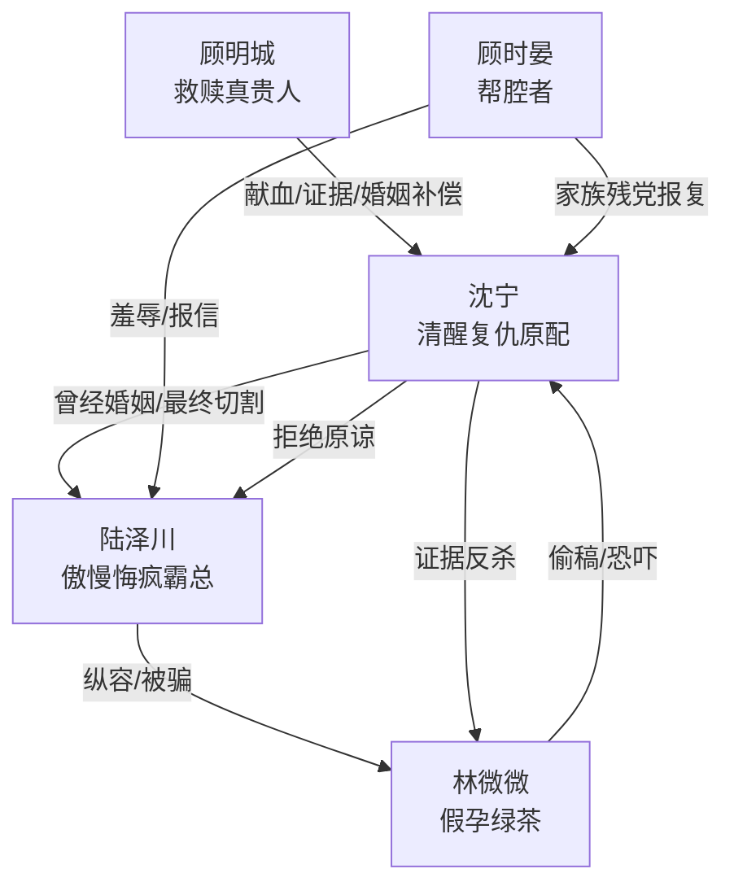

# 角色标签图谱

## 角色清单

### 沈宁 — 清醒复仇型高定大女主

- 叙事功能: 承受极致羞辱并完成证据反杀的主视角。
- 核心标签: 冷静、专业、绝不原谅
- 弧光: 被迫给小三量婚纱 → 流产失宫 → 晚宴公开反杀 → 巴黎高定大师
- 台词风格: 短句、冷讽、判决式
- 关键行为: 签字断情、保存设计册、录音取证、诱导偷稿、晚宴揭穿、拒绝临终求原谅
- 读者情绪关系: 心疼、代入、爽

### 陆泽川 — 傲慢失控型追妻火葬场霸总

- 叙事功能: 主要施害者，也是后半悔恨偿债对象。
- 核心标签: 掌控欲、迟钝、悔疯
- 弧光: 高高在上羞辱原配 → 亲手害死骨肉 → 跪求补偿 → 挡刀惨死
- 台词风格: 命令式、羞辱式，后期破碎哀求
- 关键行为: 带小三试婚纱、砸店、撕“涅槃”、锁门、囚禁、跪求、挡刀
- 读者情绪关系: 恨、等他崩溃、拒绝同情

### 林微微 — 假孕窃取型绿茶秘书

- 叙事功能: 外部诱因和偷稿反杀承载体。
- 核心标签: 假孕、虚荣、恶毒
- 弧光: 怀孕小三耀武扬威 → 偷稿穿赃衣 → 假肚皮掉落 → 被反噬
- 台词风格: 娇滴滴、炫耀、挑衅
- 关键行为: 试婚纱、入住婚房、拿死胎标本恐吓、偷“涅槃”
- 读者情绪关系: 恨、期待当众社死

### 顾明城 — 稳定救赎型真贵人

- 叙事功能: 与陆泽川形成对照，承担救命、证明、补偿结局。
- 核心标签: 克制、可靠、权力背书
- 弧光: 献血救命 → 晚宴递铁证 → 成为沈宁新生伴侣
- 台词风格: 冷硬、证据导向
- 关键行为: 献 Rh 阴性血、晚宴砸出医院资料、婚礼陪伴
- 读者情绪关系: 安全感、补偿感

### 顾时晏 — 旁观羞辱者/后续风险源

- 叙事功能: 前期帮腔羞辱，后期家族残党制造终局危机。
- 核心标签: 富二代、拱火、失势
- 弧光: 嘲笑沈宁 → 喊出 Rh 阴性血 → 家族残党报复
- 台词风格: 油滑、轻蔑
- 关键行为: 起哄、报信、间接触发最终刺杀
- 读者情绪关系: 厌恶、工具性

## 关系网络

## 角色功能对照表（供改编参考）

| 原角色 | 极致标签 | 叙事功能 | 读者情绪功能 | 改编时必须保留的 |
|--------|---------|---------|-------------|---------------|
| 沈宁 | 清醒复仇大女主 | 承压与清算 | 代入、心疼、爽 | 冷静、专业能力、绝不原谅 |
| 陆泽川 | 悔疯霸总 | 施害与偿债 | 恨、看崩溃 | 亲手造成不可逆伤害 |
| 林微微 | 假孕绿茶 | 诱因与社死对象 | 厌恶、等打脸 | 假孕/偷窃/公开社死 |
| 顾明城 | 救赎权贵 | 生路与补偿 | 安全感 | 不抢主角高光，只做背书 |
| 顾时晏 | 拱火帮凶 | 氛围压迫/终局危机 | 厌恶 | 前期羞辱帮腔，后期反噬 |
