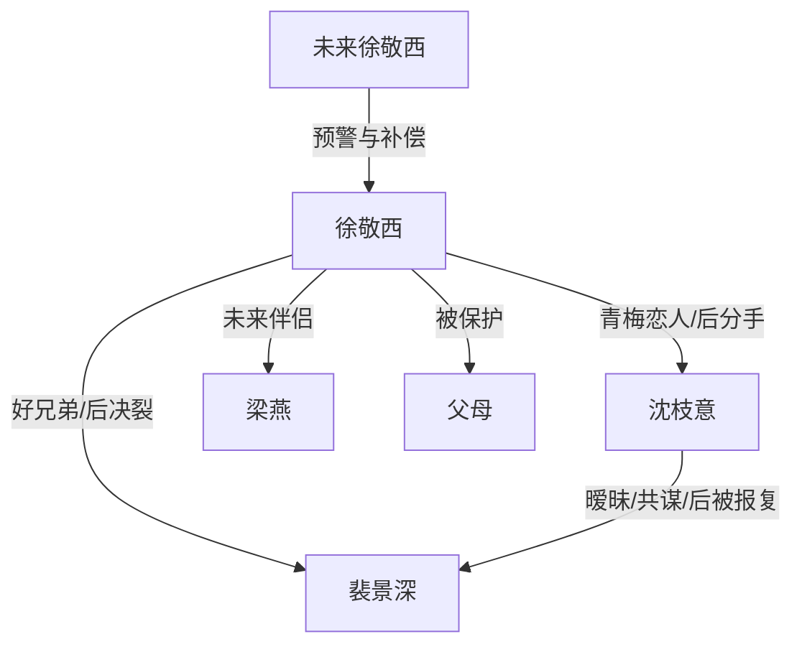

# 角色标签图谱

## 角色清单

### 徐敬西 — 清醒反杀男主

- 叙事功能: 受害者、验证者、反击执行者、人生重启者
- 核心标签: 市状元、克制、清醒
- 弧光: 盲目信任 → 验证背叛 → 冷静反杀 → 获得新人生
- 台词风格: 短句反问，带讽刺
- 关键行为: 测试消失笔、调换笔袋、分手、公开切割、拒绝求复合
- 读者情绪关系: 心疼、代入、爽

### 沈枝意 — 背刺青梅

- 叙事功能: 亲密背叛者、情绪债制造者、后悔承担者
- 核心标签: 偏心、伪装、利己
- 弧光: 青梅女友 → 暗中加害 → 落榜复读 → 失去清大和男主
- 台词风格: 先甜后辩解，危急时甩苦衷
- 关键行为: 送消失笔、漏买车票、求原谅、归还照片
- 读者情绪关系: 恨、恶心、后期少量唏嘘

### 裴景深 — 伪兄弟/利益受益者

- 叙事功能: 第三者、背叛同盟、后期清算工具
- 核心标签: 贪心、装兄弟、失控
- 弧光: 好兄弟 → 暧昧对象 → 落榜求助 → 报复沈枝意
- 台词风格: 表面兄弟义气，实则自利
- 关键行为: 与沈枝意偷吻、求钱复读、持刀报复
- 读者情绪关系: 恨、看其反噬时爽

### 梁燕 — 正向补偿爱人

- 叙事功能: 结尾补偿、健康亲密关系证明
- 核心标签: 大方、可爱、稳定
- 弧光: 新女友登场 → 接纳过去 → 要求新的合照记忆
- 台词风格: 轻松、直白、有边界
- 关键行为: 看到旧照片不误会，提出补拍合照
- 读者情绪关系: 舒心、补偿感

### 未来徐敬西 — 预警者/闭环者

- 叙事功能: 信息差来源，开篇预警与结尾补偿
- 核心标签: 愤怒、见证、答案
- 弧光: 恨意警告 → 幸福确认
- 台词风格: 信息密集，短句砸脸
- 关键行为: 揭露消失笔，结尾告知新未来
- 读者情绪关系: 悬疑、安心

## 关系网络

## 角色功能对照表（供改编参考）

| 原角色 | 极致标签 | 叙事功能 | 读者情绪功能 | 改编时必须保留的 |
|--------|---------|---------|-------------|---------------|
| 徐敬西 | 清醒反杀男主 | 承受背叛并反向清算 | 代入、爽 | 克制、验证、合法边界 |
| 沈枝意 | 背刺青梅 | 制造亲密伤害 | 恨、后悔快感 | “为别人牺牲男主前途”的逻辑 |
| 裴景深 | 伪兄弟 | 三角背叛与后期反噬 | 恶心、报应爽 | 既是受益者也是最终受害者 |
| 梁燕 | 正向补偿爱人 | 证明男主值得更好 | 治愈 | 不误会旧情，主动建立新记忆 |
| 未来徐敬西 | 时间预警者 | 提供信息差 | 悬疑、闭环 | 开头警告与结尾答案双出现 |
