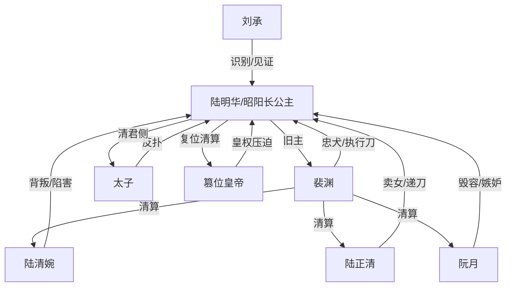

# 角色标签图谱

## 角色清单

### 陆明华 / 昭阳长公主 — 慵懒薄凉复仇大女主
- 叙事功能: 视角核心、复仇发动机、权力秩序重置者。
- 核心标签: 前朝长公主、冷静掌控、病弱假庶女。
- 弧光: 被当玩物送入东厂 → 昭阳归来清君侧 → 放弃皇权做回陆明华。
- 台词风格: 短句、轻声、宣判式。
- 关键行为: 忍受毁容堆债，认回裴渊，启动夜不收，扶新皇，带裴渊离京。
- 读者情绪关系: 爽、心疼、崇拜。

### 裴渊 — 疯批忠犬九千岁
- 叙事功能: 复仇执行刀、甜宠情绪补偿、女主权力外显。
- 核心标签: 权倾朝野、死士、卑微信徒。
- 弧光: 外界恐惧的九千岁 → 女主脚边奴才 → 江南管家。
- 台词风格: “奴才在”式低姿态，外人面前狠厉。
- 关键行为: 跪地认主、掌掴阮月、剁手清算、控制皇城、随女主离开。
- 读者情绪关系: 爽、心动、怜惜。

### 陆清婉 — 恶毒嫡姐 / 嫉妒型施害者
- 叙事功能: 前半压迫源、家庭背叛具象化。
- 核心标签: 忘恩负义、趋炎附势、太子妃执念。
- 弧光: 高高在上送妹入火坑 → 被做成人彘送东宫 → 发疯赐死。
- 台词风格: 伪善、尖刻、落难后求饶。
- 关键行为: 灌软筋散、按住女主、讨好阮月。
- 读者情绪关系: 恨、期待报应。

### 陆正清 — 卖女求荣父亲
- 叙事功能: 亲情背叛与侯府罪债载体。
- 核心标签: 贪墨军饷、懦弱虚伪、卖女。
- 弧光: 接女回府的慈父假象 → 递刀助虐 → 人头落地。
- 台词风格: 对上谄媚，对女冷硬。
- 关键行为: 把女儿献给裴渊，递刀，端盐。
- 读者情绪关系: 厌恶、憋屈、爽杀需求。

### 阮月 — 嫉妒型情敌 / 假心上人守门人
- 叙事功能: 极致虐点制造者，毁容债主。
- 核心标签: 尚书千金、妄想独占、残忍。
- 弧光: 自认提督府女主人 → 被裴渊扇飞 → 阮家满门抄斩。
- 台词风格: 侮辱、尖叫、威胁。
- 关键行为: 刺朱砂、划脸、踩手、盐敷伤口。
- 读者情绪关系: 强恨点。

### 刘承 — 旧臣识别者 / 信息风险点
- 叙事功能: 早期朱砂预警、后期秘密试金石。
- 核心标签: 东厂大太监、旧日内侍、惶恐。
- 弧光: 未认出旧主 → 恐惧请罪 → 得知裴渊秘密。
- 台词风格: 尖细、惶恐、规矩。
- 关键行为: 掌掴陆清婉，警告朱砂秘密，传递政变结果。
- 读者情绪关系: 紧张、工具性期待。

### 太子 / 篡位皇帝 — 权力终局反派
- 叙事功能: 将宅斗升级为皇权复仇。
- 核心标签: 得位不正、恐惧反扑、旧权力。
- 弧光: 以为可诛妖女 → 证据曝光 → 逃亡/自尽。
- 台词风格: 朝堂控诉、命令式。
- 关键行为: 围东厂、调兵、失败。
- 读者情绪关系: 期待清算。

## 关系网络

## 角色功能对照表（供改编参考）

| 原角色 | 极致标签 | 叙事功能 | 读者情绪功能 | 改编时必须保留的 |
|--------|---------|---------|-------------|---------------|
| 陆明华 | 慵懒薄凉长公主 | 主角/设局者 | 爽、心疼 | 被低估的假身份与真实高位身份 |
| 裴渊 | 疯批忠犬九千岁 | 执行刀/情感补偿 | 爽、甜 | 对外狠、对女主跪 |
| 陆清婉 | 恶毒嫡姐 | 家庭背叛 | 恨 | 忘恩负义与抢婚/荣华执念 |
| 陆正清 | 卖女父亲 | 亲情债源 | 憋屈 | 曾给温情假象，后亲手递刀 |
| 阮月 | 嫉妒情敌 | 毁容虐点 | 强恨 | 对女主身份象征下手 |
| 太子/皇帝 | 旧权力 | 终局压迫 | 期待颠覆 | 从宅斗升到皇权清算 |
