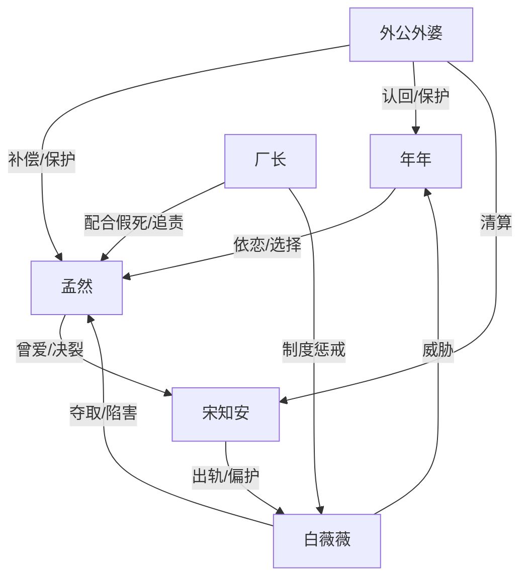

# 角色标签图谱

## 角色清单

### 年年 — 天真见证者/情绪放大器
- 叙事功能: 第一视角记录家庭崩坏，用儿童误读替读者承受最脏的成人真相。
- 核心标签: 六岁、护母、被剥夺身份
- 弧光: 懵懂依赖父亲 → 被迫目睹母亲受害 → 主动选择母亲和新家庭
- 台词风格: 短、直、天真但扎心
- 关键行为: 生日见证出轨创伤；问出上学黑户真相；砸徽章；拒绝父亲礼物关系。
- 读者情绪关系: 心疼、代入、被她的天真句刺痛。

### 孟然 — 忍到清醒的护女母亲
- 叙事功能: 被压迫核心，也是最终反转与清算的发动者。
- 核心标签: 受背叛、护崽、清醒退场
- 弧光: 为救命恩与爱情放弃前途 → 被婚姻和名誉吞噬 → 借假死脱身，拿回自己
- 台词风格: 前期沉默，后期平静断绝
- 关键行为: 收留白薇薇；决定离婚；火车站持刀护女；假死设局；拒绝复合。
- 读者情绪关系: 心疼、敬佩、希望她被补偿。

### 宋知安 — 迟来悔恨的负心丈夫
- 叙事功能: 主要施害者，承担温度反转曲线中的悔恨端。
- 核心标签: 出轨、懦弱自私、迟来悔恨
- 弧光: 被母亲救过并受益 → 背叛妻女、维护小三 → 真相后失去职位、双手、家庭
- 台词风格: 先辩解合理化，后求饶崩溃
- 关键行为: 与白薇薇登记；要求孟然顶罪；强行分开母女；抽打年年；后期求复合。
- 读者情绪关系: 恨、厌恶、后期看报应的爽。

### 白薇薇 — 白莲小三/农夫与蛇
- 叙事功能: 引爆家庭伦理冲突，制造极端恶意与外部罪证。
- 核心标签: 装弱、挑衅、蛇蝎
- 弧光: 被孟然救助 → 夺夫夺名分 → 泄密卖数据、找人害母女 → 被军事法庭带走
- 台词风格: 表面柔弱，内里挑衅羞辱
- 关键行为: 与宋知安领证；怀孕挑衅；安排火车站围堵；卖军工数据。
- 读者情绪关系: 强恨点，承担被清算的期待。

### 外公外婆 — 迟到的权力补偿
- 叙事功能: 揭开孟然隐藏资源，提供清算力量和结尾家庭补偿。
- 核心标签: 老领导、护短、愧疚
- 弧光: 与女儿决裂六年 → 收到求助赶来 → 配合假死、接回母女
- 台词风格: 直接、带长辈权威
- 关键行为: 认回年年；揭穿名额真相；压制宋知安；推动白薇薇受审。
- 读者情绪关系: 迟来的安全感和补偿感。

### 厂长 — 制度见证者/反转辅助
- 叙事功能: 连接孟然外祖家与厂内清算，证明死讯和罪证。
- 核心标签: 知情、执行、权威背书
- 弧光: 传达死讯 → 配合假死 → 推动户口和追责
- 台词风格: 公事公办，关键时刻压住白薇薇
- 关键行为: 带回血衣；联系孟然家人；参与假死局。
- 读者情绪关系: 让反转可信。

## 关系网络

## 角色功能对照表（供改编参考）

| 原角色 | 极致标签 | 叙事功能 | 读者情绪功能 | 改编时必须保留的 |
|--------|---------|---------|-------------|---------------|
| 年年 | 天真见证者 | 用孩子视角放大伤害 | 心疼、刺痛、补偿期待 | 孩子误读成人罪恶；最终主动选择母亲 |
| 孟然 | 清醒护女母亲 | 承压与反击核心 | 心疼、敬佩 | 被夺身份/护女/假死退场/拒绝回头 |
| 宋知安 | 迟悔渣夫 | 施害与悔恨对象 | 恨与看报应 | 曾幸福、亲手毁掉、迟来崩溃 |
| 白薇薇 | 白莲蛇蝎小三 | 外部恶意和罪证来源 | 强恨点 | 装弱、挑衅、实质犯罪 |
| 外公外婆 | 权力补偿 | 身份反差与清算工具 | 安全感 | 迟到但有力，不能抢走孟然主动性 |
| 厂长 | 制度背书 | 让假死和清算可信 | 可信度 | 公权/单位系统介入 |
