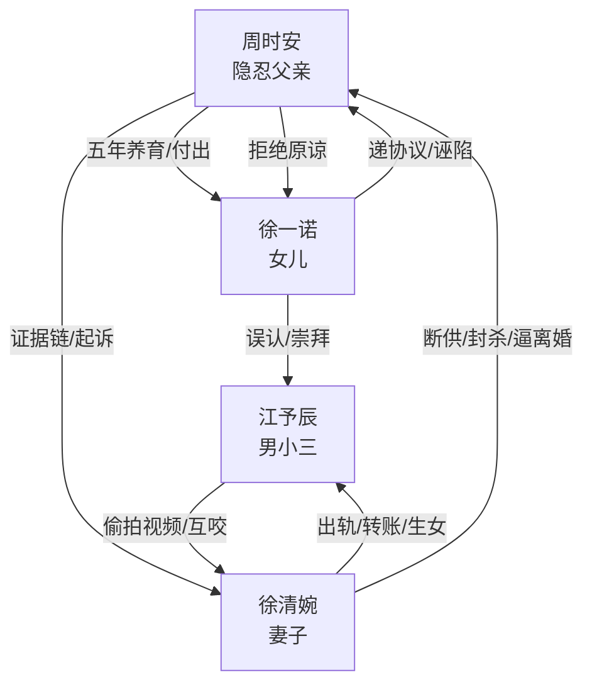

# 角色标签图谱

## 角色清单

### 周时安 — 隐忍清算型奶爸

- 叙事功能: 受害者、证据持有者、最终清算者
- 核心标签: 科技天才、牺牲型父亲、冷静复仇
- 弧光: 为女儿死撑抚养权 → 被女儿诬陷后心死 → 追回财产并拒绝廉价和解
- 台词风格: 克制短句，后期审判式列证
- 关键行为: 放弃事业养女、收集证据、放弃抚养权、起诉离婚、法庭反杀
- 读者情绪关系: 前半心疼，后半代入爽

### 徐清婉 — 百亿背叛型女总裁

- 叙事功能: 核心压迫者、规则滥用者、最终被规则反噬者
- 核心标签: 出轨、伪独立、冷血控制狂
- 弧光: 高高在上逼离婚 → 发布会塌房 → 庭审求复合失败 → 债务缠身
- 台词风格: 傲慢、命令式、利益计算
- 关键行为: 出轨、断供家庭、封杀男主、技术剽窃、试图债务捆绑
- 读者情绪关系: 强恨点

### 徐一诺 — 被宠坏的白眼狼女儿

- 叙事功能: 最强心痛来源、亲情债承载体、结尾余味来源
- 核心标签: 势利、被误导、不感恩
- 弧光: 替母逼父离婚 → 诬陷父亲害她 → 真相曝光后求原谅 → 门口长期示好
- 台词风格: 童稚但残忍，后期哭求
- 关键行为: 递离婚协议、认小三为父、学校诬陷、登门认错
- 读者情绪关系: 又气又复杂，不能简单等同反派

### 江予辰 — 软饭小三型男秘书

- 叙事功能: 婚姻破坏者、妻子堕落诱因、发布会互咬触发器
- 核心标签: 男小三、伪精英、留后手
- 弧光: 古驰高定副总 → 视频塌房 → 当众互咬 → 入狱二十年
- 台词风格: 撒娇、挑衅、推责
- 关键行为: 侵占丈夫位置、误喂过敏源、参与技术违法、偷拍自保
- 读者情绪关系: 恶心、鄙夷、看他倒霉很爽

### 刘律师/陈律师 — 清算工具人

- 叙事功能: 把情绪债转化成法律证据链
- 核心标签: 专业、稳定、执行力
- 弧光: 接受修改诉求 → 整理证据 → 法庭击穿债务陷阱
- 台词风格: 条理化、法律化
- 关键行为: 出示转账、聊天、同居、债务证据
- 读者情绪关系: 安全感、爽点放大器

## 关系网络

## 角色功能对照表（供改编参考）

| 原角色 | 极致标签 | 叙事功能 | 读者情绪功能 | 改编时必须保留的 |
|--------|---------|---------|-------------|---------------|
| 周时安 | 隐忍清算型奶爸 | 承债与反杀 | 心疼转爽 | 曾高价值、为家庭牺牲、后期证据反杀 |
| 徐清婉 | 背叛型女总裁 | 主要施害者 | 恨 | 断供、出轨、傲慢、被规则反噬 |
| 徐一诺 | 白眼狼女儿 | 亲情刀 | 心痛/复杂 | 替施害者发声、后期求原谅但不立刻洗白 |
| 江予辰 | 软饭小三 | 恶心与互咬 | 爽 | 侵占父亲位置、最终自爆/入狱 |
| 律师 | 清算执行者 | 规则转化 | 安全感 | 把前文细节转为证据 |
