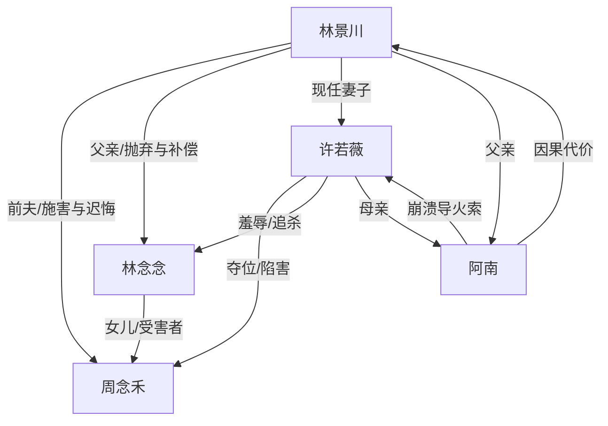

# 角色标签图谱

## 角色清单

### 林念念 — 清醒苦命复仇女儿
- 叙事功能: 第一人称见证者、真相揭露者、情绪债承载者与最终转化者。
- 核心标签: 被弃女儿、助听器伤痕、冷静控诉
- 弧光: 被父亲施舍刺激 → 揭开母亲死亡真相 → 拒绝原谅 → 带着母亲的爱继续活
- 台词风格: 短句、反问、事实砸脸，不主动卖惨。
- 关键行为: 拒绝加好友；揭穿父亲人设；说出母亲死讯；揭穿空卡；设立医疗救助基金。
- 读者情绪关系: 心疼、代入、替她憋屈，后期获得补偿性释然。

### 周念禾/妈妈 — 被榨干的苦命母亲
- 叙事功能: 全文情绪债核心，所有复仇正当性的来源。
- 核心标签: 卖肾还债、病床母亲、生日承诺
- 弧光: 相信丈夫 → 被婚礼羞辱 → 为女儿硬撑 → 死于空卡和延误
- 台词风格: 温柔、忍耐、临终仍护女。
- 关键行为: 替林景川还债卖肾；给女儿买蛋糕；病床上求父亲带走女儿。
- 读者情绪关系: 极度心疼，是读者要求清算的道德锚点。

### 林景川 — 迟来深情的纵容型父亲
- 叙事功能: 主压迫者之一，公众深情与真实冷漠的反差载体，后段悔恨清算工具。
- 核心标签: 假深情、偏袒情人、迟来悔恨
- 弧光: 施舍女儿 → 否认母亲死亡 → 亲眼见遗像 → 查真相 → 挡刀死亡
- 台词风格: 前期居高临下，后期破碎道歉。
- 关键行为: 假破产；婚礼驱赶母女；冻结救命钱；后来查病历、起诉许若薇、挡刀。
- 读者情绪关系: 前期恨，后期复杂但不被原谅。

### 许若薇 — 恶毒篡位小三/继母
- 叙事功能: 外显恶意反派，推动母亲死亡与后段持刀高潮。
- 核心标签: 假绝症、转走救命钱、恶毒母亲
- 弧光: 装病夺位 → 羞辱母女 → 自曝恶意 → 失子发疯 → 死刑
- 台词风格: 轻蔑、炫耀、阶层羞辱。
- 关键行为: 假装绝症；转走五十万；自摔诬陷；持刀刺杀女主。
- 读者情绪关系: 纯恨点，承担最直接报应。

### 阿南 — 反派家庭的无辜孩子
- 叙事功能: 因果代价放大器，让许若薇和林景川尝到“孩子受害”的回旋。
- 核心标签: 被宠坏但无辜、目睹真相、车祸死亡
- 弧光: 被父母捧在手心 → 目睹父母丑恶 → 拒绝父母 → 意外身亡
- 台词风格: 孩子式恐惧与直觉判断。
- 关键行为: 说“爸爸和妈妈都是坏人”；跑出门后车祸。
- 读者情绪关系: 复杂，不爽不恨，强化“孩子也会被大人罪孽吞没”的余痛。

### 同事/店长/助理 — 社会见证者
- 叙事功能: 提供公众视角，衬托林景川人设与真实之间的裂缝。
- 核心标签: 旁观者、传声筒、信息补足
- 弧光: 听信公众人设 → 知道真相沉默
- 台词风格: 八卦、试探、转述。
- 关键行为: 同事说林景川深情；助理转述许若薇崩溃真话。
- 读者情绪关系: 提供外界评价，帮助读者确认“伪善被拆穿”。

## 关系网络

## 角色功能对照表（供改编参考）

| 原角色 | 极致标签 | 叙事功能 | 读者情绪功能 | 改编时必须保留的 |
|--------|---------|---------|-------------|---------------|
| 林念念 | 清醒苦命复仇女儿 | 真相揭露者 | 心疼、代入、爽 | 不原谅、用事实砸脸、最后活下去 |
| 周念禾 | 被榨干的母亲 | 情绪债核心 | 心疼、愤怒 | 因救命钱缺失死亡，临终仍护女 |
| 林景川 | 迟来深情父亲 | 纵容型施害者 | 恨、复杂 | 公众深情人设与真实冷漠反差 |
| 许若薇 | 恶毒篡位者 | 外显反派 | 强恨点 | 假病、夺钱、诬陷、最终法律报应 |
| 阿南 | 无辜代价 | 因果放大器 | 复杂余痛 | 让施害者尝到孩子受害的回旋 |
